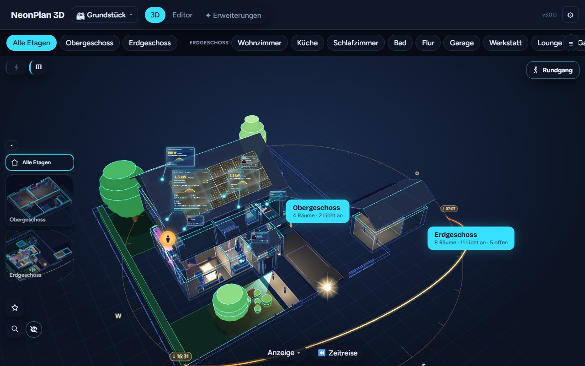
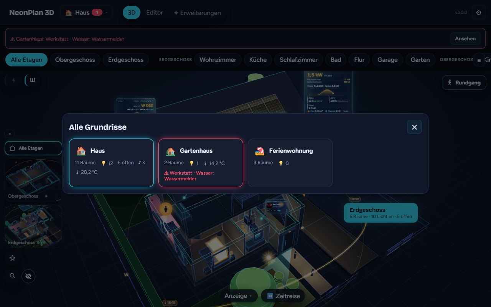
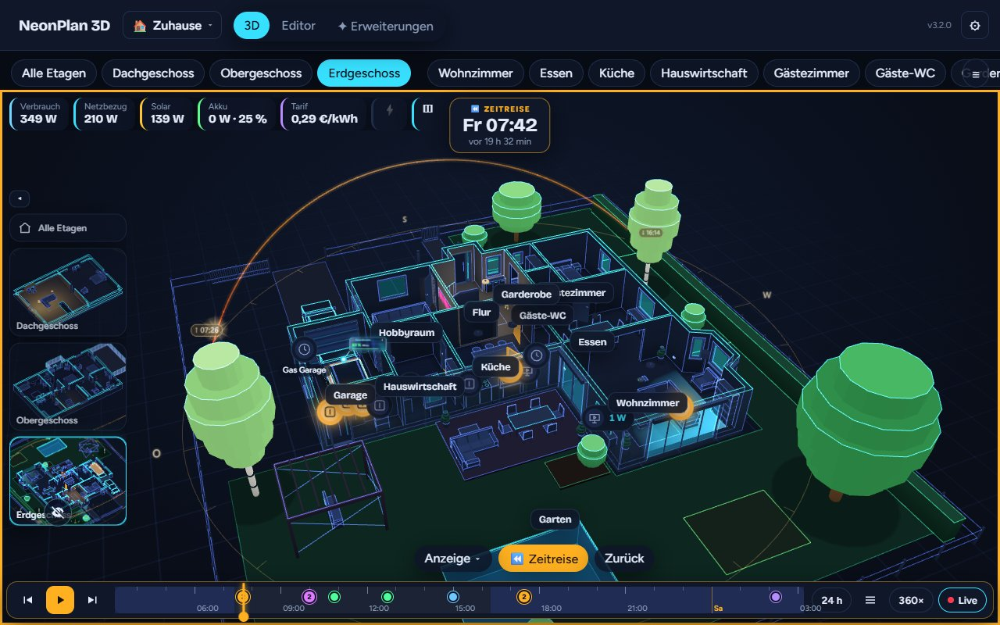
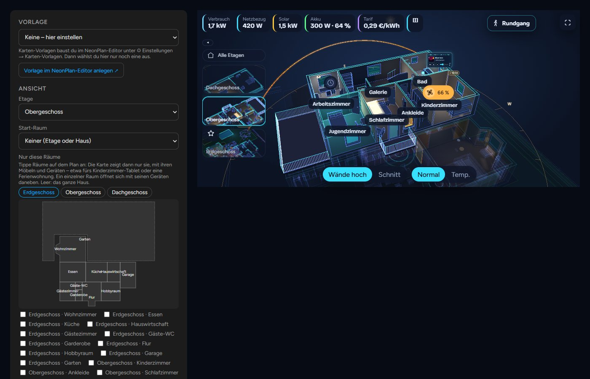

# NeonPlan 3D

[](https://www.paypal.com/donate/?hosted_button_id=Z3G2VWKSK5VJL)

**The original 3D floor plan for Home Assistant, by Mastershort.** Draw your home right inside Home Assistant and live in it as a neon 3D house: lights glow in their colours, blinds and curtains move, doors and windows open, cameras watch, the TV shows what is playing, energy flows through the walls – and you can simply **talk to it**. Since 3.0 it holds **your whole property**: the house, the garage, the garden house and the holiday flat, each on its own plan, all of them together in 3D – and a card for every single room. No external tools, no cloud, made for wall tablets – old Fire tablets included.

▶️ **[Try the online demo](https://neonplan3d.mastershort.de/)** – in your browser, with invented demo data: turn the house, switch lights, open the editor. Nothing to install.

[](https://my.home-assistant.io/redirect/hacs_repository/?owner=Mastershort&repository=neonplan3d&category=integration)

[](https://neonplan3d.mastershort.de/)

[](https://neonplan3d.mastershort.de/)

📖 **Manual:** [English](https://mastershort.de/en/neonplan3d/manual/?lang=en) · [Deutsch](https://mastershort.de/neonplan3d/anleitung/?lang=de) (also here: [manual.md](https://github.com/Mastershort/neonplan3d/blob/main/docs/manual.md), [anleitung.md](https://github.com/Mastershort/neonplan3d/blob/main/docs/anleitung.md))
💬 **Community:** [Discord](https://discord.gg/SSdVVFsev7) – show your 3D home, ask, share ideas
🗺️ **What changed:** [Changelog](https://github.com/Mastershort/neonplan3d/blob/main/CHANGELOG.md) · **Ideas:** [Discussions → Ideas](https://github.com/Mastershort/neonplan3d/discussions/categories/ideas)

---

## New in 3.0 – the biggest update ever: several houses and flats, single rooms on your dashboard, your whole property in 3D

[](https://raw.githubusercontent.com/Mastershort/neonplan3d/main/docs/images/plans-site.jpg)

- 🏘️ **Several floor plans in one installation** – the house, the garage, the garden house, a granny flat, the holiday flat by the sea. Each has its own floors, rooms, devices and restore points; a picker at the top switches between them, and your existing plan simply stays the first one.
- 🗺️ **The property in 3D** – place the other buildings beside the house once (drag and turn them in the editor) and see everything together: lights, devices and warnings of every building. Tap a room of the garden house and you are in it.
- 🧸 **Single rooms on your dashboard** – right next to your other cards (Mushroom, tiles, your own dashboards). Tap the rooms on a small map in the card dialog and the card shows only them: the kids' tablet shows the kids' room, the guest tablet the guest room – with its devices beside it, "here" in voice control meaning that room, and the tablet staying there. Fewer rooms to draw means it runs even more smoothly on old tablets.
- ⚠️ **Warnings from everywhere** – water in the garden house while the house is open? It shows at the top, one tap takes you there. **All floor plans** shows every building at a glance: lights on, windows open, warmth, warnings.

| A card for one room | All floor plans at a glance |
|---|---|
| [](https://raw.githubusercontent.com/Mastershort/neonplan3d/main/docs/images/card-room-one.jpg) | [](https://raw.githubusercontent.com/Mastershort/neonplan3d/main/docs/images/plans-overview.jpg) |

## Your house in three steps – no CAD, no Blender

Everything happens in the editor inside Home Assistant, with the 3D house growing next to the plan while you draw.

| 1. Draw | 2. Furnish | 3. Link |
|---|---|---|
| [](https://raw.githubusercontent.com/Mastershort/neonplan3d/main/docs/images/editor-draw.jpg) | [](https://raw.githubusercontent.com/Mastershort/neonplan3d/main/docs/images/editor-library-en.jpg) | [](https://raw.githubusercontent.com/Mastershort/neonplan3d/main/docs/images/editor-devices-en.jpg) |
| Rooms as rectangles or free shapes – walls, corners and measures follow by themselves. Doors, windows, stairs, roofs and the garden come from the same toolbar. | Pick furniture by room and kind, each with a picture and its size; one card per item with its sizes, left and right versions. Resize freely – legs and arms stay as they are. | Each room takes its Home Assistant area: lights, blinds, sensors and media are found and placed with one tap. From then on the house is live. |

Not drawing at all? The [import page](https://neonplan3d.mastershort.de/import/) turns Sweet Home 3D, iPhone LiDAR scans and more into a plan (see below).

## Build once, show it everywhere

NeonPlan has two places: the **editor** in the sidebar panel is where you build and set up your house – once. To show it, put the **dashboard card** `custom:neonplan3d-card` on any dashboard or wall tablet: edit a dashboard → **Add card** → search "NeonPlan". Every card has its own options (floor plan, floor, rooms, look, kiosk, voice) in its visual editor, so the kitchen tablet, the hall tablet, the kids' tablet and your phone can each show the house their way. Even simpler: build a **card template** in the editor and just pick it on the tablet – change it later in the editor, and every tablet showing it follows. The panel's 3D view works as a full view too.

## Highlights

- 🏘️ **Your whole property** – several floor plans, all buildings together in 3D, a card for every room (new in 3.0).
- ✏️ **Drawn in minutes, right in Home Assistant** – the plan editor with the 3D view beside it, a furniture library with pictures, free sizes, a wall view for exact placing. No external tool.
- 📍 **Who is where – without Bermuda** – NeonPlan locates people, phones and key tags room by room from the Shelly plugs and ESPHome proxies you already have: learn each room in 90 seconds, see everyone as a glowing figure, get a sensor per device, ask "Where is my iPhone?". Free.
- 🎙️ **Talk to your house** – tap the microphone or ask Assist: "Show the living room", "What's open?", "Good night". A tablet knows the room it hangs in, so "Lights on" or "Close the blinds" there means that room. Assist satellites and automations ask the house too (service `neonplan3d.ask`); the answer module "The house answers" is in beta for supporters.
- ☀️ **Sun and night** – a glowing arc shows the sun's way today with sunrise and sunset, the house's shadow wanders with it, and at night lit rooms throw their light out of the windows onto the lawn.
- 🎬 **Live director** – the wall tablet shows by itself what happens: the doorbell rings and the view flies to the front door and looks through its camera; someone at a camera, the washer done, a warning. Every event is opt-in.
- ⏪ **Time travel** – replay the last day or week in the house: lights, doors, motion, the robot's run.
- 🚶 **Walk through the house** at eye level, with keys or a touch stick.
- 🔋 **Energy in the walls** – solar, battery, grid and wallbox as glowing cables, holograms with day curves.
- 📱 **Runs on old wall tablets** – a *Tablet* quality level, nothing is drawn while nothing changes, and the build refuses browser features old Fire WebViews lack.

| Neon | Blueprint | Day |
|---|---|---|
|  |  |  |

Three looks, an accent colour of your choice, and **Auto** – day while the sun is up, neon after sunset.

## What it does

| | |
|---|---|
|  | **Plan editor in Home Assistant** – floors, rooms as rectangles or free shapes, automatic walls and free-standing partitions, doors, windows, garage doors, stairs, floor openings, cellars with light wells, roofs with dormers, outdoor areas, pools, balconies and solar fields. The 3D view runs next to the plan while you draw. A **wall view** shows each wall from the front for exact placing. |
|  | **Live 3D view** – tap a lamp to switch it, swipe to dim, long press for colours, blinds and covers; doors swing, windows tilt, curtains and awnings run with their cover. A **room panel** lists everything of the room's Home Assistant area; gardens and terraces open like rooms too. |
|  | **Voice control** – tap the microphone or ask Assist: "Show the living room", "Where is the washing machine?", "Show the front door camera"; anything else goes to Home Assistant's Assist. On a wall tablet "Lights on" or "Turn off the lights here" means the room the tablet hangs in. Free for everyone; the answer module ("What's open?", "Good morning") is in beta for supporters. |
|  | **Locating – who is where** – people, phones and key tags room by room, from the Shelly plugs, ESPHome proxies and Bluetooth adapter Home Assistant already has. A setup assistant learns each room in 90 seconds; rooms without a scanner work too, presence sensors make it faster, and Android phones with the Home Assistant app are found by themselves. People stand as glowing figures – at the sofa when a presence sensor's zone says so – every device gets a room sensor for automations, and Assist answers "Where is my iPhone?". No Bermuda, no ESPresense, free. |
|  | **Furniture and lamps** – 80 built-in models plus furniture packs, in one library sorted by room and kind, with a picture and the size on every card. Lamps light their room in their own colour (and the floor below through a stairwell), TVs, washers and radiators glow while they run, robot vacuums drive their lanes, pets roam the house. |
|  | **Cameras** – on walls or ceilings with their field of view, red while they see motion; snapshots, a camera wall and live streams. |
|  | **Live director** (Camera Cockpit) – the doorbell rings and the wall tablet flies to the front door and looks through its camera; it also shows a camera that sees someone, a finished washer or a new warning, then goes back. |
|  | **Time travel** (Pro) – replay the last day or week: lights, doors, motion and the robot's run, with a timeline of events. |
|  | **Walk and wall view** – walk through the house at eye level with keys or a touch stick; in the editor, each wall from the front to place furniture to the centimetre. |
|  | **Sun and night** – a glowing arc around the house shows the sun's way today with the times of sunrise and sunset, the house's shadow lies on the ground and wanders with the sun, a compass ring shows N E S W. At night lit rooms throw their light out of the windows onto the lawn, in their light colour. |
|  | **Made for the wall** – warnings for smoke, gas, CO, water, alarm, a window open in the rain and power outages pulse in their room; kiosk mode with idle return, night dimming and a slow orbit; favourites and scene buttons. |
|  | **Values and heatmap** – temperature, humidity and CO₂ per room, sunlight through the windows from `sun.sun`, the weather around the house. |
|  | **Several floor plans and the property** – the house, the garage, the garden house, the holiday flat, each a plan of its own with a picker to switch; buildings placed beside each other show together in 3D. A bin keeps deleted plans for 30 days. |
|  | **Dashboard card** – `custom:neonplan3d-card` with a visual editor, loaded automatically; **card templates** made in the editor, and **cards for single rooms** that show only them. |

**Coming from another program?** The [import page](https://neonplan3d.mastershort.de/import/) turns Sweet Home 3D, iPhone LiDAR scans (RoomPlan), CAD (DXF), Blender/SketchUp models (glTF, OBJ, STL), Floorplanner and Valetudo robot maps into a NeonPlan plan – in your browser. Or let an AI write it with [this template](https://github.com/Mastershort/neonplan3d/blob/main/docs/ai-import.md) ([format](https://github.com/Mastershort/neonplan3d/blob/main/docs/plan-format.md)).

Also included: parking spots with vehicles that appear while a car is home, waste bins and mailboxes, smart locks on doors, doors with their own opening angle, roof parts turned at any angle for wings and extensions, a clock in the view, search, restore points, a full backup of every plan with its pictures and packs, and 19 languages.

## Free, packs and Pro add-ons

The integration and everything above – several floor plans, the property and cards for single rooms included – are **free and open source (MIT)**. Safety (smoke, water, alarm, rain warning, power outage) is always free. Everything you need day to day stays free; paid extras cover special things only some homes have – a heat pump in detail, an electric car, energy flowing through the cables. Optional extras are sold once – no subscription – at [mastershort.de](https://mastershort.de/en/neonplan3d/?lang=en) and install from the **Extensions** tab:

- **Furniture packs** – living room, kitchen, bedroom, bath, kids, office & gaming, garden & terrace, garage & workshop, fitness, smart home & tech, cinema & hi-fi, utility, architecture, stairs & railings, vehicles; free fun packs (pets, Halloween) with a customer account.
- **Pro add-ons**

  | Add-on | What it brings |
  |---|---|
  | **Camera Cockpit** | Look through a camera, camera wall, motion trail, detection pins, the **live director** |
  | **Weather outside** | Rain, snow, fog, clouds, lightning, sun and moon around the house |
  | **Live screens** | App colours and artwork on TVs, pictures by rules, camera pictures on screens |
  | **Energy Pro** | Energy flow in cables, device holograms, solar fields with their own yield |
  | **Sound & Cinema** | Speakers that pulse with the music, now-playing cards, stations and playlists |
  | **Car Pro** | Your car on its parking spot with charge, range, lock and climate |
  | **Time travel** | Replay the last 24 hours or 7 days |
  | **Household Pro** *(beta)* | Bins with pickup tags, post in the mailbox, thirsty plants, appliance time left |
  | **Heat Pro** | Your heat pump as a system in 3D: a glass card with state, heat, COP, hot water and buffer; radiators glow, underfloor heating with its manifold and loops, flow red, return blue |

- **Modules** – extensions that bring their own code from the shop, signed and bound to your installation like every pack; they update through the shop without waiting for a NeonPlan release. The Pro add-ons move over one by one. Modules today: *Window watch* (free – warns when a window stays open in the cold), *The house answers* (free – spoken answers like "What's open?" or "Good morning", beta for supporters first) and *Announcements* (beta, supporters first – "Dinner is ready!" on the speaker of a room, from a tap, the microphone or the action `neonplan3d.announce`; open NeonPlan screens speak it too).

Bought packs and modules are signed for your installation. Packs update by themselves once a day; a module's code runs only after an admin has viewed and approved it, and every module update waits for that approval too. Everything installed keeps working without the shop.

## Installation

### HACS

[](https://my.home-assistant.io/redirect/hacs_repository/?owner=Mastershort&repository=neonplan3d&category=integration)

1. Click the button above, or open HACS and search for **NeonPlan 3D** (it is in the HACS default list, no custom repository needed).
2. Install **NeonPlan 3D** and restart Home Assistant.
3. Add the integration:

   [](https://my.home-assistant.io/redirect/config_flow_start/?domain=neonplan3d)

   or *Settings → Devices & services → Add integration → NeonPlan 3D*.
4. Open **NeonPlan 3D** in the sidebar, switch to **Editor** and draw your first floor – or import a plan.
5. Put the house on a dashboard: edit a dashboard → **Add card** → search "NeonPlan" (see [Build once, show it everywhere](#build-once-show-it-everywhere)).

### Manual

Copy `custom_components/neonplan3d` into `config/custom_components/` and restart Home Assistant.

Requires Home Assistant 2025.1 or newer.

## Dashboard card

All options can be set in the card's visual editor. The most used ones in YAML:

```yaml
type: custom:neonplan3d-card
template: kitchen_fire  # a card template made in the editor (then only it counts)
plan: pab12cd34ef       # another floor plan (id under ⚙ → Floor plans); site = the property
rooms: [room_ab12cd34]  # show only these rooms – the kids' tablet; rooms_lock: false lets it leave them
floor: floor_ab12cd34   # show a single floor (id from the editor); room: opens a room
height: 420             # height in pixels, or fill: true for the whole screen
quality: auto           # auto | low | high – "auto" picks the tablet level on weak devices
theme: neon             # neon | blueprint | day, with accent: "#00e5ff"
walls: auto             # auto | cut
markers: important      # device symbols: none | important | all
heatmap: none           # none | temperature | humidity | co2
room_panel: true        # a tap on a room opens its panel
alerts: true            # smoke, gas, CO, water, alarm, windows in the rain, power outage
voice: false            # 🎙️ microphone button (voice control)
voice_area: kitchen     # the room this tablet hangs in – "Lights on" means that room
director: false         # 🎬 live director (Camera Cockpit)
roof: true              # false: show the house without its roof
idle_return: 0          # kiosk: seconds without a touch until the start view returns
night: "off"            # kiosk: dim at night – off | sun | "22:00-06:00"
idle_orbit: false       # kiosk: slow camera turn after the idle return
```

More: `room`, `angle_lock`, `keep_view`, `start_view`, `explode`, `floor_stack`, `controls`, `controls_hidden`, `floor_thumbs`, `buttons`, `energy`, `flows`, `holograms`, `weather`, `time_travel`, `household_card`, `scenes`, `walk`, `pets` … – all described in the manual, chapter 8 *The dashboard card*.

## Privacy

NeonPlan 3D stores the plan, its pictures and the packs in Home Assistant's `.storage`. It talks to the internet only when you enter a licence key in **Extensions**: then it asks mastershort.de once a day for updates of your packs, sending the key and an anonymous installation fingerprint (a hash). Voice control sends your speech only to your own Home Assistant's Assist pipeline, and the microphone is open only while you speak. Locating evaluates the Bluetooth signals only in Home Assistant; nothing about who is where leaves the house. Anonymous usage and error reports are opt-in (off by default) under ⚙ Settings → 🛟 Help improve; you can view every report before it is sent and delete the data at any time.

## Ideas, questions and bugs

- **Ideas and voting:** [Discussions → Ideas](https://github.com/Mastershort/neonplan3d/discussions/categories/ideas) – vote with 👍 on what you want most.
- **Questions:** [Discussions → Q&A](https://github.com/Mastershort/neonplan3d/discussions/categories/q-a) or the [Discord](https://discord.gg/SSdVVFsev7).
- **Bugs:** [open an issue](https://github.com/Mastershort/neonplan3d/issues/new/choose).

## Development

```bash
cd frontend
npm install
npm test            # pure logic
npm run typecheck
npm run build       # writes the bundles to custom_components/neonplan3d/frontend (committed) and checks the size budgets
npm run screenshot  # renders preview/index.html (invented demo data) with a local Chrome or Edge
```

- **Preview without Home Assistant**: open `preview/index.html` through any local web server.
- **Deploy to a test instance**: create `deploy.local.json` with `{"target": "<config>/custom_components/neonplan3d"}` and run `npm run deploy` in `frontend/`.
- **Python tests** run in CI with `pytest-homeassistant-custom-component`.
- **Furniture pack format**: [docs/packs.md](https://github.com/Mastershort/neonplan3d/blob/main/docs/packs.md) (German).

## Licence

MIT – see [LICENSE](https://github.com/Mastershort/neonplan3d/blob/main/LICENSE). "NeonPlan 3D" is the name of the original project by Mastershort; furniture packs and Pro add-ons sold in the shop are not part of this repository.

## Unterstützen / Support

NeonPlan 3D ist kostenlos. Wenn es dir gefällt, freue ich mich über einen Kaffee ☕ – oder schau dir die Möbel-Packs im Shop an: https://mastershort.de/neonplan3d/
NeonPlan 3D is free. If you like it, you can buy me a coffee or check out the furniture packs.

[](https://www.paypal.com/donate/?hosted_button_id=Z3G2VWKSK5VJL)
