<div align="center">

# NeonPlan 3D

### The original 3D floor plan for Home Assistant

**Draw your home right inside Home Assistant – and live in it as a glowing neon house, or in any style you like.**<br>
Lights glow in their colours, blinds move, doors open, cameras watch, energy flows through the walls – and you can simply talk to it.

[](https://my.home-assistant.io/redirect/hacs_repository/?owner=Mastershort&repository=neonplan3d&category=integration)

[](https://github.com/Mastershort/neonplan3d/releases)
[](https://hacs.xyz/)
[-2ea44f)](https://github.com/Mastershort/neonplan3d/blob/main/LICENSE)
[](#privacy)
[](https://discord.gg/SSdVVFsev7)

**[▶️ Try the online demo](https://neonplan3d.mastershort.de/)** · **[📖 Manual](https://mastershort.de/en/neonplan3d/manual/?lang=en)** · **[📖 Anleitung](https://mastershort.de/neonplan3d/anleitung/?lang=de)** · **[💬 Discord](https://discord.gg/SSdVVFsev7)**

## Neon was just the beginning.

**Your home in every style – new in 3.1, free for everyone.**

[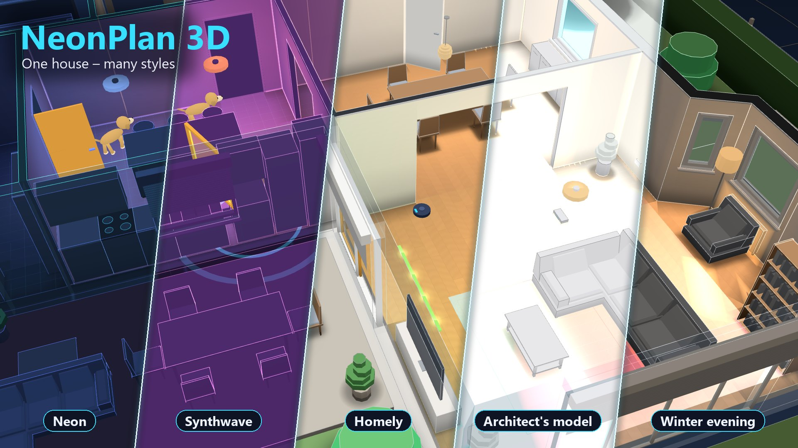](#-new-in-31--your-home-in-every-style)

</div>

---

## ✨ Why NeonPlan

| | |
|---|---|
| 🏘️ **Your whole property** | The house, the garage, the garden house, the holiday flat – each on its own floor plan, all of them together in 3D. |
| 🧸 **Single rooms on your dashboard** | A card that shows just the kids' room, the guest room or the granny flat – right next to your other cards. |
| 🎨 **Your home in every style** | Neon, Synthwave, homely with wooden floors and wall colours, Architect's model, Winter evening – or your own style. By time of day, by voice, by automation. |
| 📱 **Runs on old wall tablets** | A tablet quality level, nothing is drawn while nothing changes – made for old Fire tablets. |
| 🔒 **100 % local** | No cloud, no account, no external program. Everything lives in your Home Assistant. |
| 💚 **Free and open source** | Everything you need day to day is free – [see the big list](#-everything-that-is-free). |

> **No other floor plan for Home Assistant draws several houses and flats, shows single rooms on the dashboard and puts your whole property in 3D.** The original keeps leading. 😉

[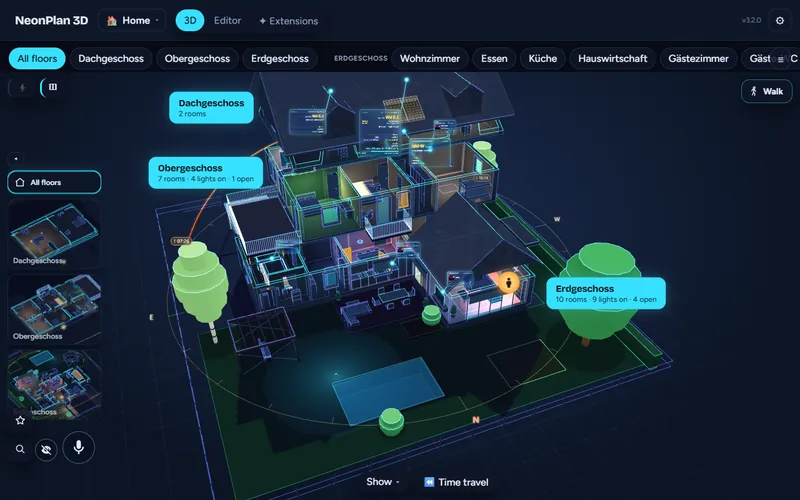](https://neonplan3d.mastershort.de/)

---

## 🎨 New in 3.1 – your home in every style

You love the neon. But on the living-room wall in the evening, a homely house with wooden floors and warm walls is sometimes just nicer. **Now you choose.** The editor and the controls stay neon – the house wears whatever you like.

| Homely, with your wall colours | Synthwave | Architect's model |
|---|---|---|
| Wooden floors, tiles, light walls in the colours you pick per room or per wall, soft shadows under the furniture. *Homely evening* and *Winter evening* dim the house warmly. | Purple and pink, glowing edges – the eighties called. | White, calm, like a model on the architect's desk. |

- 🎨 **Eleven styles to start with** – Neon, Blueprint, Day, Night / Focus, Synthwave, Homely, Homely evening, Winter evening, Architect's model, Pastel, Warm / Wood & paper. Lights, open windows and running devices keep their signal colours in every style.
- ✨ **Your own styles** – copy any style and turn every knob: real materials or your own palette, evening mood, floor texture, shadows, background. You see each change live on the house.
- 🕒 **By time of day** – homely during the day, warm in the evening, calm at night: switched by the sun or by the clock. Every card can have its own evening and night style.
- 🗣️ **By voice and automation** – "NeonPlan style homely", the action `neonplan3d.set_style`, or a helper entity your automations set.
- 📱 **Still runs on old wall tablets** – the styles only colour differently, they cost no extra performance.

Pick a style in the 3D view under **⚙ → 🎨**, build your own under **⚙ Settings → 🎨 Styles** in the editor. [How it all works →](docs/manual.md#512-styles-new-in-31)

---

## 🚀 New in 3.0 – the biggest update ever

The wish you have sent us more than any other since NeonPlan started: **more than one floor plan.** Here it is – and more.

| Your whole property in 3D | A card for a single room | All floor plans at a glance |
|---|---|---|
| [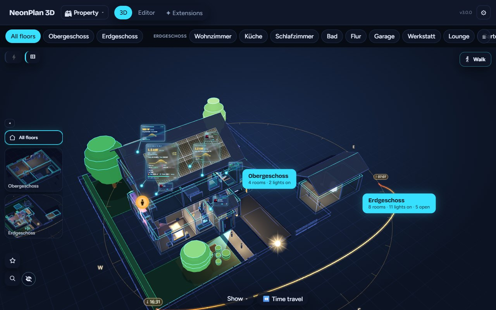](https://raw.githubusercontent.com/Mastershort/neonplan3d/main/docs/images/plans-site-en.jpg) | [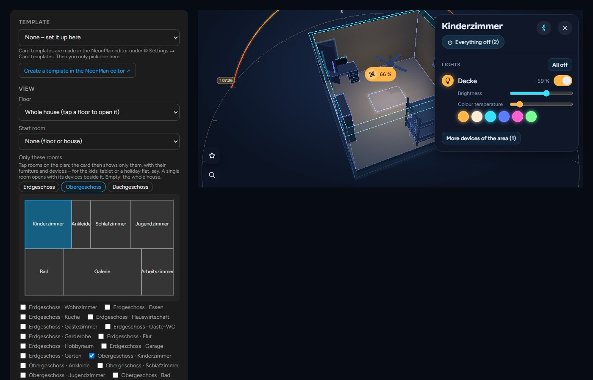](https://raw.githubusercontent.com/Mastershort/neonplan3d/main/docs/images/card-room-one-en.jpg) | [](https://raw.githubusercontent.com/Mastershort/neonplan3d/main/docs/images/plans-overview-en.jpg) |
| Place the garage and the garden house beside the house once – every building with its own roof, lights and warnings. Tap a room and you are in it. | Tap rooms on a little map in the card dialog. One room opens with its devices beside it, "here" means that room, the tablet stays there. | A tile per building – and water in the garden house shows at the top while the house is open, one tap takes you there. |

- 🏘️ **Several houses and flats** – a new floor plan in seconds: empty, a copy, or from a file. Switch at the top. Each has its own floors, rooms, devices and restore points; deleted ones wait 30 days in the bin.
- 🧸 **Single rooms on the dashboard** – "🖥 Card for this room" in the editor makes the card template for you. Runs even more smoothly on old tablets, because only those rooms are drawn.
- 🗺️ **The property** – drag and turn the buildings on a view from above; also as a dashboard card.

---

## 🏠 Your house in three steps – no CAD, no Blender

Everything happens in the editor inside Home Assistant, with the 3D house growing next to the plan while you draw.

| 1. Draw | 2. Furnish | 3. Link |
|---|---|---|
| [](https://raw.githubusercontent.com/Mastershort/neonplan3d/main/docs/images/editor-draw.jpg) | [](https://raw.githubusercontent.com/Mastershort/neonplan3d/main/docs/images/editor-library-en.jpg) | [](https://raw.githubusercontent.com/Mastershort/neonplan3d/main/docs/images/editor-devices-en.jpg) |
| Rooms as rectangles or free shapes – walls, corners and measures follow by themselves. Doors, windows, stairs, roofs and the garden come from the same toolbar. | Pick furniture by room and kind, each with a picture and its size. Resize freely – legs and arms stay as they are. | Each room takes its Home Assistant area: lights, blinds, sensors and media are found and placed with one tap. From then on the house is live. |

Not drawing at all? The **[import page](https://neonplan3d.mastershort.de/import/)** turns Sweet Home 3D, iPhone LiDAR scans (RoomPlan), CAD (DXF), Blender/SketchUp models (glTF, OBJ, STL), Floorplanner and Valetudo robot maps into a NeonPlan plan – in your browser. Or let an AI write it with [this template](https://github.com/Mastershort/neonplan3d/blob/main/docs/ai-import.md).

**Build once, show it everywhere:** the editor in the sidebar is where you build the house. To show it, add the dashboard card `custom:neonplan3d-card` anywhere – or build a **card template** in the editor and just pick it on the tablet. Change the template later, and every tablet showing it follows.

---

## 🎨 What it does

### ✏️ Draw and build

| | |
|---|---|
| 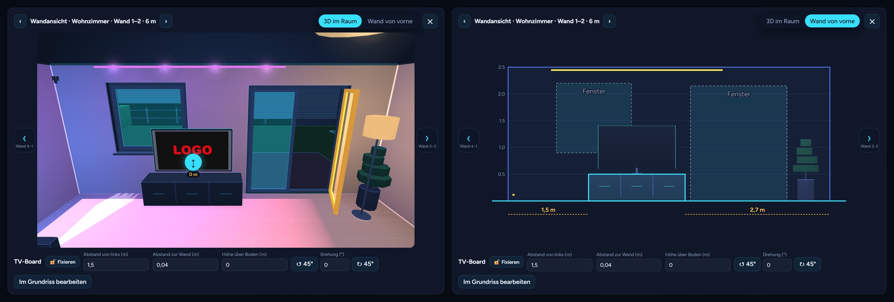 | **A real plan editor in Home Assistant** – floors, rooms as rectangles or free shapes, automatic walls with clean corners, free-standing partitions, sloping walls, doors, windows, glass walls, garage doors, stairs and floor openings. The **wall view** shows each wall from the front for placing to the centimetre. |
|  | **Roofs of every kind** – gable, hip, half-hip, pyramid, mansard, pent, flat and parapet; roof parts turned at any angle for wings and extensions, dormers, cross gables, carports, roof windows. Cellars sink into the ground with light wells. |
|  | **Furniture and lamps** – 80 built-in models in a library with pictures and sizes, ready-made room sets, furniture blocks you build from pieces, lamps that light their room in their own colour. |

### 💡 Live 3D and control

| | |
|---|---|
| 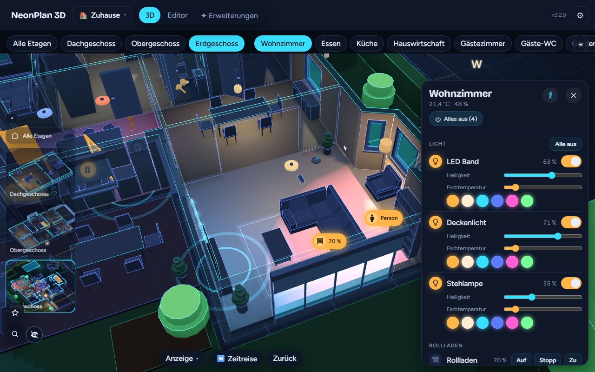 | **Tap, swipe, hold** – tap a lamp to switch it, swipe to dim or move a blind, hold for colours and slats. A tap on a room opens its **room panel** with every device of the area, scenes first, ⏻ Everything off and 🧹 Vacuum this room. |
| 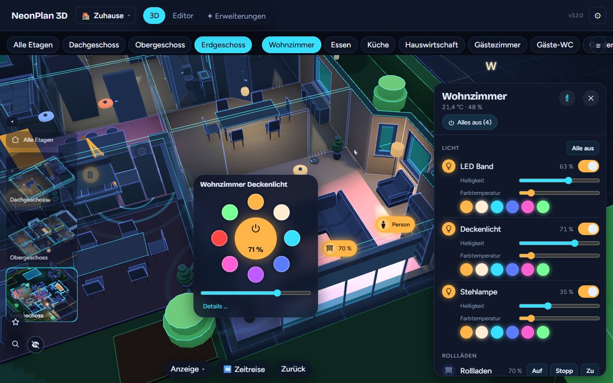 | **Everything at hand** – quick menus for lights and blinds, the ⭐ central menu for all lights and blinds, favourites and your own buttons, a "Where is …?" search, doors swinging and windows tilting with their sensors. |
|  | **Walk through your house** at eye level with keys or a touch stick – the house lives on around you. |
| 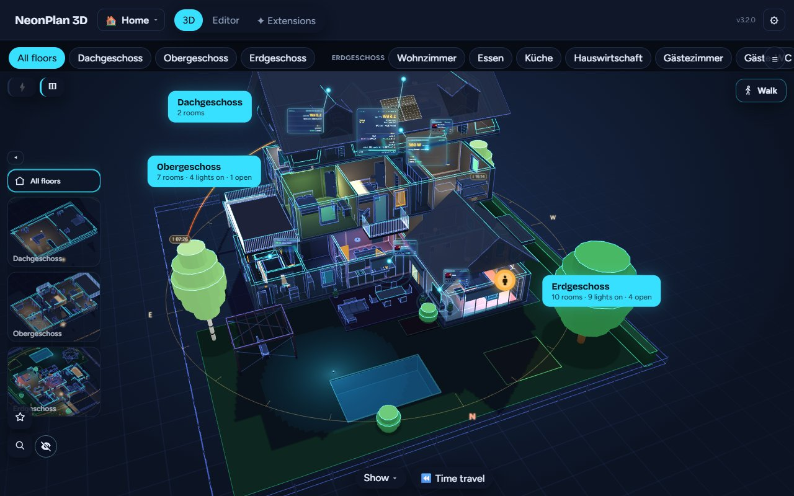 | **Sun and night** – a glowing arc shows the sun's way today, the house's shadow wanders with it, sunlight falls through the windows; at night lit rooms throw their light onto the lawn. |
| 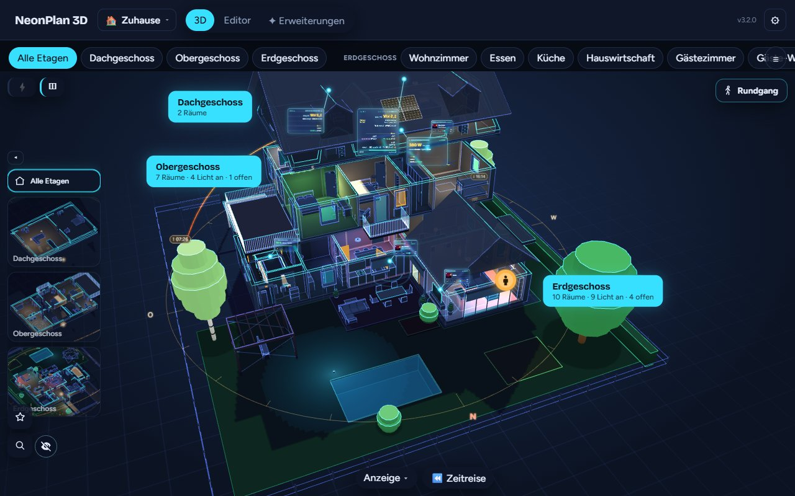 | **The garden too** – lawns, terraces, paths, beds, hedges, fences with gates that open, pergolas, pools and garden lights. |

### 📷 Your devices, alive

| | |
|---|---|
| 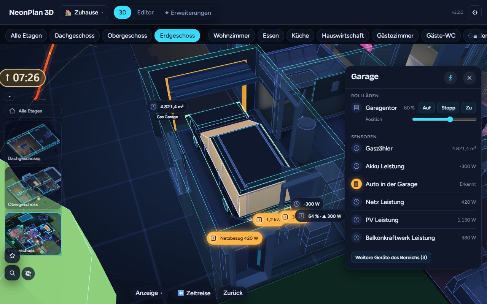 | **Everything you have** – TVs, washers and dishwashers glow while they run, radiators while they heat, the robot vacuum drives its lanes, the car appears on its spot while it is home, awnings run with their cover, bins, mailboxes, switches, sockets and the Wi-Fi access point. |
| 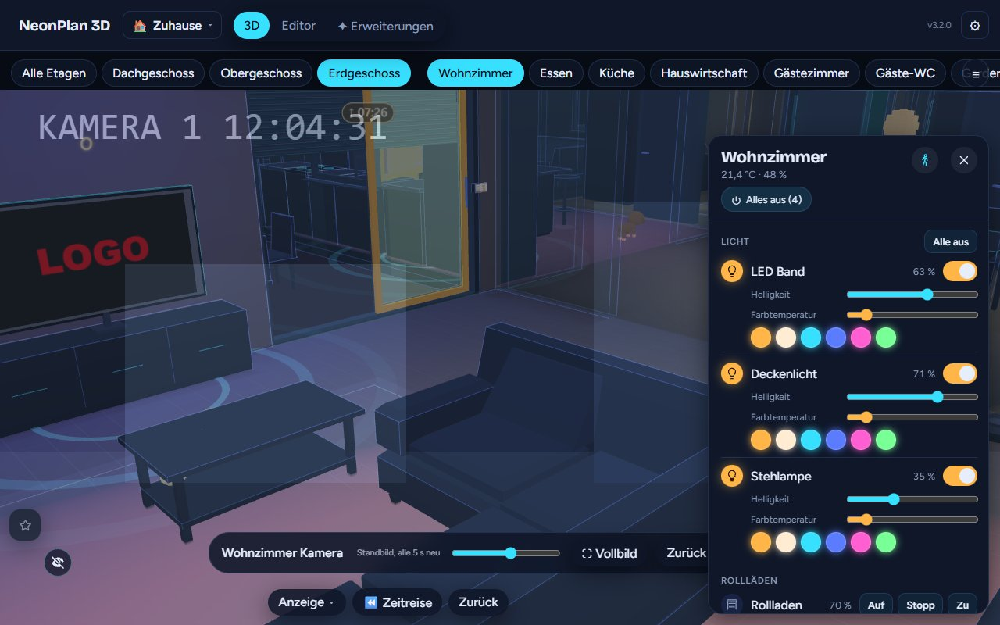 | **Cameras** – on walls and ceilings with their field of view, red while they see motion, snapshots and the live view with a tap. With Camera Cockpit: look through the camera, the camera wall, motion trails and detection pins. |
|  | **Live director** (Camera Cockpit) – the doorbell rings and the wall tablet flies to the front door and looks through its camera; a finished washer or a warning shows the same way. |
|  | **Fun packs, free** – pets that roam the house, Halloween decorations and the Winter & Christmas pack with fairy lights, snow and a New Year firework. |

### ⚡ Energy

| | |
|---|---|
|  | **Solar on the roof, free** – solar fields on any roof face, the wall or the ground, inverters, batteries, wallboxes and meters with live values, the energy balance from Home Assistant's energy dashboard. With **Energy Pro** the energy flows through glowing cables, holograms show day curves and self-sufficiency. |

### 🎙️ Voice and Live Presence

| | |
|---|---|
|  | **Talk to your house** – "Show the living room", "Where is the washing machine?", "Vacuum here". A tablet knows the room it hangs in, so "Lights on" means that room. Anything else goes to Home Assistant's Assist. Free. |
|  | **Who is where – without Bermuda** – people, phones and key tags room by room from the Shelly plugs, ESPHome proxies and Bluetooth adapter you already have. Learn a room in 90 seconds, see everyone as a glowing figure, get a room sensor per device, ask "Where is my iPhone?". Free. |

### 📱 Dashboards and wall tablets

| | |
|---|---|
| 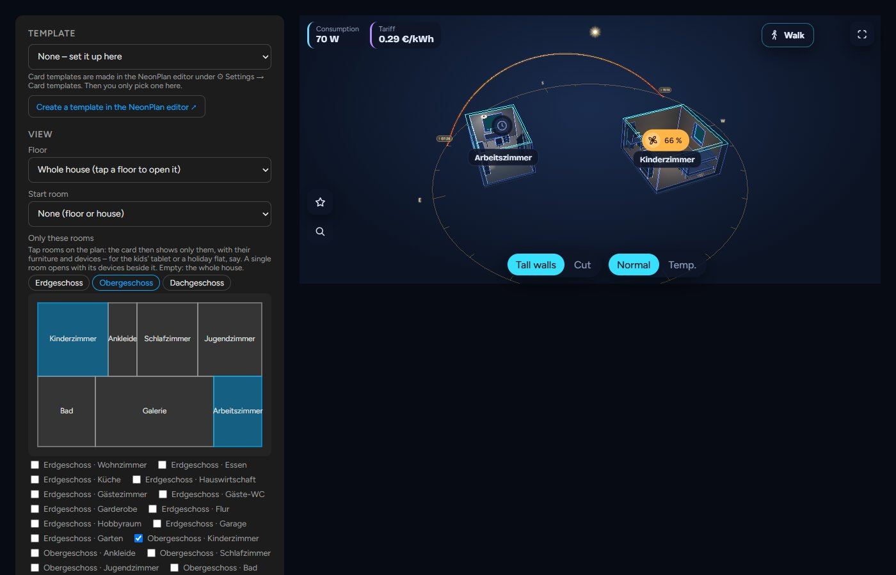 | **The dashboard card** – one floor, the whole house, a few rooms or the whole property, every look and option in a visual editor. **Card templates** are built once in the editor; every tablet showing one follows its changes live. |
| 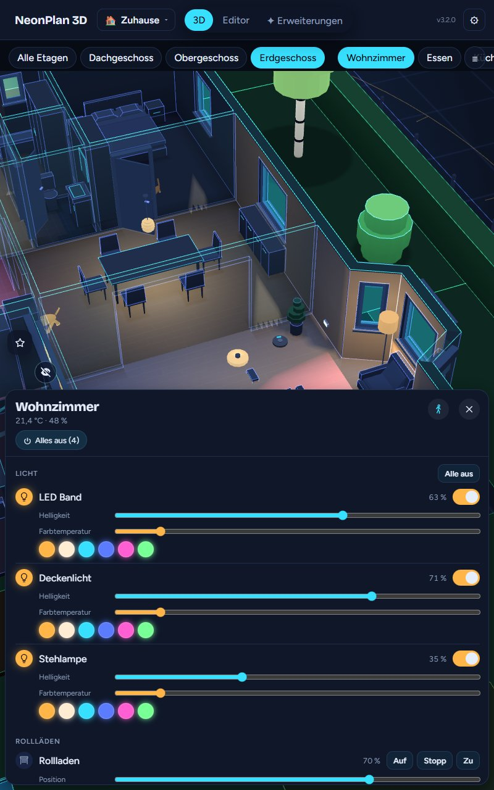 | **Made for the wall** – kiosk mode with idle return, night dimming and a slow orbit as screensaver, portrait layout, full screen, "Reload screens" for every tablet after an update. |
| 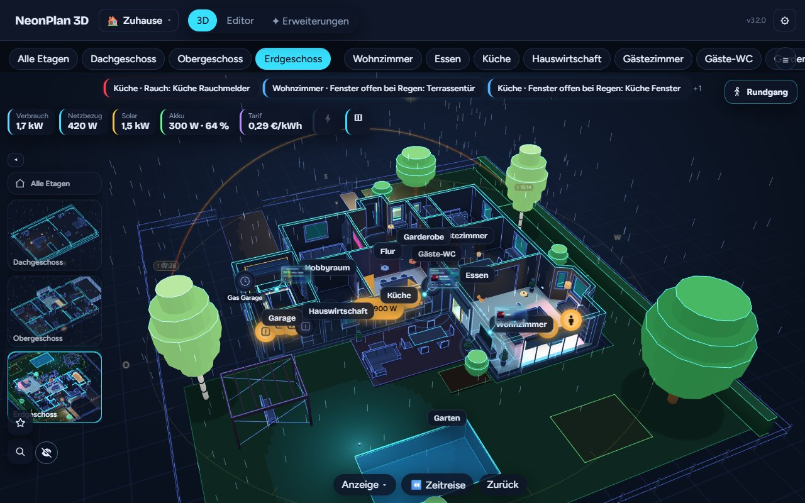 | **Safety, always free** – smoke, gas, CO, water, alarm, a window open in the rain and power outages pulse in their room, with a banner and a jump there – now from every floor plan. |

### 🌈 The classic looks

| Neon | Blueprint | Day |
|---|---|---|
|  |  |  |

Plus **Auto** (day while the sun is up, neon after sunset), an accent colour of your choice – and since 3.1 [many more styles](#-new-in-31--your-home-in-every-style).

---

## 💚 Everything that is free

**Free and open source (MIT). No subscription, no account, no cloud.** Everything below costs nothing.

| Area | What you get for free |
|---|---|
| ✏️ **Editor** | Plan editor inside Home Assistant · 3D beside the plan while you draw · floors from your HA floors · rooms as rectangles, free shapes or by wall lengths · one room per HA area with one tap · snapping, undo/redo, right-click menu · lock the plan, fix single items · floor material, ceiling height, area per room |
| 🧱 **Walls & openings** | Automatic walls with clean corners · thickness and height per wall · split walls · sloping walls · open floor plans · free-standing partitions · doors, windows, glass walls, terrace and garage doors · front doors with sidelights, sliding and double doors · door opening angle · contacts and tilt sensors · smart locks on doors · "ask before switching" |
| 🛋️ **Furniture** | 80 built-in models with pictures · library by room and kind, search in English and German, favourites · free resizing · mirror, height above floor · ready-made room sets · furniture blocks · wall view with measures to the centimetre · "only show while …" for seasonal decoration · beds and sofas that glow when occupied |
| 🌳 **Outside** | Lawn, terrace, path, driveway, beds, hedges, fences, balcony, pergola · gates with motor or contact · pools (round, oval, free, sunken) · slopes and heights · outdoor areas that open like rooms |
| 🏚️ **Roofs & ground** | Flat and gable roofs · roof sections in 8 shapes, turned at any angle · dormers, cross gables, carports · roof windows with blind, contact and motor · cellars in the ground, light wells · metres or feet and inches |
| 🏘️ **Several plans (3.0)** | Several houses and flats · picker at the top · copy or import a plan · bin for 30 days · the whole property in 3D, every building with its own roof · all floor plans at a glance · warnings from every plan |
| 🧸 **Cards & tablets** | Dashboard card with a visual editor · card templates with live preview, changes reach the tablets live · **cards for single rooms** · the property as a card · reload all screens · list of open screens · kiosk: idle return, night dimming, screensaver orbit · tablet quality level for old Fire tablets |
| 💡 **Live 3D** | House → floor → room with flying camera · tap, swipe, hold · double-tap a room for its lights · room panel with every device, scenes, ⏻ Everything off, 🧹 Vacuum · ⭐ central menu with favourites and own buttons · search · walk through the house · heatmap for temperature, humidity, CO₂ · clock · 3D lock and start views |
| ☀️ **Light & sun** | Lamps in their real colour and brightness · 13 lamp kinds, LED strips, ceiling fans that turn · colour effects · sun arc with sunrise and sunset · house shadow · sunlight through the windows · window light outside at night |
| 🔌 **Devices** | TVs, washers, dryers, dishwashers, stoves glow while running · radiators and air conditioners · power in watts · robot vacuum that drives its lanes · parking spots with the car while it is home · awnings · waste bins and mailboxes · switches, sockets, Wi-Fi access point, water heater |
| 📷 **Cameras** | Cameras with their field of view · red on motion · snapshots and live view with a tap · your own camera model |
| ⚡ **Energy** | Solar fields on roofs, walls and the ground · inverters, batteries, wallboxes, meters with live values · energy balance from HA's energy dashboard · gas and water meters · setup checklist |
| 🎙️ **Voice** | 🎙 microphone in the panel and the card · "Show the living room", "Where is …" · "here" means the tablet's room · vacuum and everything off by voice · own names for the voice · Assist sentences · service `neonplan3d.ask` |
| 📍 **Live Presence** | Room-level locating of people, phones and key tags · no Bermuda, no ESPresense · setup assistant, 90 s per room · Android phones found by themselves · key helper for iPhones and Apple Watches · glowing figures in 3D · a room sensor per device · "Where is my iPhone?" |
| 🚨 **Safety** | Smoke, gas, CO, water, alarm, power outage · window open in the rain · contacts gone silent · the room pulses red, a banner with a jump there · **Window watch** module (open in the cold) |
| 🎈 **Fun packs** | Pets (cat, rabbit, dogs, fish) · Halloween · Winter & Christmas with fairy lights, snow and a New Year firework – free with a customer account |
| 🔁 **Import & backup** | Restore points per plan · export and import, share as a template · full backup of every plan, picture and pack · import page for Sweet Home 3D, LiDAR scans, DXF, glTF/OBJ/STL, Floorplanner, Valetudo · AI import template |
| 🎨 **Styles & languages** | 11 styles: Neon, Blueprint, Day, Night, Synthwave, Homely, Homely evening, Winter evening, Architect's model, Pastel, Warm · own styles · wall and facade colours · styles by time of day, voice, automation or helper · own accent colour · own background · 20 languages |
| 🔒 **Privacy** | Everything stays in Home Assistant · voice and locating stay local · reports only if you switch them on, each one viewable and deletable · signed packs, module code runs only after you approve it · open source |

**Safety is always free. Everything you need day to day stays free.**

---

## ⭐ Optional extras

For special things only some homes have. Sold once at [mastershort.de](https://mastershort.de/en/neonplan3d/?lang=en) – **no subscription** – and installed from the **Extensions** tab.

| Pro add-on | What it brings |
|---|---|
| **Camera Cockpit** | Look through a camera, camera wall, motion trail, detection pins, the **live director** |
| **Weather outside** | Rain, snow, fog, clouds, lightning, sun and moon around the house |
| **Live screens** | App colours and artwork on TVs, pictures by rules, camera pictures on screens |
| **Energy Pro** | Energy flowing through cables, device holograms, living solar modules |
| **Sound & Cinema** | Speakers that pulse with the music, now-playing cards, stations and playlists |
| **Car Pro** | Your car on its spot with charge, range, lock and climate |
| **Time travel** | Replay the last 24 hours or 7 days, with events and "while you were away" |
| **Household Pro** | Bins with pickup tags, post in the mailbox, thirsty plants, appliance time left |
| **Heat Pro** | Your heat pump as a system in 3D: state, heat, COP, hot water, radiators and underfloor loops |

**Furniture packs:** living room, kitchen, bedroom, bathroom, kids, office & gaming, garden & terrace, garage & workshop, fitness, smart home & tech, home cinema & hi-fi, utility, architecture & fit-out, stairs & railings, vehicles.

Bought packs and modules are signed for your installation and update by themselves. A module's code runs only after an admin has viewed and approved it. Everything installed keeps working without the shop.

---

## 📦 Installation

[](https://my.home-assistant.io/redirect/hacs_repository/?owner=Mastershort&repository=neonplan3d&category=integration)

1. Click the button above, or open HACS and search for **NeonPlan 3D** (it is in the HACS default list).
2. Install **NeonPlan 3D** and restart Home Assistant.
3. Add the integration: [](https://my.home-assistant.io/redirect/config_flow_start/?domain=neonplan3d) or *Settings → Devices & services → Add integration → NeonPlan 3D*.
4. Open **NeonPlan 3D** in the sidebar, switch to **Editor** and draw your first floor – or import a plan. More buildings: **＋ New floor plan** at the top.
5. Put it on a dashboard: **Add card** → search "NeonPlan". For one room: select it in the editor → **🖥 Card for this room**.

**Manual install:** copy `custom_components/neonplan3d` into `config/custom_components/` and restart Home Assistant. Requires Home Assistant 2025.1 or newer.

## 🧩 Dashboard card

All options can be set in the card's visual editor. The most used ones in YAML:

```yaml
type: custom:neonplan3d-card
template: kitchen_fire  # a card template made in the editor (then only it counts)
plan: pab12cd34ef       # another floor plan (id under ⚙ → Floor plans); site = the whole property
rooms: [room_ab12cd34]  # only these rooms – the kids' tablet; rooms_lock: false lets it leave them
floor: floor_ab12cd34   # a single floor; room: opens a room
height: 420             # height in pixels, or fill: true for the whole screen
quality: auto           # auto | low | high – "auto" picks the tablet level on weak devices
theme: neon             # neon | blueprint | day, with accent: "#00e5ff"
voice: false            # 🎙️ microphone button; voice_area: the room this tablet hangs in
idle_return: 0          # kiosk: seconds without a touch until the start view returns
night: "off"            # kiosk: dim at night – off | sun | "22:00-06:00"
```

Every option is described in the manual, chapter 8 *The dashboard card*.

## 🔒 Privacy

NeonPlan 3D stores the plans, their pictures and the packs in Home Assistant's `.storage`. It talks to the internet only when you enter a licence key in **Extensions**: then it asks mastershort.de once a day for updates of your packs, sending the key and an anonymous installation fingerprint. Voice control uses only your own Assist pipeline; the microphone is open only while you speak. Locating works only inside Home Assistant – nothing about who is where leaves the house. Anonymous usage and error reports are off unless you switch them on (⚙ Settings → 🛟 Help improve); you can view every report before it is sent and delete the data at any time.

## 💬 Ideas, questions and bugs

- **Ideas and voting:** [Discussions → Ideas](https://github.com/Mastershort/neonplan3d/discussions/categories/ideas)
- **Questions:** [Discussions → Q&A](https://github.com/Mastershort/neonplan3d/discussions/categories/q-a) or the [Discord](https://discord.gg/SSdVVFsev7)
- **Bugs:** [open an issue](https://github.com/Mastershort/neonplan3d/issues/new/choose)
- **What changed:** [Changelog](https://github.com/Mastershort/neonplan3d/blob/main/CHANGELOG.md) · [Releases](https://github.com/Mastershort/neonplan3d/releases)

## 🛠️ Development

```bash
cd frontend
npm install
npm test            # pure logic
npm run typecheck
npm run build       # writes the bundles to custom_components/neonplan3d/frontend (committed) and checks the size budgets
npm run screenshot  # renders preview/index.html (invented demo data) with a local Chrome or Edge
```

- **Preview without Home Assistant:** open `preview/index.html` through any local web server.
- **Deploy to a test instance:** create `deploy.local.json` with `{"target": "<config>/custom_components/neonplan3d"}` and run `npm run deploy` in `frontend/`.
- **Python tests** run in CI with `pytest-homeassistant-custom-component`.
- **Furniture pack format:** [docs/packs.md](https://github.com/Mastershort/neonplan3d/blob/main/docs/packs.md) (German).

## 📄 Licence

MIT – see [LICENSE](https://github.com/Mastershort/neonplan3d/blob/main/LICENSE). "NeonPlan 3D" is the name of the original project by Mastershort; furniture packs and Pro add-ons sold in the shop are not part of this repository.

## ☕ Support

NeonPlan 3D is free. If you like it, you can buy me a coffee – or have a look at the packs in the shop: https://mastershort.de/en/neonplan3d/?lang=en<br>
NeonPlan 3D ist kostenlos. Wenn es dir gefällt, freue ich mich über einen Kaffee ☕ – oder schau dir die Packs im Shop an: https://mastershort.de/neonplan3d/

[](https://www.paypal.com/donate/?hosted_button_id=Z3G2VWKSK5VJL)
