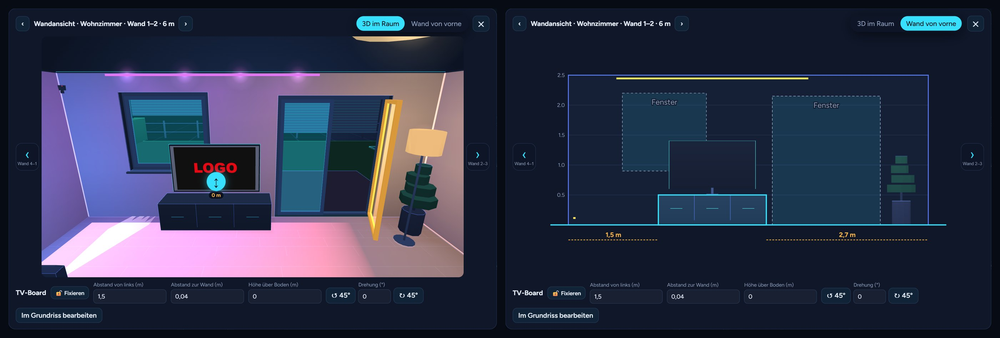
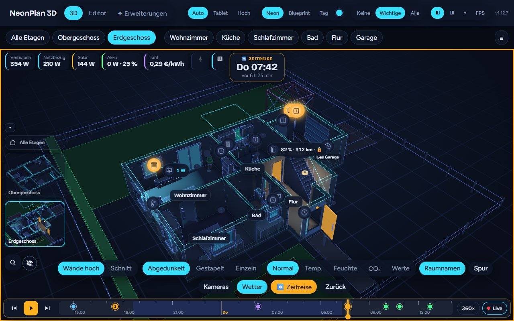
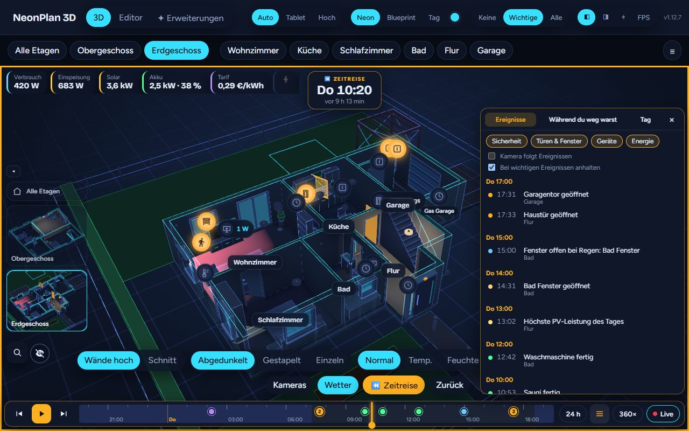
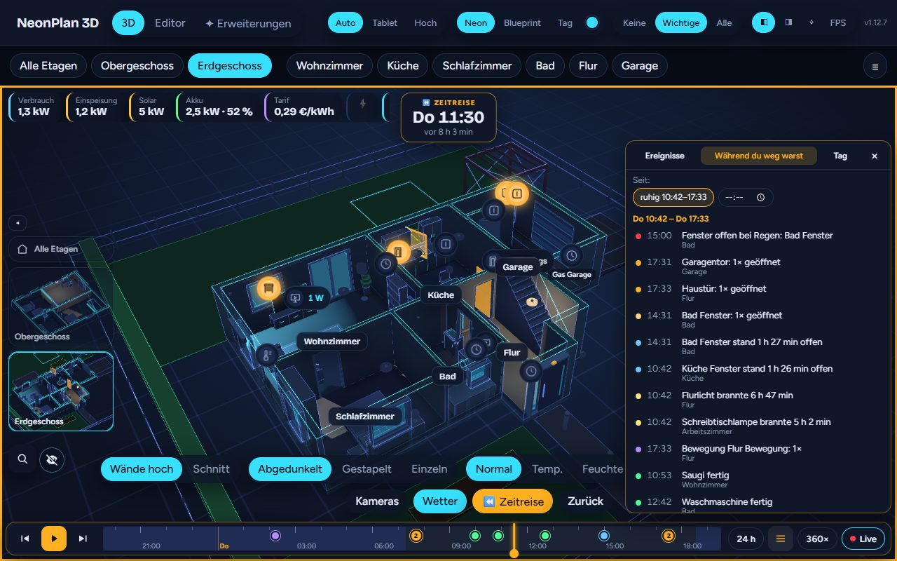
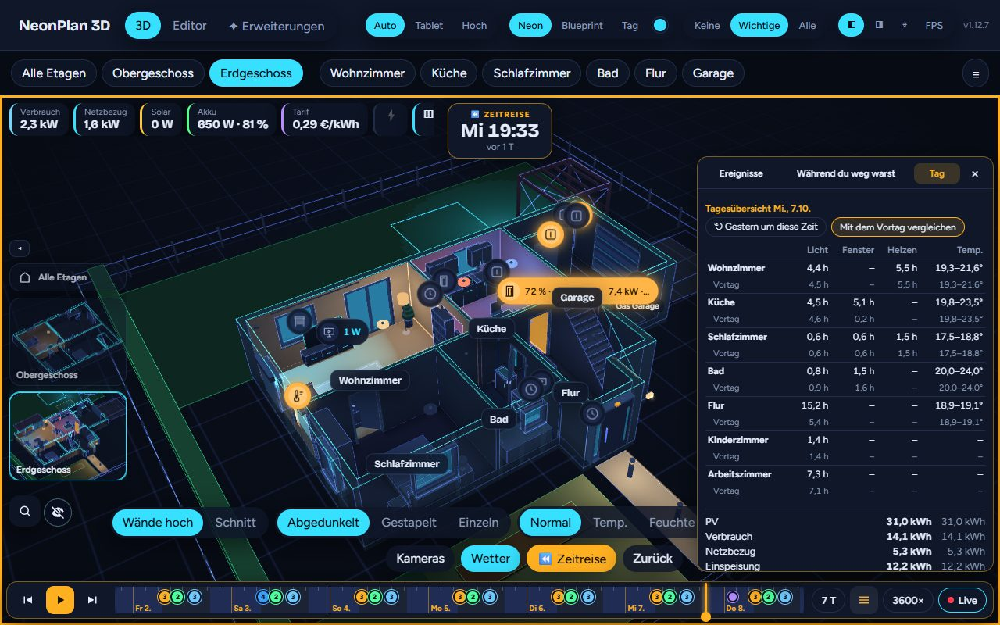

# NeonPlan 3D – Manual

🇬🇧 English · [🇩🇪 Deutsch](anleitung.md)

NeonPlan 3D draws your home right inside Home Assistant and shows it as a 3D model in a neon look. Lights glow in their colours, blinds move, windows tilt, doors swing open, cameras look into the room and the TV shows what is playing. Everything runs locally in Home Assistant, without a cloud or external programs, and it is built for wall tablets.

This manual describes every feature of the current version. What changed in which version is in the [changelog](../CHANGELOG.md) and on the [releases page](https://github.com/Mastershort/neonplan3d/releases). The pictures come from the demo with invented data. The app follows the language of your Home Assistant user (profile → language); the labels below are the English ones. German and English are built in; French, Spanish, Dutch, Italian, Hungarian, Danish, Swedish, Norwegian (Bokmål and Nynorsk), Finnish, Czech, Polish, Romanian, Slovenian, Portuguese and Chinese (Simplified) are fetched when needed, so the bundles stay small for wall tablets. A text missing in a language shows in English.


---

## Contents

1. [Installation](#1-installation)
2. [Your first 3D plan in ten minutes](#2-your-first-3d-plan-in-ten-minutes)
3. [The interface at a glance](#3-the-interface-at-a-glance)
4. [The editor](#4-the-editor)
5. [The 3D view](#5-the-3d-view)
6. [Pro add-ons](#6-pro-add-ons)
7. [Extensions, shop and furniture packs](#7-extensions-shop-and-furniture-packs)
8. [The dashboard card](#8-the-dashboard-card)
9. [NeonPlan 3D on a wall tablet](#9-neonplan-3d-on-a-wall-tablet)
10. [Backup and moving](#10-backup-and-moving)
11. [Data and privacy](#11-data-and-privacy)
12. [FAQ and troubleshooting](#12-faq-and-troubleshooting)

---

## 1. Installation

### Requirements

- Home Assistant 2025.1 or newer.
- A browser with WebGL. That is every current browser, the Home Assistant app and Amazon Fire tablets.
- An administrator to edit. All other users see and control the plan but do not change it.

### With HACS

[](https://my.home-assistant.io/redirect/hacs_repository/?owner=Mastershort&repository=neonplan3d&category=integration)

The button opens NeonPlan 3D straight in the HACS of your installation. NeonPlan 3D is in the official HACS list, no custom repository needed. By hand:

1. Open **HACS** in Home Assistant.
2. Search for **NeonPlan 3D**, install it and restart Home Assistant.
3. **Settings → Devices & services → Add integration → NeonPlan 3D**, or straight with this button:

   [](https://my.home-assistant.io/redirect/config_flow_start/?domain=neonplan3d)

**NeonPlan 3D** now appears in the sidebar. The dashboard card is available right away, no resource needed.

If you added NeonPlan 3D as a custom repository before, there is nothing to do: updates keep coming as usual.

### By hand

Copy the folder `custom_components/neonplan3d` from the repository into `config/custom_components/`, restart Home Assistant and add the integration as above.

### Updates

HACS reports new versions by itself. Restart Home Assistant after every update. Until then NeonPlan 3D shows a note at the top that a restart is pending. Your plan always stays, even if you remove the integration and add it again.

---

## 2. Your first 3D plan in ten minutes

1. Open **NeonPlan 3D** in the sidebar and switch to **Editor** at the top.
2. Choose **Add floor** on the right. If you have floors in Home Assistant, NeonPlan 3D offers them directly.
3. If the floor has areas, **"Add … rooms from HA areas"** creates a room for each area. Drag the rooms into place and adjust the corners. Or draw under **Build → Room** with **Rectangle**, **Free shape** or **By measure**.
4. Tap a wall with **Doors & windows** to add doors and windows.
5. Tap a room and tap **Place** under **Devices** on the right for the devices you want, e.g. the lights, covers, thermostats, media players and sensors of the area. Below the list, **Place all …** puts all main devices in at once after asking.
6. Furnish the room with **Furniture** and **Furnish …**.
7. Switch to **3D** at the top. Done: tap a lamp, and it switches.

The plan saves itself while you edit.

---

## 3. The interface at a glance

There are three tabs at the top:

| Tab | What for | Who sees it |
|---|---|---|
| **3D** | Look at the house and control it | everyone |
| **Editor** | Draw the floor plan, place furniture and devices | administrators |
| **✦ Extensions** | Shop connection, Pro add-ons, furniture packs | administrators |

The dashboard card brings the same 3D view into any dashboard. See [chapter 8](#8-the-dashboard-card).

---

## 4. The editor


The editor has the floor plan in the middle, the toolbar at the top and the sidebar on the right. The sidebar always shows what is selected: the floor, a room, an item, a door or a device.

Drawing works best on a PC or tablet. On a phone you can look around and control your home; the editor says so there once (✕ hides the hint).

### 4.1 Tools

The toolbar at the top is grouped. On its far left is always the floor you are working on, see [4.2](#42-floors).

| Button | What it does |
|---|---|
| **Select** | Tap rooms, furniture, doors, windows and devices, move them, drag corners |
| **Build ▾** | A menu with **Room** (drag a **Rectangle**, a **Free shape** corner by corner or **By measure** with typed wall lengths), **Wall** (a free-standing wall, e.g. a partition), **Doors & windows** (tap a wall), **Floor opening** (a hole in the floor, e.g. above the staircase) and **Roof** (see [4.19](#419-roof)) |
| **Outside ▾** | **Outdoor** (its type such as lawn, path or terrace and its shape, rectangle or free form, right in the menu) and **Pool** (Rectangular, Round, Oval or Free), see [4.17](#417-outdoor-areas-and-outdoor-lights) |
| **Furniture** | Open the furniture library |
| **Energy** | Solar fields on the roof and in the garden, strings and energy devices, see [4.20](#420-energy-solar-fields) |
| **↶ / ↷** | Undo and redo (Ctrl+Z / Ctrl+Y) |
| **3D beside** | The 3D view next to the plan, see [4.18](#418-3d-beside) |
| **Wall view** | See a wall from the front, see [4.8](#48-furniture) |
| **Whole plan** | Brings the floor's whole plan into view; with the garden while drawing outdoor areas or a pool |

A group's button names the tool in use, e.g. "Room: Free shape" or "Outdoor: Lawn". **A tool stays in use** after you placed something, so you can set several doors, windows, rooms or areas in a row. **Esc** or **Select** ends it. A short hint for the active tool is always shown at the bottom of the plan.

**Dragging the sidebar wider:** at its left edge the sidebar can be dragged wider or narrower with the mouse or a finger (280 to 640 pixels); the browser remembers the width.

**Collapsing the sidebar:** **Collapse ›** at the top of the sidebar folds it to a narrow strip – the plan gets all the room, e.g. for moving furniture. **‹** unfolds it, a glowing **⚙** in the strip opens the settings of the selection. Choosing another tool unfolds it again by itself. The browser remembers the choice.

**Mouse and touch:** Two fingers pan and zoom. With a mouse, the wheel zooms; drag an empty spot or anywhere with the **right or middle mouse button** to pan (a right click without dragging still opens the menu). **Ctrl+Z** undoes, **Ctrl+Y** or **Ctrl+Shift+Z** redoes, **Del** deletes the selection, **Esc** cancels. The **arrow keys** nudge the selection (room, corner, furniture, device, wall, outdoor area) by one grid step, with **Shift** by 10 cm, with **Alt** by 1 cm; doors and windows slide along their wall.

**Locking the floor plan and fixing:** **Lock floor plan** in the floor settings (see [4.2](#42-floors)) or by right-clicking a room locks all rooms, walls, doors, windows and outdoor areas, newly drawn ones too; a selected room then shows "🔒 Floor plan locked", a click on it unlocks. Furniture and devices are fixed one by one once they are in place: with the lock **🔓 Fix** at the top of the form, with the key **L** or by **right-click** (long press on a tablet). The right-click menu also offers **Duplicate**, **Turn 90°** and **Delete**. Locked items can be selected and edited in their form, but not dragged, not nudged with the arrow keys and only deleted after asking; dragging then moves the view. Fixed furniture and devices also stay put in the 3D half.

### 4.2 Floors


On the far left of the toolbar is **Floor: Ground floor ▾** – the floor you are working on. The menu is there in every tool: it lists all floors (the top one first, the current one with ✓), below them **Add floor** and **Floor settings**. If Home Assistant has floors that are still missing, **Add floor** unfolds them to choose from, plus **Empty floor**. **Floor settings** opens the current floor's settings on the right; the sidebar shows the same when nothing is selected:

- **Lock floor plan** locks all rooms, walls, doors, windows and outdoor areas, see [4.1](#41-tools).

- **Add floor** creates a floor. Home Assistant floors that are still missing are offered.
- **Name**, **height above the ground** and **ceiling height** set where the floor sits in the 3D house and how tall its walls are. **Turn 90°** turns everything on the floor about the middle of its rooms when a floor was drawn the wrong way round. **Shift the floor** moves everything on the floor (rooms, furniture, devices, outdoor areas, free walls, background image) by X and Z when a floor sits offset against the others; roof sections and cables stay. With **Take every floor along** ticked, shift and turn act on the whole house: every floor with the roof sections, outdoor areas, cables, meter and hologram. **View as this floor's start** remembers how the 3D pane beside stands right now – this floor then opens from that side, with that zoom and framing, e.g. the ground floor from the front and the upper floor from the back; ↺ removes it.
- **Background picture:** in the **Background** section you load a photo or scan of your floor plan as a template under the plan (opacity adjustable). **Move, scale and turn** gives the picture handles in the plan like a piece of furniture: drag moves it, the lower right corner scales it, the round handle on top turns it (Shift for 15° steps). **Done** fixes it again, so you can draw over it undisturbed. **Rotation (°)** turns it to a tenth of a degree. The easiest way to the scale is **📏 Scale with a ruler**: tap the start and end of a stretch of known length in the picture (a dimensioned wall), enter the real length – the picture is scaled to fit and the first point stays put. A skewed scan is put straight with **📐 Straighten**: tap two points on a wall in the picture that should run horizontally or vertically – the picture turns to fit. Order: straighten first, then the scale, then draw the rooms over it.
- **Floor in Home Assistant** links the floor to an HA floor. Then **"Add … rooms from HA areas"** offers the areas of that floor as rooms.
- **Move up** and **Move down** change the order, **Delete floor** removes it with its rooms.
- **Close gaps** joins rooms that are up to 60 cm apart. This helps when you measured inside dimensions. The gap becomes the interior wall thickness.
- **Straighten slanted edges** finds room edges that are only a few centimetres off straight (a corner 1 cm out makes slanted walls in 3D) and straightens them in every room that shares the corner. Walls drawn slanted on purpose stay.


### 4.3 Drawing rooms

- **Rectangle:** Tap the plan and drag.
- **Free shape:** Set corner after corner. A tap on the first corner or **Enter** closes the room, **Esc** cancels. While you draw, every edge shows its length, the one you are pulling too.
- **Moving corners:** Tap a room with **Select** and drag its corners. The **+** on an edge inserts a corner.
- **Snapping:** Corners snap to the grid, to corners and edges of other rooms and to alignments. Hold **Alt** to move freely.


A selected room shows on the right:

- **Name** and **Area**: The link to a Home Assistant area matters most. Through it NeonPlan 3D finds the room's lights, covers, sensors and scenes.
- **Floor**: wood, oak, tiles, carpet, stone or concrete show as a subtle pattern in 3D.
- **View as this room's start**: turn on **3D beside**, turn and zoom the room the way it should show, then tap the button. When you tap the room in 3D later, the camera flies right there – angle, zoom and framing. ↺ removes it, and the room is shown from above again.
- The room's **ID** for the card option `room:` (a tap copies it).
- **Ceiling height**: empty = the floor's room height. With a height of its own the room's walls end there (unless a neighbouring room is taller), and ceiling lamps hang from that ceiling – e.g. 2.5 m in a living room beside a 5 m garage on the same floor.
- **Area and net area**: the area counts the drawn corners. Net takes off what walls occupy in the room: shared interior walls stand half in the room, outer walls grow outwards; free walls in the room and the gap behind a wall built in front of another (an installation wall) do not count.
- The room's **Doors and windows** as a list: a tap selects the opening – handy when a door is hard to hit in the plan.
- The **Devices** of the area, see [4.10](#410-devices).
- **Furnish …** for ready-made furniture sets, see [4.9](#49-furnishing-rooms).
- **Duplicate** and **Delete**.

### 4.4 Walls

Walls are created automatically: every shared edge of two rooms becomes an interior wall, every outer edge an exterior wall. Corners and T-junctions are mitred. You set the thicknesses under **Settings**.

**Single walls:** The **Wall** tool draws a free-standing wall, e.g. a partition that runs through half a room. **Shift** keeps it straight, **Alt** draws without snapping. Where it meets a room wall, the corner is mitred. When selected, drag the handles to move its ends or the line to move the whole wall. On the right you set **X** and **Y** (the middle of the wall, as with furniture; so you place it to the centimetre, off the grid), **Length**, **Wall thickness** and **Height**. In 3D it behaves like any interior wall. With rooms on one side only (a single wall drawn as an outer wall), the other side counts as outside: blinds and sills sit there whichever way the wall was drawn, and it turns to glass like the other outer walls when it faces the camera. You can put doors and windows into single walls too, with **Doors & windows** (see 4.7). Deleting the wall removes its doors and windows as well.

**Wall height:** Any wall can be lower than the room, e.g. a parapet or a counter. For a single wall you set its **Height** in the form. For rooms (rectangle and free shape) select the room; the form shows the **Wall heights** box with every wall of the room, named by its corners (e.g. "Wall 2–3", the numbers are shown at the corners in the plan) and with its length. Hovering a row or tapping its field lights the wall up in the plan. ↥ resets it to full room height. If two rooms share the wall, the lower setting applies. Windows and doors in a low wall end at the wall height. Low walls look lighter in the plan. If one wall in line should have two heights (2.5 m next to 1.7 m), split it with **✂**: the part gets a row and a height of its own, the split point can be moved in **Split point from corner** (marked by a tick in the plan), **⨉** joins the parts again.

**Thickness per wall:** in the same box every wall has a **Thickness (m)** field. By default it is the house's thickness (exterior or interior wall, chapter 4.4); a setting of its own makes the 36.5 cm outer wall next to a 24 cm one, or the 11.5 cm partition. If two rooms share the wall, the thicker setting applies and the wall stays centred on the room border. ↺ goes back to the house's thickness. Windows and doors follow the thickness.

**Sloping wall:** **◢ Sloping** in a row of the wall heights gives the wall a height of its own at each of its two corners; the top runs straight between them – for a lean-to, a garage on a slope or clerestory windows on the tall side. The tall side may reach above the floor height. Windows and doors stay under the top, so a window at the low end gets lower. Splitting the edge with a new corner, both halves meet at the height in between. **◢ Sloping** again makes the wall straight.

**No wall:** In open floor plans the hall, kitchen and living room are one space, yet separate areas in Home Assistant. For that, every row in the **Wall heights** box has a **No wall** button: the wall is left out in the plan and in 3D, even when the neighbouring room shares it. ↥ brings it back. The light follows: a lamp shines through the left-out wall into the neighbouring room as if it were one room.

**Split walls:** When a neighbouring room splits a wall into several parts (say two small rooms along one long wall), every part gets a row of its own, "Wall 2–3 · part 1", "… part 2", with its length, and every part can have its own height or be left out.

### 4.5 The ⚙ settings menu

Everything that belongs to the whole plan rather than to a floor, a room or an item sits in one menu: **⚙ Settings ▾** on the right of the toolbar (only the gear on narrow screens). Each entry opens a dialog over the plan, also while something is selected; **✕** or **Esc** closes it. The side bar without a selection only keeps the floor's rooms, the floor-plan picture and the help.

| Entry | Content |
|---|---|
| **🏠 House** | wall thicknesses, grid, lengths, north (the rows below) |
| **🌦 Weather & warnings** | weather entity and effects, rain warning, warning names, outage sensor, sun patches |
| **🎬 Live director** | see [6.1](#61-camera-cockpit) |
| **🎙 Voice control** | see [5.10](#510-voice-control-new) |
| **⭐ Favourites** | the central menu of the 3D view (below) |
| **🖼 Background** | what lies behind the 3D house (below) |
| **⛰ Ground** | see [4.21](#421-cellar-and-ground) |
| **💾 Backup** | export, import, restore, see chapter 9 |
| **🧩 Modules** | the modules installed (code from the shop, e.g. "The house answers") and **Import a module …** for the .fp3dpack file |

The **roof shape** (none, flat, gable, ridge, pitch, overhang) sits with the roof tool, see [4.19](#419-roof). The **start view** is remembered in the 3D view: turn and zoom the house, then tap **📌** in the view settings (gear at the top right); **📌✕** resets it. The 3D view, the card and the kiosk then open the house like that, and an opened floor is shown from the same side.

| Setting | Meaning |
|---|---|
| **Exterior wall (m)**, **Interior wall (m)** | Wall thicknesses |
| **Grid (m)** | Drawing step |
| **Lengths** | **Automatic** follows Home Assistant's unit system, otherwise **Metres** or **Feet and inches**. With feet and inches the editor shows every length, dimension and area (ft²) that way and understands input like `8' 2"`, `98in`, `8.2ft` or even `2.5m`. The plan always stores metres, so you can switch at any time |
| **North** | Degrees clockwise from up. Needed for sunlight |
| **Weather entity** | Which weather entity drives the weather outside, see [6.2](#62-weather-outside) |
| **Weather effects in 3D** | Which effects are shown |
| **Favourites** | Scenes, scripts, automations, buttons and switches for the central menu (star) of the 3D view: party, presence simulation, shading, watering. Pick them with the search, order them with ↑ ↓, ✕ removes one. Below them **Own buttons** with a label, an icon and an action: **Open a path** (e.g. `/lovelace/blinds`), **Entity details**, **Call a service** (`domain.service` with data as JSON) or **fire-dom-event** – with it a button opens a browser_mod popup with your own card, e.g. `{"browser_mod": {"service": "browser_mod.popup", "data": {"title": "Blinds", "content": {"type": "custom:my-blind-card"}}}}` |
| **🖼 Background** | What lies behind the 3D house: the look's sky (default), **one colour**, a **gradient** or a **picture**. Put the picture into `config/www` in Home Assistant and enter `/local/filename.jpg`; **Darken** lays a dark veil over it so the neon lines stay readable. Applies to the panel and cards and costs no performance |

### 4.6 Floor plan image as a template

Under **Template (floor plan image)** you load a photo or scan of your floor plan under the drawing. **Width in plan (m)** brings it to scale, **Opacity** makes it subtler. Then simply trace the rooms.

### 4.7 Doors, windows and garage doors


With **Doors & windows** you tap a wall, a room wall or a single wall. Then you choose the **Type** on the right: door, window or garage door. A window with a sill of 0 is a terrace door; like a door, **⇅ Reverse opening direction** turns it outwards (in 3D its sashes then swing outside; tilting stays inwards). The preset **Glass wall** sets fixed floor-to-ceiling glazing with slim mullions and no sashes – for an indoor glass wall or partition; width and height are free, and any window can take it under **Style**.

Where two rooms meet without a wall (an open transition) and the outer wall carries on in a straight line, a window or door may reach across the transition into the neighbouring room's wall. The middle of the opening stays on its own room's wall.


Every opening has:

- **Width**, **sill** and **height**, plus the hinge side. With **Select** you slide it along the wall.
- **Sill** (windows only): *automatic* (default) draws a window board inside and a sill outside from a sill height of 30 cm – except for a window that sits directly on another window or a door of the same wall (transom light, fixed upper part, a glass front split in two): that one gets none of its own. *None*, *inside only* or *outside only* fix it, e.g. for a glass front without a board or a window above a kitchen worktop. Chosen by hand it also shows on a window down to the floor or a terrace door (lying at the floor) and on a glass wall, which has none by itself.
- **Style:** room door, front door, front door with glass, with one or two sidelights, glass door, sliding door or **Opening (no door)**. With sidelights you set their **width** below (empty = automatic), with two the left and the right one separately; a single sidelight sits opposite the hinge, or next to the hinges with **Sidelight on the hinge side**. An opening is just a gap in the wall, without frame and leaf; light always passes through. Windows come as standard or with glazing bars. "Automatic" picks a front door for exterior doors.
- **Leaves:** single or double, with an own contact for the second leaf.
- **Highlight in 3D:** *When open* (default) makes open windows and doors glow warm. *When closed* turns this round, e.g. for the WC or a child's room door: it glows while it is shut. This needs a contact; without a sensor nothing is highlighted.
- **Show closed without a sensor:** a door without a contact stands half open in 3D, so it is seen as a door. The checkbox draws it closed, e.g. for a front door or a carport without a sensor.
- **Opening angle (since 2.0.6):** how far the leaf stands open: **Default**, 15°, 30°, 45°, 60° or 90°. Without a sensor the door always stands that far open, with one it opens that far as soon as the sensor reports "open". **Default** stays as before: half open without a sensor, fully open with one.
- **Smart lock:** the door's lock (Nuki, Aqara, `lock.*`). A pin stands at the door in 3D: 🔒 locked, glowing red while it is unlocked; a tap locks or unlocks. A tap on the door itself (without a drive) also opens its menu with **Lock** or **Unlock**, always asking first; while the lock is unlocked, the leaf's free edge glows softly in the accent colour – whatever the door contact says. On a double door or terrace door the pin sits on the main leaf (on the hinge side). The voice asks it ("Is the front door locked?").
- **Invert contact:** for sensors that report open and closed the other way round. NeonPlan then shows open when the sensor reports closed, and vice versa (default: off).

Doors and windows can also be tapped in a wide band around the opening in the plan; a selected room lists its doors and windows in its form.


**Sensors:**

| Field | Effect in 3D |
|---|---|
| **Cover** | The blind moves in front of the window – or of a door (front door, French window, sliding door) – with the cover's position |
| **Position sensor** | For blinds whose position comes from a separate sensor, e.g. Homematic. Can be inverted |
| **Ask before switching** | Open, close and positions ask first in the quick menu and the room panel, and a swipe on the marker no longer moves the blind (it turns the view instead). Stop never asks. Good for tablets where blinds or the garage door would otherwise move by accident |
| **Contact** | The door swings open, the window opens. Offered are binary sensors of the door, window or opening class and ones without a class (KNX, enOcean, template sensors often have none) |
| **Tilt contact** | A second sensor that reports "tilted" |
| **Tilt angle sensor** | Optional: a sensor reporting the tilt angle in degrees (e.g. the "Rotation" of a Shelly BLU Door/Window). The sash tilts exactly that far in 3D; **Angle that counts as fully tilted** (15° by default), an **Offset** for the value while closed and **counts the other way round** adapt it to the mounting. Above a small angle the window counts as tilted, also for the rain warning |
| **Contact second leaf** | For double windows and doors |
| **Garage door** | A garage door follows a cover entity or a contact (on = open; sensors reporting “open”/“closed” work too). A **switch or input_boolean** that drives the door works as the contact too: on = open, a tap in 3D switches it. If your opener only takes a short pulse, choose the **switch, button or `input_button` under Drive** and the real door contact under Contact: a tap on the door switches the switch on or presses the button (asking first with *Ask before switching*), and open or closed comes from the contact. Its open part lies under the ceiling. A gate or garage-door cover on a **door** (e.g. a sliding gate) moves the door leaf instead of a roller shutter |

NeonPlan 3D matches covers and contacts through the area automatically. You can change them by hand at any time.

### 4.8 Furniture


The **Furniture** tool opens the library: the 80 built-in models and everything from your installed furniture packs, sorted together by **what** it is – Sofas, Seating, Tables, Cabinets & shelves, Beds, Kitchen, Appliances, Bathroom, Lights, TV & audio, Office, Tech & smart home, Heating & climate, Energy, Household, Decoration, Plants, Garden & outdoors, Kids, Fitness, Pets, Vehicles, Stairs & railings, Architecture. Every card shows a **picture**, the size (width × depth) and where the item comes from ("Basic" or the pack's name). NeonPlan draws the pictures the first time a section opens and keeps them in the browser; on very weak devices the cards stay without pictures, the hover preview still works.

- **Room chips** at the top: when you open a room, its room kind is preselected (a "Living room" shows Living, a "Kitchen" Kitchen) – the library then shows only what fits that room, plus everything that fits anywhere (lights, tech). **All rooms** lifts the filter, any other chip switches it.
- **Filter chips:** ⚡ **Linkable** (takes an entity), 💡 **Lights up** (links a light), 🌳 **Outdoors**.
- **Families:** an item that comes in several sizes (dining table 120 / 160 / 200, bed 90 to 200, base unit 30 to 120) stands as **one card** with chips for the sizes; the chip places exactly that size. That keeps the list short even with many packs. An item that comes for one side only ("Corner sofa (left)", "Sofa with chaise (left)") gets a chip for the other side by itself – it places the item mirrored.
- **★ Favourites** and **🕘 Recently used** stand at the top as soon as there are any – the star on every card marks them, both stay in the browser.
- The **search field** finds English and German names, the pack name and everyday words ("lamp" finds all lights, "cabinet" all cabinets), several words in any order ("corner sofa"); Escape clears it. While searching, every section is open.
- Long sections show 24 cards first and **"Show … more"** below.

The **Worktop** (Kitchen) is a free top without a base, for gaps in the kitchen or a self-built desk; its **height** is the top edge, 91 cm by default. Under Sofas, next to the sofa, there are a **Corner sofa (L-shaped)** and a **U-shaped sofa**; **Mirror** puts the corner sofa's side section on the other side. On devices that show the cards without pictures, hovering shows the bigger 3D preview as before.

**Symbols on the entries:**

- 💡 A **lamp**: it links to a light and switches in 3D.
- ⚡ An **electric item**: it takes an entity and a power sensor, e.g. a TV, a washing machine or a thermostat.

**Placing and editing:**

- Tap a room, then pick an entry. The item appears in the room.
- **Drag** to move it. Near a wall it turns its back to the wall and sits flush. **Alt** moves freely.
- The **handle in front of the item** turns it in 15° steps, the **corners** resize it. Pack furniture from the October 2026 packs onwards keeps what is fixed while you resize: legs, arms, plates and handles stay as thick as they are, the seat and the body grow – a sofa stretched to 3 m still has 20 cm arms, a taller one a taller back.
- On the right you set width, depth, height, rotation and **Height above the floor**. **Mirror** swaps left and right – the L-sofa the other way round, the cabinet with its door on the other side; the item is in the right-click menu and in the furnish bar of the 3D view as well. That is how a network cabinet or a shelf hangs on the wall, or a dryer stands on the washing machine. It always counts from the floor: a wall cabinet sits at 1.45 m by default, a wall TV is centred at 1.3 m; you can set both higher or lower. **Automatic height** resets it.
- **Wall view:** **Wall view** at the top of the toolbar, then click into a room (near a wall opens exactly that wall) – or **▦ See this room's walls from the front** in the room form, **▦ Wall view** in the furniture form and the right-click menu, **▦** beside each wall under *Wall heights* – shows the wall from the front – with its doors and windows and everything standing or hanging on it, as a real front view of the furniture: cabinets, shelves, wall cabinets, TVs, wall lights. Drag a piece along the wall there and, when it hangs, up or down; dimension lines show the distance to the wall's ends and to the floor, and edges snap to the wall's ends, doors, windows and other furniture (**Alt** drags freely). Arrow keys move by 1 cm, with **Shift** by 10 cm; below, **Distance from the left** and **Height above the floor** can be typed in. The arrows **‹** and **›** at the left and right (and **←** **→** when no piece is chosen) turn you to the wall joining on that side – once round the room. A double click opens the piece in the plan. At the top right you switch between **3D in the room** and **Wall from the front**: in 3D you stand in the middle of the room at eye height looking at the wall – with everything in the room, the table in front of the corner bench too. Tap a piece to choose it, drag to move it on the floor, the round **↕** handle above the chosen piece lifts or lowers it (with its height shown), the mouse wheel or two fingers walk closer or back, the middle or right mouse button (two fingers on a tablet) looks around – so the left button is kept for the furniture; below, **Distance from the left**, **Distance from the wall** and **Height above the floor** can be typed in, with **↺ 45°** / **↻ 45°** and the **Rotation** in degrees – turned at a wall, the piece moves back into the room by itself. A fixed piece shows **🔒 Release** at the bottom: release it first, then it can be dragged. **Wall from the front** is the flat view for lining things up on the wall to the centimetre. Zoom there with the mouse wheel (towards the pointer), two fingers on a tablet or **＋** / **−** at the bottom right; **⤢** shows the whole wall again, and while zoomed the arrows beside them move the view. With **Energie Pro**, a side bar on the left puts the meter, inverter, home battery and wallbox straight onto the wall shown.



- **State from:** any piece of furniture can show an entity that reports on, occupied or home – its top then glows: the bed with an occupancy mat, the armchair, the sauna. A second entity lights the other half (left/right, bottom/top for a bunk bed); set the first one to *none* and the second moves up into its place. Lamps, energy devices and screens have fields of their own for this.
- **Duplicate** and **Delete** are there too.


**Furniture blocks** (a kitchen, a wall unit): place the pieces one by one as they fit, then join them into a block.

- **Shift + click** adds a piece to the selection or takes it out again, **Shift + drag** over an empty spot draws a frame – everything whose centre lies inside is selected. On a tablet without a Shift key, switch on **Select several** in the furniture form: a tap then adds and a drag draws the frame.
- Several selected pieces move, turn (**R**, ↺/↻ 90° – about their common centre), copy (**Ctrl+D**), fix or delete together. **Join into a block** makes them a lasting block (orange frame labelled "Furniture block").
- From then on, a click on any part selects the **whole block**; dragging moves it, in **3D beside** too. Edit a **single part** with a **double click** (double tap on a tablet) or by its name in the list on the right – a wall cabinet 2 cm higher, say. **Select the whole block** goes back, **Break up block** makes single pieces again. If a part is fixed, the whole block stays put – a note says so, **Release all** frees it.
- **In the wall view** blocks work the same way – in **Wall from the front** and in **3D in the room**: **Shift + click** (*Select several* on a tablet) or **Shift + drag** (a frame, front view only) selects several parts, **Join into a block** at the bottom. Dragging slides the whole block along the wall (it snaps with its outer sides); at the bottom you switch between **Whole block** and **This part only** – to line up a single cabinet without breaking up the block. A double click on a part of a block selects just that part too.
- **Onto the wall** (side bar on the left of the wall view): a few symbols instead of a long list – base cabinets & boards, hanging, tall cabinets, seating & beds, lights, your packs (and energy with Energie Pro) – plus a search and **Recently used**. **Tap a free spot on the wall:** NeonPlan measures the gap (low: standing, high: hanging) and shows only what fits – what fills it best first. Cabinets built to measure (kitchen unit, wall cabinet, tall cabinet, sideboard, shelf …) take the gap's width (↔), anything else goes to the gap's left end in its own size. Every piece shows a small picture. **Resize** in *Wall from the front*: on the chosen piece the handles **left and right** change its width, the **top** one its height and, for hanging pieces, the **bottom** one its lower edge – the other side stays put, edges snap to neighbours, the wall's ends, doors and windows (**Alt** freely), and the size shows live above it. Below, **Width** and **Height** can be typed in too (in *3D in the room* as well). Delete a chosen part (or several) with **Delete** at the bottom or the **Del** key.


### 4.9 Furnishing rooms


**Furnish …** on a room puts a whole set of furniture against the walls: kitchen row, L-shaped kitchen, bathroom, bedroom, living room, dining room, office, kids' room or hall. Lamps link to the area's lights. Adjust single items afterwards. **Ctrl+Z** takes the whole set back.

### 4.10 Devices


A room with an area lists all devices of that area on the right, grouped by device. The main entity comes first, further ones such as LED indicators or effects sit behind **"+n more"**. A search field helps with big areas. When a device brings very many entities (such as the segments of an LED strip from Govee2MQTT), the unfolded list shows the first 40 – the search narrows it down – and **"Hide all n in the room panel"** takes them out of the room panel with one click (**"Show all n again"** brings them back).

Sensors appear when they measure something for the room: temperature, humidity, CO₂ and air quality, power and energy, gas and water meters, illuminance and pressure. Meters without a device class count too when their unit fits (m³, l, kWh, lx). Battery and signal sensors stay out. The value shows the decimals set in Home Assistant. If a device is missing, check in Home Assistant that it is assigned to the room's area.

Above the list you choose the source: **This area** (default), **Other areas** (the devices of the other areas, grouped by area; if a device already stands in another room, that is shown, and **Place** brings it here) or **No area** (e.g. template lights, groups and helpers; here any sensor with a numeric value and a unit counts). The area in Home Assistant does not change.

**Room climate:** In the room form, **Room climate** sets which sensors give the room's temperature, humidity and CO₂ (heatmap and room panel). *Automatic* takes the sensors of the area and the ones placed in the room, but leaves out device temperatures, e.g. of a 3D printer or a heat pump's flow. Without a sensor of its own, the room takes the current temperature (and humidity) of its **thermostat** (climate entity); a thermostat can also be chosen by hand. *None* hides the value.

- **Place** puts a device into the room. **Place all …** below the list puts all main devices in at once after asking; **Undo** (Ctrl+Z) takes them back in one step.
- Lights are placed as lamps from the library, so they glow in 3D.
- **☆** adds a device to the room panel of the 3D view without placing it. **👁** hides an entity of the area from the room panel (struck through in the list, 🙈 brings it back) – for entities that only clutter it. **Aa** hides only a device's state in the room panel (∅ shows it again), e.g. for a cover without feedback. Both work for a device's further entities under "more" too, each on its own; a bare "unknown" is left out for switches, covers and lights anyway.
- Drag a placed device to its spot in the plan.


A selected device has:

- **Marker height**, **rotation** and, for lights, the **mount**: ceiling, floor, table or wall.
- **Ask before switching:** A tap in 3D, the quick menu and the room panel ask first. This protects, for example, a server switch from an accidental tap. A double tap on the room leaves this device out.
- **Marker in 3D:** *Automatic* follows the None / Important / All switch of the 3D view. *Always show* shows the marker with "Important" too, e.g. for a temperature sensor. *Without watts* leaves out the power, e.g. on a smart plug. *Hide* never shows a marker. With "None" all markers stay off.
- **Own symbol:** the name of a Material Design icon as in Home Assistant, e.g. `mdi:thermometer` or `mdi:water-alert`, replaces the symbol of the device kind in the pin. Leave it empty for the default. Works for electric furniture just the same.
- **Show as furniture:** replaces the pin by a fitting furniture item in the same place, already linked to the device – a speaker or smart display for a media player, a lamp for a light, a radiator for a thermostat, the robot vacuum for a vacuum. The list only shows furniture that fits the kind of device. In the furniture form **Back to a device pin** brings the plain pin back; Ctrl+Z undoes either.
- **Own name** and **Show the name under the marker in 3D:** ticked, the own name sits small under the pin – three thermometers in the garden ("Pool water", "Pool air", "Greenhouse") stay apart. The tick appears as soon as an own name is set; furniture with an own name has it too. The card option `marker_names: true` shows the names of every device with an own name.
- **To room centre** and **Remove**.

### 4.11 Lamps

Lamps are furniture with a linked light: ceiling light, downlight, surface spot, LED panel, pendant, ceiling fan with light, floor lamp, uplight, table lamp, wall light, LED strip, path light and garden spot.

- The 3D model glows in the light's colour and brightness. The room's floor and walls are lit too, two coloured ceiling lights mix in between. Light reaches the next room only through doors. A lamp over a stairwell or floor opening (up to 1.5 m beside it) also shines through the opening into the floor below.
- Colour effects such as a colour loop are animated in 3D.
- Table lamps stand on the item below (under a worktop high up from 1.2 m – a step of stairs built from worktops – what fits beneath stays on the floor), wall lights and LED strips snap to the wall, a pendant's height is how far it hangs below the ceiling. On wall lights from packs, the halo and the light sit in the glowing parts (a lantern's glass).
- **Ceiling fan with light:** the light switches the lamp under the motor. Under **Fan (fan entity)** you choose the fan: its blades turn in 3D with its speed (about once a second at 100 %, still when off). It gets a symbol of its own beside the lamp showing its speed; a tap switches it, a long press opens the menu with the speed. The width is the blade span, the height how far it hangs below the ceiling. On old tablets the blades turn with few frames per second, and only while the fan runs.
- **Height above floor:** wall lights hang at 1.75 m by default, LED strips right under the ceiling. Under a sloped roof, ceiling lamps, spots and pendants hang from the roof's underside instead of in the air. In the form you set a **Height above floor** of their own, e.g. for a strip under the wall cabinets or behind the TV unit. **Automatic height** resets it. Recessed and surface spots, ceiling lamps, LED panels and flat ceiling lights from packs (such as the workshop light) have the field as well: by default they sit under the ceiling, with a height of their own – under a staircase too – e.g. under the wall cabinets – model and light then shine down from there onto the worktop. A strip below 1 m (skirting board, behind a cabinet) shines up the wall, higher strips shine down. A strip below the cut height stays visible with cut walls. **Tilt about its length** lays the strip against a roof slope or turns it sideways (90° = its face points to the side); **Rise (°)** lets it climb along its length, e.g. up the stairs or along a handrail (about 35–40°), its height above the floor then being its middle; **Upright** stands it on end: it then runs up from the height above the floor, along a door frame or as a light column, and shines all around.
- **Colour and brightness from:** when a relay (Shelly, switch actuator) switches the lamp while the bulb itself knows its colour and brightness, on/off comes from the switch and the colour from this second entity.
- **Glow in one colour only:** the lamp only glows while the light shows about the chosen colour. A colour light can serve as a signal this way – yellow for "water" at the washbasin – without its other colours (red, green, blue for other alerts) showing there.
- **Glow in 3D (%):** how strongly the lamp glows in 3D. Below 100 % tones down bright LED strips so the room does not burn out, above 100 % makes a weak lamp glow more. Works for lights placed as devices too; it switches nothing in Home Assistant.
- A switch works instead of a light too, e.g. a relay for the ceiling light.
- Several lamps may follow the same light.


**Place spots** on a room lays out a grid of lamps that all follow one light, e.g. six downlights on one dimmer. Choose columns and rows first.

### 4.12 Electric furniture

TVs, media walls, the wall unit with a TV (the wall unit without a TV is a lamp: vitrines and LED strips glow with the linked light), desks with monitors, washing machines, dryers, dishwashers, radiators, robot vacuums and many pack items link to entities:

- **Radiator – Heating (sensor):** when the thermostat does not say whether it heats (Tuya valves report a "work state" sensor instead), pick that sensor under **Heating (sensor)**: "opened", "heating", "on" or an opening above 0 % makes the radiator glow.
- **Device** or **TV (media player or smart plug)**: A **status sensor** works as a device too, e.g. the print status of a 3D printer (Bambu Lab and others); the item then counts as active while the status reports "running", "printing", "prepare" or similar. A TV glows while it is on. An older TV on a smart plug simply takes the plug's switch; the screen glows while the plug is on, and a tap switches it. Washing machine, dryer and dishwasher glow while they run – washer and dryer with a ring of light round their round door. A radiator with a thermostat glows while it heats. The **air conditioner (wall)** hangs high on the wall and glows at its air outlet in the colour of its mode: red heating, blue cooling, green automatic, yellow drying, white fan only – bright while it works, dimmed on standby. A **stove** glows on its cooking zones while it cooks; an operating-state sensor (e.g. Home Connect: "run", "ready", "inactive") makes it glow faintly at "ready" and stay dark at "inactive".
- **Power sensor (W)**: The item shows its watts. **Running from (watts)** sets from how many watts it counts as running and glows (empty: 10 W) – handy for appliances behind a smart plug that draw a few watts on standby, e.g. 100 W. When it is set, the pin shows only the state (or "Standby") below it instead of the standby watts.
- **Extra value at the symbol:** a sensor whose value stands at the item's symbol – a gas boiler's water temperature, a ventilation unit's humidity. With an extra value the symbol shows by itself.
- **Ask before switching** and **Marker in 3D** as with devices.
- **Pictures by state** on screens: a Pro add-on, see [6.3](#63-live-screens).

"Automatic" means NeonPlan 3D finds the matching entity in the area by itself.

### 4.13 Cameras


Place cameras like any device. Then:

- **Mount:** wall, looking along its rotation, or ceiling as a dome that sees all round.
- In the plan a **wedge** shows where the camera looks. The **handle at its tip** turns the camera and sets its reach at the same time.
- **Show the field of view in 3D** can be switched off per camera. In 3D the wedge ends at the first wall: an indoor camera does not see through the wall into the next room.
- **Field of view (°)**, **Reach (m)** and **Tilt down (°)** can be typed in as numbers.

In 3D the camera hangs as a small model on the wall or ceiling, its field of view lies on the floor as a wedge. When a motion or presence sensor of the camera reports motion, the wedge turns red.

### 4.14 Parking spots and vehicles


The item **Parking spot** in the Parking group marks where a car stands: in the garage, on the driveway or anywhere on the plot. A new parking spot points with its arrow from the room's garage door into the garage, without a gate along the room's longer side.

- **Sensor "car present":** a `binary_sensor`, `device_tracker` or similar. While it reports a car, the vehicle is there.
- **Vehicle:** the model from the "Vehicles" pack.
- **Vehicle type sensor** (optional): If a sensor reports which car is there, e.g. from an AI camera analysis, assign a model to each state.
- **Size (%)** fits the model to the spot. If the vehicle is taller than the room, the editor warns.


### 4.15 Robot vacuum

The robot vacuum item – and the **robot vacuum with dock** from the Smart Home pack just the same – links to the `vacuum` entity. While the robot cleans, it drives lanes through the room of its dock in 3D and then returns. The lanes are simulated because Home Assistant usually does not know the real position. With the robot vacuum with dock, the model's own robot drives off: while it is away, the dock stands empty.

Many robots do report the room they are cleaning, for example Roborock and Dreame with a "current room" sensor. NeonPlan 3D finds this sensor on the robot's device by itself; the **Current room (sensor)** field lets you pick another one. The reported name is compared with the room name and the Home Assistant area, ignoring case and the spelling of umlauts ("Kueche" matches "Küche"). When the robot changes rooms it appears there in 3D and drives its lanes. If no room matches, it stays in the room of its dock.

Its lanes keep clear of furniture standing on the floor: cabinets, sofas, beds, kitchen units and appliances. It drives under tables, desks, chairs, stools and benches, over rugs and under anything hung on the wall, such as wall cabinets.

### 4.16 Stairs and floor openings

- The **Stairs** from the library rise from the marked front edge towards the back. If they reach the floor above, they cut the stairwell into its floor.
- The **U-stair with landing** (Work & other) has two flights side by side: it rises on the left from the marked front edge towards the back, turns at the landing and comes back up on the right towards the front. **Mirror** turns it the other way. Like the straight stairs it gets the height up to the floor above when you add it and cuts the opening into that floor. Its default size is 2.10 × 2.70 m.
- The **Floor opening** tool draws a hole straight into a floor, e.g. above the staircase or for a gallery. From above you look through it. Across several rooms it is cut in each of them. Several openings may overlap, for example to make an L shape.
- More stairs and railings come with the **Stairs & railings** pack.


### 4.17 Outdoor areas and outdoor lights

With **Outside → Outdoor** you draw lawn, terrace, path, driveway, flower bed, hedge or fence. Choose in the menu first what you draw; the type can still be changed in the form afterwards. There you also choose **Rectangle** (drag it open) or **Free form**: then you place the corners one by one like a free-form room – for curved beds, slanted plot borders or an L-shaped path; a tap on the first corner or **Enter** closes the area. A selected outdoor area is resized at its corners; a rectangle stays a rectangle. Hedges and fences take a **height** in the form (a 2.5 m thuja screen, a 0.5 m bed border); **Show the outline** unticked leaves out the glowing line along the edge, say on a plot made of several lawns. **Height offset** lowers an area below the ground or raises it – the driveway down to a lower garage, a raised terrace; lamps on it follow. **Slope** tilts an area: the height difference in metres and the direction it falls towards (the high edge sits at the height offset) – a driveway falling to the street, a sloping garden; fence posts and lamps stand on the sloped surface. **Wild patch** is a type for unmown corners. **Balcony** is for upper floors: a thin slab at the floor's level with a see-through railing of bars (height in the form); edges along a house wall get no railing – balcony doors behind it stay in view. **Cut out of the areas beneath** turns an area into a hole in every area drawn before it that contains it whole – a pond or a wild patch in the middle of one single big lawn. **Pergola / frame** draws corner posts, beams and rafters at the set height, with **X-bracing** on the sides – for pergolas, carport frames or the support of a roll-off roof. Fences and pergolas can stay **open**: the edge from the last point back to the first is left out, so the fence leans against the house. Trees, shrubs and brush come as furniture from the **Garden & Terrace** pack (from release 3: oak, lime, birch, maple, fruit tree, spruce, pine, thuja, shrub, flowering shrub, brush, group of trees); width and height in the furniture form set crown and growth. Path lights, garden spots and outdoor wall lights light the outdoor areas and the facade. **Pool:** pools are drawn with **Outside → Pool**; in the menu you choose the shape – **Rectangular**, **Round**, **Oval** or **Free** – and then draw it (round: as wide as the short side of the box). A round or oval pool is resized at the four corners of its box (a circle stays round) or in the form by diameter or width and depth; the shape itself stays. A pool cuts itself out of the lawn around it. **Above-ground pool** stands it on the ground as a tub, with a **pool height**; otherwise it is let into the ground. **Basin depth** is the depth from the rim down to the floor (1.50 m by default), **Rim above the lawn** how far the rim stands out – a 1.50 m deep pool standing 20 cm out of the lawn: depth 1.50, rim 0.20. The water stands 15 cm below the rim; you look through the water onto the basin's walls and floor. The depth shows when the pool lies in a lawn, terrace or other area – without ground around it the basin would show from outside, so it stays flat.

**Outdoor areas like rooms:** give an area (lawn, terrace, balcony, pool …) a Home Assistant **area** in its form, say "Garden", and a **name** if you like. It then acts like a room: it is in the room bar, a tap in 3D opens it with the area's devices (garden lights, sockets, irrigation), the camera frames it, and with **Show → Values** the outdoor temperature stands at its name – sensors with "outdoor" in their name count here on purpose. The area's form lists its devices like a room's: **Place**, **☆** shows a device in the room panel without putting it on the plan, **👁** hides it there, **Aa** leaves out its state text. Hedges, fences and pergolas take no area.


### 4.18 3D beside

**3D beside** shows the 3D view to the right of the plan. Every change appears there a moment later.

- Drag the **divider between plan and 3D** to change the ratio. The browser remembers it.
- At the top of the 3D half you switch between **Tall walls** and **Cut**.
- You can also tap and drag an item or device in the 3D half. A bar with width, depth, height, height above the floor, rotation and delete appears at the bottom.
- Without the pin, the sidebar folds away beside the 3D view as soon as you tap something there, and opens over the 3D half; **‹** at the right edge brings it back. With **📌 Pinned** it stays beside it and only folds with **Collapse**.

### 4.19 Roof


A simple house gets a flat or gable roof over the whole top floor under **Build → Roof** at **Roof shape**, with the ridge (along the long or the short side, e.g. a terraced house), pitch and overhang. For everything else – an L- or T-shaped house, a house with a barn, an extension with a pent roof, a roof that reaches far down on one side – you build the roof from **roof sections**.

- Choose **Roof sections (custom)** under **Roof**, or the **Roof** tool. The first time, NeonPlan 3D proposes the sections from your rooms: per floor the parts no higher floor covers, each with a gable roof. Then you adjust them.
- In the **Roof** tool you drag a new section in the plan. Tap selects one, dragging moves it, the corners resize it. At the top you choose the floor whose rooms the plan shows. The 3D view opens beside it with the whole house, so you see every change at once.
- With the lock **🔓 Fix** (or the key **L**) a finished section stays put and no longer slips when you tap it; **Lock floor plan** locks all sections too.
- Each section has a **shape** – gable, hip, half-hip (a gable hipped at the top), pyramid (four slopes to a point), mansard (steep below, flatter above), pent, flat and parapet (a flat roof with a wall ring) – and a **ridge direction** (↔ or ↕).
- For gable, hip and half-hip, **End left/right** (or **top/bottom**) sets each end of the ridge on its own to a gable, a hip or a half-hip – a hip roof with an upright gable at the other end, for example. **as the shape** leaves the end as the shape has it.
- **Eave** and **pitch** are set for both sides separately. All heights count from the ground. A side with a lower eave reaches further down, e.g. a catslide over a low extension. A pent roof rises from the first side; **Swap sides** turns it round.
- **Turn:** if an extension or wing stands at an angle to the house, turn its section with **Turn** (or ↺ 15° / ↻ 15°), clockwise. Dormers and cross gables on it turn along, roof windows and solar fields stay on it. A turned section is moved by dragging; the corners for resizing come back at 0° (turn back, resize, turn again). Where a turned wing runs into another roof, that roof's slopes cut it off. By default every section stays at 0°.
- **Top of walls** is the height where the walls below the roof end. A new section takes it from the rooms below, whatever floor the plan shows. Gables and knee walls are built from there up under the roof, so the space under a pent roof is closed too.
- **Sits on floor** shows which floor the section belongs to in the 3D view and puts it on another floor's wall tops – top of walls and eaves move along. This helps when a new section landed on the wrong floor, e.g. over an upper floor with a stairwell in the middle.
- **Flat roof as a free shape:** a flat roof has the button **Take the floor's outline** – the surface takes the outline of the shown floor's rooms (L- or Z-shaped too), one surface without seams instead of several rectangles. The corners can be dragged in the plan afterwards; **Back to the rectangle** drops the shape.
- **Dormers:** in a section's form, **+ Dormer** adds a dormer on the chosen side – 2 m wide, its front at the eave wall, eaves 1.4 m above the roof's eave, gable roof, as deep as its ridge needs to meet the slope. A dormer is a small section: move it and change its width, heights and shape (gable, pent) like any other. The main slope opens under it, the cheeks close its sides, and the attic wall rises under the dormer up to its eave – put the dormer window there with **Door & window**.
- **Cross gables (a "three-gable house"):** a gable stepping out of the eave side is a wide dormer whose eaves lie on the top of the walls: **+ Dormer**, then drag its width (say 3.4 m) and set its **eave** to the top of walls. Its depth follows by itself – the dormer reaches exactly as far as its ridge meets the slope, and the main roof opens only where the dormer's roof lies above it (the valleys). The attic wall under the cross gable rises into the gable; put its window there with **Door & window**.
- **Roof slopes (knee walls):** if the top of walls lies below the ceiling height of the floor underneath (also when the slope already starts in the floor below: its walls on the eave side then end at the slope as well) – say 0.9 m above the attic floor – that floor's walls end under the roof: knee walls at the eaves, gables up to the ridge, inner walls cut by the slope. Windows then only fit where the wall is tall enough (in the gable); on the eave side use roof windows. Dashed lines in the plan show where 1.5 m and 2 m of headroom remain under the slope.
- Where a section meets a taller part of the house, e.g. a pent roof against the house wall, the overhang is left out there; the roof ends at the wall.
- The **ridge height** is shown at the bottom of the form. Sections may overlap: the lower roof runs under the higher one, as with a real extension.
- **Create again from the rooms** replaces all sections with a new proposal, **Back to one roof** switches to the simple roof. The sections are kept for later but no longer cut any walls.

- The **ridge height** is shown at the bottom of the form. Sections may overlap: the lower roof runs under the higher one, as with a real extension – what lies under the other section is cut away, and a line shows the valley where two sections meet. A wing whose ridge runs at right angles into the slope of a higher roof (an L- or T-shaped house) reaches on into that roof and ends there cleanly in two valleys instead of a gable.
- **Create again from the rooms** replaces all sections with a new proposal, **Back to one roof** switches to the simple roof.
- **Canopy:** For a terrace roof or a carport, drag a section over an area without a room. It becomes a canopy by itself: a flat pent roof at 2.4 m, carried by posts and beams instead of walls, with a see-through roof. At the house wall it rests on the wall. The **Canopy** switch is in the form of every section, too.


#### Roof windows

Below the roof sections, **+ Roof window** puts a window into a roof face (78 × 118 cm by default). Drag it in the plan, also onto another roof face. Like a window it has a **Blind**, a **Contact** and a **Tilt contact**: open, the sash swings out, hinged at the top; tilted, a little; the blind comes down over the glass from the top.

Every roof window has a **name** (optional), a **blind**, a **contact** and a **tilt contact** – and a **window motor**: Velux, Roto or Fakro report the window's position as a cover, and the sash opens in 3D as far as the motor stands. Open or tilted, the frame glows warm like a wall window's. In a roof section the window cuts a hole into the slope, so the attic looks out through it. When the roof fades out as you zoom in on a floor or a room, the roof windows fade out with it. With **Show over the room without the roof** a window stays where it is over the room – open, tilted, with its blind. Its pane is see-through like a wall window's and its blind has slats, so you can tell from afar whether it is down. Where the slope reaches over a room of the floor below, the window belongs to that floor and shows with it. Every roof window belongs to the room below it: tap the room and its blind, contact and window motor are in the room card, and when the sun shines on that roof face, its light falls through the window onto the room's floor (less with the blind down).

### 4.20 Energy: solar fields

In the **Energy** tool only solar fields and energy devices can be moved, in the plan and in 3D; rooms and furniture are locked there, as a note at the top of the plan says. The tool gathers everything about energy in the house, starting with the **solar fields** (meters, heating and heat pump will follow). **+ Solar field** puts a field on the sunniest free roof face, as large as fits. **+ Free-standing** puts a field on frames beside the house, e.g. in the garden or on a flat garage roof. **+ On a wall** hangs a row of modules on the sunniest outer wall of the floor shown (facade, balcony).

Drag fields in the plan and in the **3D view beside it**, also onto another roof face or wall. Roof windows work the same way in the **Roof** tool. The modules lie in the slope of the face; on a flat roof they stand on frames. This works on the single gable and flat roof and on all roof sections (gable, hip, pent, flat). On hip and pyramid roofs the two triangular **hip ends** are offered too, e.g. the south end of a hip roof with an east-west ridge; fields get narrower towards the tip.

| Field | Effect |
|---|---|
| **Roof face** | The face with its compass direction and pitch, e.g. "Main roof · south · 35°" |
| **Name** | E.g. "String 1 south"; several fields for several strings or roof faces |
| **Rows** and **Modules per row** | Size of the field. A list like **"4, 4, 3"** gives every row its own length (from the eave); shorter rows sit left, centred or right. Modules that would reach beyond the face are left out |
| **Modules on/off one by one** | Tap single modules in the plan to take them away or put them back, e.g. around a chimney or a roof window |
| **Full black** / **Blue** | Look of the modules: all black (default) or classic blue |
| **Module width** / **Module height** | Size of one module in portrait, 1.13 × 1.72 m by default |
| **Module power (Wp)** | Peak power of one module, 400 by default – sets the kWp of the field and its string and how bright the living modules (Energy Pro) glow |
| **String** | Fields wired together, also on different roofs: e.g. 5 modules on the house and 5 on the garage in "String 1". A string has a name, a PV sensor and is **connected to** an inverter – or to a battery with a solar input of its own (a power station such as EcoFlow); add both under **Devices** |
| **PV power of this field** | The power sensor of its string, for the coming Pro add-on |
| **Portrait** / **Landscape** | How the modules (1.13 × 1.72 m) lie |
| **Distance from the edge** / **from the eave** | Position of the field. Drag it in the plan, also onto another roof face; it does not slide beyond the edge of its face |
| **Tilt of the frames** | Flat roofs and the garden: the angle of the frames, plus the direction |
| **Free-standing** | The field stands on frames and moves freely. **Height of the surface** lifts it, e.g. 2.8 m onto a garage roof (0 = ground). **Rotation** turns the rows, as do the ↺/↻ 15° buttons and the turn handle in the plan; the field turns about its middle |
| **Wall** | Modules hang on an outer wall; in the list every wall is named by floor, room and the corner numbers from the plan (“Wall Ground floor · Hall 4–5 · East · 1.2 m”), free-standing walls say “free-standing”. On a wall the field keeps as many modules as fit in the row; too short for a module lying down, it takes it upright, and a wall narrower than a module (say a 0.9 m garden wall) carries one centred, overhanging both ends. Instead of "distance from the eave" there is the **height above the floor**. **Tilt away from the wall** angles them: standing off at the top or at the bottom, up to 90° as a canopy. The floor buttons at the top choose the floor you work on |
| **Fill face** | Puts as many modules on the face as fit |

Below the field you see its power, counted with 400 W per module. The plan lock does not hold solar fields; **🔓 Fix** in the form fixes a single field (and a roof window just the same). **Devices:** solar inverters, home batteries and wallboxes are added in the **Energy** tool as well, under **Devices**, on the floor chosen at the top. A wallbox goes into the garage by itself, inverters and batteries into a utility room (utility room, basement …), each against a wall without a door or gate, and the plan moves there. Tapping a device in the list shows it in the plan. There, in the Energy tool, every device carries a round marker with a symbol (⚡ inverter, 🔋 battery, 🔌 wallbox) to grab and move it by, also below a solar field on the roof. With a power sensor they show their watts. The **home battery** also shows its charge with the **State of charge** field, e.g. "64 % · ▲ 1.5 kW" (▲ charging, ▼ discharging), the **wallbox** "charging · 11 kW" or "plugged in" with a **Status** sensor.

**Meter and grid connection:** The **electricity meter** is the fourth energy device; it takes the grid sensor (W, + = import) and shows "Grid import 420 W" or "Export 900 W". The **grid connection** marks where the cable to the utility leaves the plot, e.g. at the end of the driveway; it is added where the cable would end by itself and can be dragged in the plan. Every device has a **Name** field in its form ("Inverter north") that shows in the list, the form and on the pins in 3D, and inverters and batteries a **Model**: wall unit, slim and tall or hybrid; tower, wall battery or compact balcony battery. Several inverters and batteries work, e.g. a big plant and a balcony plant: each gets its own sensor.

**Energy balance:** NeonPlan takes grid, solar and battery from the devices in the plan (meter, inverters, batteries; several add up, charges are averaged). In the **Energy balance** section you choose other sensors, flip signs and set the house consumption. **Take over from the energy dashboard** fetches the sensors you set up in Home Assistant's energy dashboard: for every energy statistic the power sensor of the same device, plus the gas and water meters. Check the signs afterwards. **Gas meter** and **water meter** are counters (a meter reading, e.g. in m³); with Energy Pro the house card shows how much was used today.

At the bottom, a card announces the coming Pro add-on **Energy Pro**. Everything you set up here stays free and is used by it directly.

### 4.21 Cellar and ground

A **cellar** is a floor with a negative **elevation**, e.g. −2.6 m. Under **⚙ Settings → Ground** you set:

- **Ground height** (in metres, ground floor = 0) says where the ground lies around the house. Lawns, paths and terraces lie on it. For a **semi-basement** or raised ground floor you lower it as far as the cellar should show, e.g. to −1.2 m. If the house then stands higher than the ground, it gets a **plinth** down to the ground in 3D – nothing floats.
- **Show cellars in the earth:** floors below the ground sit in the earth in 3D. Open the cellar and you see it as in a building pit, with the earth walls around it. Unticked, they stand free as before.
- **Reset the ground** sets everything back.

**Cellar window:** in a window's form, **Cellar window** sets the right size – 100 × 50 cm, 25 cm under the ceiling. A window below the ground gets a **light well** with a grate in 3D by itself. The tick **Light well** is in the window form exactly when 3D draws a well (a window in an outer wall below the ground) and takes it away again (e.g. where a path runs past outside); **Rim above the ground** raises the rim and grate so a gravel or paved path around the house does not cover them. Where a lawn, path or terrace of the garden tool reaches over the well up to the house, its rim stands just above that surface by itself.

### 4.22 Awnings

Under **Furniture → Terrace & balcony** there is the **Awning**. In 3D it runs out and in with its cover – like a blind.

- **Kind:** **Folding-arm** (the classic over a terrace), **Drop-arm** (balcony, window – the arms swing out and down), **Vertical / ZIP** (the fabric runs straight down in side rails), **Pergola / conservatory** (a fixed frame with posts, the fabric runs out on top) and **Side awning** (a privacy screen pulled out sideways from a post). Choosing a kind sets its usual sizes, which you then adjust.
- **Size:** width is the awning along the wall, depth its projection fully out (for a drop-arm the arm length, for a pergola up to the posts). The back of the frame goes against the house wall; **Height above the floor** is the cassette's underside (for a side awning the fabric's height). **Fall** is the fabric's slope.
- **Awning (cover):** the cover from Home Assistant. If it reports its position while it runs, the awning runs out slowly in 3D; if it only says opening/closing, it moves at its **Run time fully out**. A separate **Position sensor** works too. **Reverse direction** helps with covers that report 100 % while the awning is in.
- **Valance:** the fabric edge hanging at the front, can be switched off.

### 4.23 Waste bins and mailboxes

Under **Furniture → Household** you find the **waste bin** and the **mailbox**.

- **Waste bin – shape:** wheelie bin 120 l or 240 l, 1100 l container, multi-compartment bin, bag, caddy / pail or underground container (only its column stands out of the ground). The shape sets the usual size.
- **Waste:** general, food / organic, paper, packaging, glass, garden, recycling or other. It gives the bin the colours usual in your country (by the country set in Home Assistant: in Germany paper is blue and food waste brown, in the US recycling is blue; in Australia the lid tells the kind). **Colour** and **lid** can be changed freely afterwards.
- **Mailbox – shape:** wall mailbox (hanging at 1 m), mailbox on a post with a flag, post box with a newspaper holder, parcel box or mailbox bank.

### 4.24 Home technology: light switches, sockets, Wi-Fi and hot water

Under **Furniture → Home technology** (in the wall view under 🔌 **Switches**) you find the **light switch** and the **socket**. They hang on the wall: the switch at 1.05 m, the socket at 0.3 m (the outdoor socket at 0.5 m); **Height above floor** sets your own. A socket placed a little into the wall is shown on the wall's face in 3D; on a low wall (a balcony parapet, say) it comes down, without a height of its own, far enough to stay below the wall's top.

- **Buttons / sockets in the frame:** 1 to 4 in one frame; the frame grows wider to fit.
- **Every button, every socket gets its own entity:** a light, a switch (the relay, the smart plug) or a fan. It glows in 3D while the entity is on – a socket green, a light switch's button softly: for a light in its colour, otherwise in the accent colour.
- **The same entity on several sockets:** when one relay switches two sockets (inside and outside, or a double socket), choose the same entity for both. This works across any number of frames.
- **Power (sockets only):** an optional power sensor per socket. The socket glows brighter the more it draws and counts as a consumer.
- **Kind (socket):** indoor or **outdoor socket with lid**.
- **Tap:** with one entity a tap switches it right away. With several, a small menu opens with one button per gang. **Ask before switching** applies to every gang.
- With several gangs, the symbol above the frame shows how many are on (e.g. "1/2"); sockets show their power too.

**Wi-Fi access point:** a flat disc under the ceiling or a plate on the wall (**Mounting**). As its **status** pick whatever says whether it is there – a connectivity sensor, its state, a device_tracker; diagnostic entities (UniFi's, for example) are offered too. Its ring glows blue while it is there and red when it is gone; its symbol then shows with "Offline". With the **connected clients** sensor their number stands at the symbol.

**Water heater:** a standing tank or a slim tank on the wall (at 1.1 m). Link the water_heater entity, a thermostat or the heating element's switch, plus optionally a sensor with the **water temperature** and a power sensor. It glows warm while it heats (thermostat heating, switch on or power above the threshold), faintly while it is ready, and shows the water temperature. The **heat pump (indoor unit)**, gas boiler, buffer tank and water heater from the packs take a water_heater entity as well; their pin shows the mode and the water temperature.

---

## 5. The 3D view


### 5.1 House, floor, room

The 3D view has three levels:

1. **The whole house** with a label per floor: rooms, lights on, open windows.
2. **One floor:** The floors above fly away, the ones below stay dimmed, stacked or hidden, as you choose.
3. **One room:** The camera flies in, the room panel opens.

**Navigating:**

- Tap a floor label or a room to go one level down.
- **Double tap** an empty spot, **Esc** or **Back** go one level up.
- Drag to turn the view, two fingers or the mouse wheel zoom.
- The **floor pictures** on the left jump straight to a floor. The small arrow above them folds them into plain floor buttons (the device remembers it); in the card `floor_thumbs: false` turns them off.
- Buttons at the top list all floors and the rooms of the open floor.

### 5.2 The switches at the bottom

The switches for walls, floors, roof, heat map and the Pro displays are in the **Show ▾** menu at the bottom left; a tap beside it closes it.

| Switch | Effect |
|---|---|
| **Tall walls** / **Cut** | Walls at full height, the front ones as tinted glass, or all walls cut at hip height – tall furniture (wardrobe, stairs, tall units) is cut with them, so it hides nothing behind it. Each device remembers the choice |
| **Apart** / **Stacked** | In the house view: floors pulled apart or on top of each other |
| **Roof stays** | In the house view: the roof stays while zooming in instead of lifting and fading (in the editor's roof and energy tools it always stays) |
| **Dimmed** / **Stacked** / **Alone** | With an open floor: what happens to the floors below |
| **Normal** / **Temp.** / **Humidity** / **CO₂** / **Values** | Heatmap: floors coloured by the room's value; **Values** colours nothing and writes temperature, humidity and CO₂ as numbers under the room names |
| **Room names** | Show or hide the room names |
| **Trail** | Motion trail, Pro, see [6.1](#61-camera-cockpit) |
| **Weather** | Weather outside, Pro, see [6.2](#62-weather-outside) |
| **⏪ Time travel** | Replay the last 24 hours in the house, view only, Pro, see [6.7](#67-time-travel) |
| **≡ / ↔** (right end of the floor and room bar) | Wrap the bar at the top onto several lines when many rooms do not fit in one, or back to one line; in one line it scrolls sideways, on a PC with the mouse wheel too. In the house view the rooms of every floor follow its name. You change the order of the rooms in the editor: with nothing selected, **↑** and **↓** in the floor's room list |
| **⚙** (at the top next to the version) | Unfolds and folds the view options quality, look, icons and FPS; so the header stays slim |
| **Eye** (bottom left, next to the magnifier) | Hides everything that is not the 3D view: header, floor and room bar, energy values, floor pictures, switches. The stage alone remains – half a screen more on a phone. A tap on the eye brings it all back; rooms can still be tapped. The device remembers the choice |


At the top right:

| Switch | Effect |
|---|---|
| **Auto** / **Tablet** / **High** | Quality level. Tablet leaves out patterns, shadows and halos and is chosen automatically on Fire tablets. High adds light cones under spots |
| **Clock** | Date and time in a corner of the view (↖ ↗ ↙ ↘) or off – per device; in the card `clock: tr` |
| **Neon** / **Blueprint** / **Day** / **Auto** | The look; **Auto** shows Day while the sun is above the horizon (`sun.sun`) and Neon after sunset – for the wall tablet. In the card `theme: auto`. The colour well beside it sets an **accent colour of your own**: in the neon look lines and glowing edges take it, the buttons and pins in every look; ↺ brings the cyan back |
| **None** / **In the room** / **Important** / **All** | Which device markers appear. Important shows only devices without their own 3D model and values such as watts or the running app. **In the room** shows no markers in the house and floor views and, in an open room, only that room's own – handy with many sockets and sensors |
| **Small** / **Normal** / **Large** | How large the device markers are; the device remembers the choice (card: `marker_size`) |
| **◧ / ◨** | Floor pictures, star, search and eye on the left or on the right – handy when the view sits at the left edge of a dashboard |
| **⌖ Keep view** | Switching from floor to floor keeps the camera where it is; only its height follows |
| **🔒 3D lock** | The angle stays fixed: a drag moves the view, zooming still works, flights to rooms keep the angle; a saved start view (house, floor or room) brings its own angle – nobody turns the house on a wall tablet by accident. Per device; in the card `angle_lock: true` |
| **FPS** | Frame rate, slowest frame and the reason for every drawn frame. At rest it reads 0 fps |

At the far right of the header stands the installed version (e.g. v1.11.0); hovering it shows which version the integration in Home Assistant reports.

Each device remembers these switches.


### 5.3 Controlling


- **Tap** switches lamps and switches. The lamp flashes briefly to confirm.
- **Swipe up or down** on a lamp dims it; on a blind or window it moves the blind. The value appears at your finger. Devices and windows with "Ask before switching" do not react to a swipe.
- **Long press** opens the quick menu: brightness, colour temperature and colours for lights; up, stop, down and fixed positions for blinds. Venetian blinds and Raffstores get a **Slats** slider there and in the room panel (or slats open/closed) as soon as the entity supports it. Roller shutters, garage doors and curtains only get them when they report a slat position (some integrations such as KNX announce slat buttons for roller shutters, too).
- Tap a **window** – frame, glass or blind – to open the blind menu or show the contact.
- **Double tap a room** switches all its lights on or off. Devices with "Ask before switching" stay out.
- TVs, doors and garage doors can be tapped directly as well.


### 5.4 The room panel


In a room the room panel opens on the right, at the bottom on phones and portrait tablets. It shows the room's devices by kind: lights with brightness, colour temperature and colours, **All on** and **All off**, covers with **All up** and **All down**, heating, media, switches, cameras with snapshot, sensors, and scenes & scripts.

It shows the devices placed in the room and everything you added with ☆ in the editor. **More devices of the area** shows the rest.

With a selected room and no open room panel, the area's **scenes and scripts** appear as buttons at the bottom.

### 5.5 Search


The **star** above the magnifier opens the **central menu**: lights on or off and blinds up or down for the floor shown – in the house view for the whole house, then with a confirmation ("Sure?", a second tap runs it). Garage doors and gates do not count as blinds. Below it the **favourites** from the editor; a tap starts a scene or script, presses a button or toggles a switch. In the card, `central: false` hides the star.

The magnifier at the bottom left opens **"Where is …?"**. Type a device or room name. A hit flies the camera there and the device flashes.

**Walk:** the **🚶 Walk** button at the top right starts a **walk through the house**: you stand at eye height in the chosen room (else the biggest of the floor shown) and walk through it. **Drag** to look around, **tap the floor** to walk there – through doors into other rooms too –, **W A S D** or the **arrow keys** walk, on a tablet the **stick** at the bottom right. Walls stop you, doors let you through. The house lives on around you: lights, TVs, sun patches, glass cards. At the top you see the room you are in; **✕ End** or **Esc** takes you back. In the card, `walk: false` hides the button. While walking, only the glass cards of the room you stand in show.


### 5.6 Heatmap


**Temp.**, **Humidity** and **CO₂** colour the floors by the area's sensors, with a colour scale at the edge. Temperatures appear in the unit set in Home Assistant (°C or °F); sensors in °F are converted correctly.

### 5.7 Sun and daylight


With north set, sunlight from `sun.sun` falls through the windows facing the sun as soft patches on the floor. Lowered blinds make the patches smaller. If you do not like the patches, switch off **Sunlight through the windows** in **Settings**. By day the sky behind the house gets lighter.

### 5.8 Warnings


NeonPlan 3D warns for free and without setup:

| Warning | Trigger |
|---|---|
| Smoke, gas, carbon monoxide, water | A `binary_sensor` of that device class in the area reports on |
| Alarm | An `alarm_control_panel` is triggered or about to trigger |
| Power outage | The entity from the plan settings (**Report a power outage with**) reports an outage: a grid sensor of class power is "off", a UPS runs on battery, the mains voltage is below 100 V, or a helper of your own is "on". The grid connection in 3D is crossed out meanwhile |
| Window open in the rain | A window is open or tilted while the weather entity reports rain, lightning rain, hail or sleet |

The room pulses red and a banner appears at the top. A tap on the warning jumps into the room. The rain warning uses the weather entity from the plan settings and can be switched off there on its own under **Warning: window open while it rains**. A single window that may stay open in the rain (under a canopy, say) gets the tick **No rain warning** in its form. With a weather station of your own, choose its rain sensor (on = rain) or rain rate (mm/h) under **Rain from your own weather station**: then what counts is whether it really rains at the house – for the warning and, with Weather outside, for the rain in 3D.

On a wall tablet the banner can get long: "Guest WC · Window open in the rain: Guest bathroom window". Switch off **Show device names in warnings** in the plan settings, and it reads "Guest WC · Window open in the rain". A warning without a room keeps the device name.

**Contact unavailable (since 2.0.6, off by default):** when a window or door contact has been "unavailable" for 10 minutes (empty battery, out of radio reach), the window looks shut in 3D although nobody knows. Switch on **Warn when a window or door contact is unavailable** under **⚙ House**, and a warning names the contact. A short gap while Home Assistant restarts does not warn.

### 5.9 Cameras in 3D


A tap on the camera or on its wedge opens the snapshot, which refreshes every few seconds. A tap on the picture opens the Home Assistant live view. The wedge is a much bigger target than the small camera.


### 5.10 Voice control (new)

> **New in 1.20 and still in development.** Voice control is switched on for everyone, free, and already works well. It will grow over the next versions. If a sentence is not understood the way you mean it, send us the sentence on Discord or in a GitHub issue.

Talk to your house. A **microphone button** 🎙️ appears at the bottom left of the 3D view. Tap it: it turns red and "Listening …" shows above it. Say your sentence and pause briefly, and NeonPlan responds.

**What you can say:**

| You say | What happens |
|---|---|
| "Show the living room", "Go to the kitchen" or just "Bathroom" | The room opens, on its floor. |
| "Show the upper floor", "Cellar" | The floor opens. |
| "Show the whole house" | Back to the house view. |
| "Show the garden", "Terrace" | An outdoor area with a name and an area opens like a room. When a room and an outdoor area (or its Home Assistant area) share a name, the room's own name wins: "Show the garage" opens the room Garage, not the driveway in the garage's area. |
| "Show the washing machine", "Where is the floor lamp?", "Show the TV", "Where is the dryer?" | The view flies to the device or piece of furniture and it flashes. Furniture answers to its kind ("dryer", "pool pump"), its own name and everyday words ("TV", "telly", "heating", "car") – with or without a linked entity. If the sensor is called "Washing machine power" in the plan, "washing machine" is enough. With several of a kind, name the room too ("the heating in the living room"). |
| "Show the front door camera", "Show the camera in the garden" | The view looks through the camera (with the Camera Cockpit). |
| "Show the cameras" | The camera wall opens (with the Camera Cockpit). |
| "What is open?", "Where is it cold?", "Is the washing machine running?", "What is drawing power?", "Who is home?", "What is the weather like?", "Is everything OK?", "What is on today?", "Good morning", "Good night" … | With the module **The house answers** (free in the shop, see below): the answer shows as a speech bubble, is spoken through Assist's text-to-speech, and the house shows it – open windows flash, the coldest room opens, the view flies to the washing machine. The full list is below. |
| "Turn on the hall light", "Lower the blinds" | Commands go to Home Assistant's **Assist**. The answer shows as a speech bubble. |

Compounds work too: "driveway camera" said as one word finds the camera "Driveway". Under **⚙ Settings → Voice control** the list **What NeonPlan understands** shows the sentences, with those of the installed modules.

NeonPlan knows the names from **your plan**: rooms, outdoor areas, floors, devices and furniture. A room also answers to the name of its Home Assistant area. Devices need a "show" or "where is", so "turn on the living room light" stays a command for Assist and switches the light instead of flying there.

**Further names.** Your TV is called "Smart TV Pro" in Home Assistant, but you say "living room TV" or "telly": every room, piece of furniture and placed device has the field **Further names for the voice** below its name in the editor (comma separated, up to twelve). They count for voice control and the search.

**The house answers – the questions.** The module (see below) answers from your plan and your sensors, without AI, all local:

| Topic | You ask, for example |
|---|---|
| Open | "What is open?", "Which windows are open?", "Is a window open in the bathroom?", "Is the garage closed?", "How long has the window been open?" – the view flies to each open window, from inside, and says there what it is |
| Temperature | "Where is it cold?", "Where is it warmest?", "How warm is it in the living room?", "How warm is it outside?" |
| Air | "How humid is the bathroom?", "How is the air in the bedroom?" (CO₂), "Should I air the house?" |
| Heating | "What is the heating set to in the living room?", "Is the heating on?" (the room's thermostats) |
| Appliances | "Is the washing machine still running?", "Is the TV on?", "What is running right now?", with Haushalt Pro: "How long does the washing machine need?", "When is the laundry done?" |
| Media | "What is playing on the TV?", "What music is playing?" |
| Energy | "What is drawing power?", "What is the solar doing?", "How full is the battery?" |
| Lights, blinds, locks | "Which lights are on?", "Is a light still on in the hall?", "Are the blinds down?", "Is the front door locked?" |
| People | "Who is home?", "Where is Anna?", "Is anyone in the living room?", "Where is motion?" |
| Warnings | "Is everything OK?", "Any warnings?" (smoke, water, a window in the rain, a power outage …) |
| Household (Haushalt Pro) | "What is on today?", "When is the bin collected?", "Is there mail?", "Do the plants need water?" |
| Car (Auto Pro) | "How full is the car?", "Is the car charging?", "How far can I still go?", "Is the car locked?", "Where is the car?" |
| Weather, time | "What is the weather like?", "Is it raining?", "What time is it?", "What day is it?", "When does the sun set?" |
| The house | "How many rooms does the house have?", "How big is the living room?", "How many windows does the house have?" |
| The day | "Good morning" – the morning report: weather, warnings, what is open, what is on today, who is home, the car. "Good night" – the night check: open windows and doors, unlocked locks, lights, running appliances, with a tour |
| And more | "Who are you?", "How are you?", "Tell me a joke", "Thank you", "Hello", "What can you do?" |

Commands ("turn on the light", "set the heating to 22 degrees") still go to Assist. The answers come in your user's language (German or English).

**Modules.** Some abilities come as a **module** from the shop: a signed pack that carries code NeonPlan loads – checked and bound to your installation like a furniture pack. The first module is **The house answers** (free with a customer account). You import the .fp3dpack file under **⚙ Settings → 🧩 Modules → Import a module …** (or on the Extensions page in the **Modules** section); it is then listed there as "Module by Mastershort", and its sentences show under 🎙 Voice control. Speaking needs text-to-speech in the Assist pipeline (Settings → Voice assistants → Text-to-speech); without it the speech bubble stays.

**Switching it on.** Voice control is off by default. You switch it on where you want to speak:

- **NeonPlan page (panel):** editor → **⚙ Settings → 🎙 Voice control** → **Switch on on this device**. This only applies to this browser, e.g. the wall tablet but not the phone.
- **Dashboard card:** edit the dashboard → NeonPlan card → **Features** → **Voice control (microphone button)**, or `voice: true` in YAML. The card setting applies on every device that shows this dashboard, so you can set it on the PC even when it is meant for the tablet.

**What you need:**

1. **An Assist pipeline with speech to text** in Home Assistant: Settings → Voice assistants. Home Assistant Cloud, Whisper or **Speech-to-Phrase** (local and fast, even on a Raspberry Pi) all work well. NeonPlan uses the **preferred** pipeline, the starred one. Under **Assist pipeline on this device** you can choose another one per device.
2. **https:** browsers only give out the microphone on secure pages. It does not work over `http://192.168…`, but it does over Nabu Casa, your own certificate or a reverse proxy.
3. **The microphone allowed:**
   - in the browser, "Allow" on the first tap;
   - in **Fully Kiosk**: Settings → Web Content Settings → enable microphone access (Plus licence), plus Fully's microphone permission in Android.

**Asking through Assist – without a microphone on the tablet.** Everything NeonPlan understands you can also say to Assist: a voice satellite (Home Assistant Voice, ESPHome), the Assist dialog or the app. Assist needs a sentence file for that: NeonPlan writes `custom_sentences/en/neonplan3d.yaml` and `…/de/…` into your configuration folder **only once you make a choice under Sentences for Assist** (since 1.24 – before, this happened on start). Say "Show the living room" or "What is open?" to Assist and the sentence goes to **every open NeonPlan view** – the wall tablet shows the room or the open windows, and Assist speaks the answer where you asked. The tablet itself stays quiet. Which sentences stand there you choose under **⚙ Settings → 🎙 Voice control → Sentences for Assist**: **Only distinct ones** ("show …", "go to …", "ask the house …", "NeonPlan, …", "good morning", "good night" – nobody says those to Home Assistant itself), **All questions** (adds "which windows are open", "where is …", "is the washer running" – careful, some of these Home Assistant answers itself otherwise) or **None** (default: no file; a file NeonPlan wrote is removed). A file you changed yourself is never overwritten or deleted by NeonPlan – the dialog tells you which language it left alone. Removing the integration takes NeonPlan's sentence files with it. "Ask the house which windows are open" reaches NeonPlan in every mode. Your own sentences go into a further file under `custom_sentences` for the intent `NeonPlanAsk`.

**The service `neonplan3d.ask`.** For automations and scripts: fields **Sentence** (`text`), **Screen** (`screen`, optional) and **Speak** (`speak`, off by default). The service returns the answer (`answer`, `answered`, `screen_open`), e.g. for a notification. With `speak: true` the view speaks the answer itself through its Assist pipeline's text-to-speech. Example – the night check on the wall tablet every evening at 10 pm:

```yaml
action: neonplan3d.ask
data:
  text: "Good night"
  screen: "Hall"
  speak: true
```

**Screen names.** With several tablets, give each view a name: in the editor under **⚙ Settings → 🎙 Voice control → Screen name** (for this device) or on the card with the option `screen: Kitchen`. When the service names a screen, only the view with that name reacts; without one, all of them do. With no view open, Assist answers "No NeonPlan screen is open right now".

**Testing:** in the **🎙️ Voice control** section, **🎙️ Test the microphone** starts a probe. It checks https, the microphone, the level and Assist one after the other. It also shows which room a spoken sentence would open, and switches nothing while doing so. Wherever there is a ✖, the fix stands next to it.

**Good to know:**

- The microphone is **only open while you speak**. It does not listen all the time, so there is no wake word. That also spares old tablets.
- Speech to text is done by **your** Assist pipeline, so how fast and accurate it is depends on that pipeline. With Speech-to-Phrase or the cloud a sentence usually takes one to two seconds.
- If the live director is on, it does not interrupt you while you speak.

### 5.11 Locating (new)

> **New in 2.0, free.** Who and what is where in the house – without Bermuda, without ESPresense, without new hardware. NeonPlan uses the Bluetooth scanners Home Assistant already knows.

NeonPlan shows which room you are in right now – and where your iPhone or your keys are. People stand as a glowing figure in the room and glide over when they change rooms. Every device gets a sensor in Home Assistant ("Torsten's watch room: Kitchen"), and by voice you ask "Where is my iPhone?".

**What you need:**

- **Bluetooth scanners in Home Assistant** – what you already have is enough:
  - **Shelly** Gen2 and Gen3 (plugs, in-wall). In the Shelly device set **Configure → Bluetooth scanning** to **passive**.
  - **ESPHome Bluetooth proxies** (an ESP32 for a few euros). They report more often than Shellys, so room changes arrive faster.
  - the Bluetooth adapter of the Home Assistant machine.

  About one scanner per room is ideal. Rooms without a scanner of their own (hall, guest toilet) are still recognised: learning remembers how they look to the scanners in the rooms next door.
- **Something you carry:**
  - **Apple Watch and iPhone** with their key (IRK) – the key helper reads it in three minutes (see below). The watch on the wrist is ideal: an iPhone in a pocket goes quiet about a minute after its screen turns off.
  - **Android phones:** in the Home Assistant app switch on **Settings → Companion app → Manage sensors → BLE Transmitter**. No key needed. Set the **transmit power to "High"** and the **advertise mode to "Low latency"** there: out of the box the app sends so weakly that the scanners barely hear it. NeonPlan then finds the phone by itself and shows a hint when a setting is too weak.
  - **Pairing Android through the key helper does not help:** Android does not send this key in the background, so the device stays "not heard".
  - **Key tags** with a fixed address or as an iBeacon (e.g. Nut, Tile, iBeacon tags). **AirTags do not work** – they change their address, and Apple gives no key.

**Setting up** (editor → **⚙ Settings → 📡 Locating**, admins only):

1. **Scanners:** NeonPlan lists all Bluetooth scanners of Home Assistant and suggests their room – from the device's Home Assistant area, a pin or a piece of furniture in the plan (the washing machine with the Shelly plug's power sensor) or the name ("PC office plug"). After learning NeonPlan knows from the signals where each scanner stands and offers **"Signals say: … – use it"** when they disagree.
2. **Devices:** the watch and the iPhone through the **🔑 Key helper**, Android phones appear by themselves under **📱 Android with the Home Assistant app**, key tags through **📱 Add an Android phone or a key tag** (hold the device right next to a scanner). When no scanner hears a device right now, it says **⚠ not heard**; a key you already have goes in under **🔑 Paste a key you already have**. Give every device a name, a person and – for "ring my iPhone" – the phone's Home Assistant app.
3. **Learning:** tick the devices you are **carrying**. Go into every room, tap it and walk around slowly for **90 seconds**, into the corners and along the walls. Keep a phone in your **pocket** (screen off), as in everyday life – best tap with another tablet or phone. **Learning once is enough:** devices without learning of their own use the others'. The countdown runs; at 0 the room is done (✓). **Check accuracy** then shows how surely each room is recognised. Simply learn a weak room again.
4. **Live:** switch locating on and walk through the house – the list shows at once where NeonPlan sees you.

**In the 3D view:**

- **A person's watch and phone:** what is worn on the body (watch, band – tick **⌚ worn**, already set for "watch" in the name) tells where the person stands while it was heard in the last two minutes; otherwise the device heard last. When the watch and the phone are heard at the same time in different rooms (typically at a shared wall), the phone only wins when it is clearly surer (by more than 15 percentage points). A phone left lying in another room while you walked on with the watch shows there as a small symbol of its own. **Presence sensors with zones** (such as an Aqara FP2): when a zone named like a piece of furniture in the room ("Sofa", "Armchair", "Dining table", "Bed", or the furniture's own name) reports someone there, the figure stands at that furniture instead of in the middle of the room. A zone at a door ("Entrance hall", "Terrace door") puts the figure in front of the door to the room of that name, or of a door to the outside; "rest of the room" keeps the middle. The sensor belongs to the room by its Home Assistant area. The other way round too: a watch that has lain in one room for ten minutes while the phone changed rooms after it counts as taken off – the phone then tells where the person is, and the watch stands as a symbol where it lies.
- People stand as a **glowing figure** in their colour in the room, with the name above. Things (keys, an iPhone without a person) are small round symbols. A tap shows the room, the certainty and since when.
- In the assistant under **4 · Live → People in 3D**: **figure, pin or off** – once for the whole house.
- The **room panel** shows under its name who is here now, and the floors count the people.
- **Show people to admins only** (in the Live step) hides them from all other users.

**Faster with presence sensors:** motion and presence sensors (radar like the Aqara FP2 too) that belong to an area in Home Assistant speed locating up by themselves: Bluetooth tells **who** it is, the sensor tells **when** someone enters the room. Without sensors a room change takes two to five seconds – with one often just a moment.

**Voice** (with the Assist sentences under **⚙ Settings → Voice control**): "Where is my iPhone?", "Where is Torsten?", "Who is home?", "Ring my iPhone". The answer comes straight from Home Assistant – even without an open NeonPlan screen. Open NeonPlan views fly into the room of the answer, on "Who is home?" into every room with someone in it, one after another (a tap stops it). Switch it off in the locating assistant under **Live**; while people are shown to admins only, only admins' views fly to them. "Where is Anna?" with the names locating knows is understood by Assist even when an AI agent (such as Gemini) answers everything else. Ringing sends a loud notification to the Home Assistant app (on an iPhone a critical alert that rings in silent mode too).

**For automations:** every device has a sensor, e.g. `sensor.torstens_watch_room`. Its state is the room name; the attributes are `room_id`, `area_id` (the room's Home Assistant area), `floor`, `probability` (certainty 0–1), `since` and `last_seen`. Example – the light follows you:

```yaml
triggers:
  - trigger: state
    entity_id: sensor.torstens_watch_room
    to: Kitchen
actions:
  - action: light.turn_on
    target:
      area_id: kitchen
```

**How fast a room change shows:** usually after **two to five seconds**. That comes from the scanners, not from NeonPlan: a **Shelly** passes a device on only about **every three to four seconds**, an **ESP32 Bluetooth proxy about every second**. Watches send once or twice a second, an iPhone in a pocket much less often. NeonPlan also waits for two or three readings so the view does not jump between two rooms. It gets faster with **ESP32 proxies** instead of Shellys – and with **presence sensors**, then almost at once.

**Where scanners work best:**

- **In a corner or on an outside wall of the room – not on the wall to the next room.** A plug right behind the wall hears you in the next room almost as loudly as in its own; then the view jumps between the two. (Example: you sit in the kitchen, and the living room's Shelly is plugged in right behind you in the shared wall.)
- **Not back to back:** two scanners on both sides of the same wall make the two rooms hard to tell apart.
- **In the open, not hidden:** not behind a fridge, radiator or mirror or in a metal cabinet – metal and water swallow Bluetooth.
- **About one per room.** Rooms without a scanner of their own still work; large or angled rooms gain from a second one.
- After moving a scanner, learn the rooms around it again briefly.

**Good to know:**

- **Room-level, not to the centimetre.** Bluetooth wavers (your own body damps the signal). NeonPlan reliably tells the room, not the spot in it.
- **Everything stays in the house.** The signals are only evaluated in Home Assistant, nothing goes to the internet.
- **Learn again** when you move scanners or add new ones.
- **Using Bermuda or ESPresense?** NeonPlan runs alongside and does not disturb them. Just set your devices up here; once everything works, switch your automations to the new sensors and remove the old tools.

**Getting the key (IRK) of an iPhone or Apple Watch:** the easiest way is the **NeonPlan key helper** – no Mac needed, the Apple Watch too:

1. Plug an **ESP32** (ESP32, ESP32-C3 or ESP32-S3, about 5 €) into the computer and click **Install** on [neonplan3d.mastershort.de/keys](https://neonplan3d.mastershort.de/keys/) with Chrome or Edge. Then enter your Wi-Fi.
2. Home Assistant finds **NeonPlan Key** as an ESPHome device: **Settings → Devices & services → Discovered → Add**.
3. In the assistant under **Devices → 🔑 Key helper** pick "For an Apple Watch" or "For an iPhone" and pair: on the watch tap "NeonPlan Key" under **Settings → Bluetooth → Health devices**, on the phone under **Settings → Bluetooth**. The key appears at once – tap **Add**. Afterwards remove "NeonPlan Key" from the Bluetooth settings again.
4. **More devices:** tap **🔄 Next device** first – the helper gets a new Bluetooth identity, so the device paired before does not connect in between.

You can reuse the ESP32 afterwards, best as an ESPHome Bluetooth proxy – it then even makes locating faster. The helper is built on [irk-capture](https://github.com/DerekSeaman/irk-capture) by Derek Seaman (MIT licence) – thank you! Another way: with a **Mac** through Keychain Access (the Mac must be on the same iCloud account). Then paste the key in the assistant under **Devices → Paste a key** (as 32 characters or the way the Mac shows it).

---

## 6. Pro add-ons

Pro add-ons are paid extra features, sold singly in the shop. Without an add-on, the switches show a 🔒 and a hint leads to the shop. How to install them is in [chapter 7](#7-extensions-shop-and-furniture-packs).


### 6.1 Camera cockpit

**Look through the camera:** The snapshot menu of a camera and the room panel offer "Look through the camera". The 3D view flies to the camera's spot and looks along its direction, with the live picture blended over the scene. The slider at the bottom sets the blend, "Back to the view" flies back. **⛶ Full screen** shows the camera picture on the whole screen; where the browser cannot (old tablets), Home Assistant's camera view opens, with sound there too. If the picture does not line up, correct the camera's rotation and tilt in the editor.


**Motion trail:** The **Trail** switch shows where motion was reported in the last 30 minutes: glowing spots with the time, joined in order, older ones fading. Sources are motion, presence and occupancy sensors. Sensors placed in the plan sit at their spot, camera sensors at the camera, all others in the middle of their room. The data comes from Home Assistant's history and reloads every minute.


**Detection pins:** when one of a camera's sensors reports a detection right now (Frigate, UniFi Protect, Reolink and the like give one sensor per object: person, vehicle, animal, motion), a pin stands in front of the camera with a symbol, the kind and the time – "Person · 18:42". A tap opens the sensor. Several objects at once give several pins on top of each other. Too busy? Switch off **Show detection symbols** in the camera's form – a detection then only turns the field of view red.

**Camera wall:** the **Cameras** switch at the bottom (in the card the option `camera_wall: true`) lays every placed camera's live picture over the scene as a wall, refreshed every few seconds. A camera that sees motion right now gets a red frame; one that records, a red dot. The tiles share the wall: the grid picks as many columns as make every camera as large as possible without overlapping (one camera fills it, two sit side by side, 22 e.g. as 6 × 4); with very many cameras the wall scrolls. The tiles are stills, refreshed every 5 seconds (every 10 on the tablet level; a small note in the header says so) – ten live streams would overwhelm an old tablet. The look-through in 3D is a still as well; the bar at the bottom says so. A tap shows the picture big, as a **live stream** through Home Assistant’s player as soon as the camera can stream (otherwise the still stays); from there **Look through the camera** goes into the 3D view, and **Back to the view** brings the wall back. **‹ All cameras** returns to the grid, ✕ closes the wall.

**Live director:** a screen, usually the wall tablet, shows by itself what happens in the house. When the doorbell rings, the view flies to the front door and looks through the camera there. When a camera sees someone, the washer is done or a warning comes up, it flies there too. Afterwards it goes back to where it was. Everything is **off** until you switch it on, in two places:

1. **Which events:** editor → **⚙ Settings → 🎬 Live director**. Every event has its own switch:
   - **Doorbell rings:** NeonPlan finds the doorbell itself, as an event entity of the class "doorbell" (Ring, UniFi Protect …) or a sensor like Reolink's "Visitor". You can also choose it yourself, and the camera at the door too. Without a choice NeonPlan takes the camera of the same device, or one in the same area. The camera has to be placed in the plan; otherwise the view only flies to the doorbell.
   - **A camera sees someone:** "People only" or "Any motion", for all placed cameras.
   - **Washer, dryer or dishwasher finished:** the appliance has to be furniture linked to a power sensor or a status. It counts as finished once it rests for 3 minutes after its run, so a pause in the programme does not count.
   - **New warning:** smoke, water, alarm, a window in the rain and so on.
   - **Back after:** the seconds before the view goes back (default 30). The doorbell stays twice as long.
   - **Own triggers:** further entities, each with a camera. When one goes on or open, e.g. a second doorbell, the garage door or the garden gate, the view flies there and looks through that camera. Without a camera it flies to the device.
   - **Live picture when looking through:** instead of a still every few seconds the camera's video runs, also for "Look through the camera" by hand. Needs more power; better leave it off on very old tablets.
2. **On which screen:** in the same section, **Switch on on this device**. This only applies to this browser, e.g. the wall tablet with the NeonPlan panel. On a dashboard card you switch on **Live director** in the card settings instead (`director: true`).

Someone using the tablet is only interrupted by the doorbell and by warnings. If you touch the screen while the director shows something, the view stays where it is. Part of the camera cockpit.

### 6.2 Weather outside


The weather around the house follows your weather entity:

| State | In 3D |
|---|---|
| rainy, pouring, hail | Rain, with clouds |
| snowy, snowy-rainy | Snow, both for sleet |
| lightning, lightning-rainy | Lightning, with rain for the second |
| fog | Fog, only if switched on |
| cloudy, partlycloudy | Clouds dim the sky and the sunlight |
| windy | Wind drives rain and snow at an angle |
| sunny, clear-night | Sun by day, moon by night |

If the entity provides `cloud_coverage` and `wind_speed`, NeonPlan 3D uses them.


**Settings** in the editor: **Weather entity** picks the entity, **Weather effects in 3D** switches single effects off. Fog starts off because it greys the whole scene. At the Tablet quality level only the dimming by clouds remains.

### 6.3 Live screens

Without this add-on a TV only glows while it is on. With it:

- TVs and monitors show the **colour of the running app** and the media player's **artwork**.
- **Pictures by state:** Add rules to a screen item. When an entity is in a certain state or an attribute has a value, the screen shows a picture. Example: the TV's attribute `app_name` contains "netflix", so the Netflix logo appears. A value matches when it is equal or contained in the text, `*` always matches. The first matching rule wins.
- A picture can be an upload, scaled to 512 pixels, a picture URL or a **camera**. A camera picture refreshes every 5 seconds while it is visible.
- **Screen behind the picture:** dark or white, depending on whether the logo is light or dark.
- "✓ matches now" on a rule shows which picture is visible right now. Uploaded pictures can be reused on other screens.


---

### 6.4 Energy Pro

Energy Pro turns the Energy tool into a living picture of your plant: power visibly flows through the house, the solar modules live with the sun, and a glass hologram shows the balance. Everything you set up for it is free and described in [4.20](#420-energy-solar-fields); Pro unlocks the display. Since 1.14.0 gas and water show on the house card with today's use (gas in m³, water in litres); heat follows as an update of the same pack.

**Set up in five minutes**

At the top of the **Energy** tool sits the **Setup** list: it ticks off what is in place and jumps to the right spot when tapped.

1. **Solar field:** + Solar field puts modules on the sunniest roof face (4.20).
2. **Devices:** add the meter, inverter, home battery, wallbox and grid connection. They land in the garage or utility room by themselves and can be dragged in the plan.
3. **Sensors:** easiest with **Take over from the energy dashboard** (Energy balance section): NeonPlan takes the statistics of your energy dashboard, finds the power sensor of the same device for each and puts it on the meter (grid), the inverter (PV) and the battery (power, charge). Missing devices are created. Otherwise pick the sensors in each device's form by hand: meter = grid power in watts (+ = import), inverter = PV power, battery = power (+ = discharging) and charge in percent, wallbox = power and status.
4. **Check the signs:** if the meter reports "export" at night or the battery charges without sun, a sensor counts the other way round. The energy balance says so and offers **Flip the sign**.
5. **Grid connection** (optional): the grid cable runs there, e.g. to the end of the driveway. Without it the cable ends at the edge of your outdoor areas.

Several plants (roof and balcony) work: a second inverter, a second battery, each with its own sensor; the balcony field as a solar field on the wall or free-standing, assigned to a string with that inverter. Every plant then gets its own plant card over its field (power, day curve, battery) – including the one whose field carries the main hologram; that one steps aside next to the field as long as you have not moved it yourself. The inverter form switches a plant’s card off or moves it on its field with **Sideways offset** and **Upward offset**, like the main hologram, and shows which strings feed that inverter. At a solar field the inverters appear with their own name (or their entity’s name). Batteries that report charging and discharging in two sensors (e.g. Anker Solix) take the discharging sensor as **Power** and the charging sensor as **Charging power**. The same for the meter: if it reports import and export separately (Growatt, Tibber Pulse, many Shelly templates), the import sensor goes into **Power** and the export sensor into **Export power**; a signed sensor does not need this. The power fields offer every sensor in W or kW, even without a device class. Put a solar sensor into the energy balance only if it reports the whole production – otherwise it overrides the sum of the inverters.

**Cables**

In the 3D view the ⚡ button of the energy bar switches the cables on. Thin cables with moving light dots show where the power flows right now; the dots are comets, so the direction is clear even on a still picture. Yellow solar (from the field through the roof, down the wall inside to the inverter), green battery (the direction turns between charging and discharging), blue wallbox, light blue the consumers in the house, cyan export and red-violet import, from the meter to the grid connection with a pin showing the value. More power means faster and denser dots.

Every cable finds its own way (dashed in the plan); the last piece to a device runs at a right angle, not slant through the corner. To route it differently, say along the facade outside or under the ceiling: pick it in the **Cables** section and press **Lay by hand**, or just grab the dashed cable in the plan. Then you drag points, a click on the cable adds a point, a double click removes it, and **Height above the floor** sets where it runs. Several cables can run side by side to the meter this way. **Fix** protects a finished cable, **Automatic again** removes your way.

**Living modules**

The modules get a glowing cell structure with a band of light sweeping towards the eave, brighter and faster with more power. At night they rest. The power per field comes from the field's sensor, else from its string (shared by module count), else as a share of the total.

**Hologram**

In the house view a glass hologram hangs on the largest solar field (beside the house without one), joined by a glowing line. It shows PV now, today's yield and peak, the day curve since midnight (from the statistics of your PV sensor), with several plants a line per inverter, the battery with an arrow, grid, house, wallbox and the **Self-sufficiency now** bar (the share of the house's use not coming from the grid right now; without a grid reading it stays away). It keeps its size in the world, so it shrinks as you zoom out; from behind you see it mirrored like a pane of glass (switch off **Mirrored from behind (like glass)** to keep it readable from everywhere). A tap folds it down to the big number. In the **Hologram** section you choose its field, size and offset – the section is there without a solar field too (mirroring, size, device cards), only the field settings wait for a field – or **Free in the plan**: then a handle ◈ stands in the plan, which you drag to where the card should float, say over the terrace, plus its height above the ground. The card faces away from the house.

**Device holograms**

Also without a solar system: every device with a power sensor (TV, washing machine, fridge, heat pump, PC, wallbox) can carry a small glass card over itself – power now, today's consumption and the day curve from its sensor's statistics. Tick **Hologram over the device** in the furniture form – or in the form of a placed device with a power sensor, such as a smart plug. When devices stand close together (washer and dryer), their cards step out of each other's way. The cards show in the house view and on the device's floor; a tap folds them. Ten cards cost less than one cable, on the wall tablet too.

**House balance and plant cards in floor views too** (off by default) keeps the big card and the plant cards visible when a floor is open – on the floor of their solar field, e.g. a plant in the garden on the outdoor floor. In the hologram settings, **Device cards in the house view too** keeps them out of the house view (then only on their floor), **Device cards in an opened room** shows the cards of a room's devices when you open it, and **Hide device cards below (W)** hides a card while its device draws less – e.g. 1 W for "off".

The **Holograms** button in the energy bar (next to ⚡) hides all cards and shows them again – handy when many devices carry one. The card has the button too, or you fix it with `holograms`.

**Wall tablet:** on the tablet level the holograms run without the glass effect and the cables at about 5 frames a second; 30 seconds after the last touch they stand still until someone taps again.

**When something is missing:** the Setup list at the top of the tool shows what does not fit yet. No hologram usually means: no sensor on the inverter, or not the house view (floor and room views have none). No cable to a device: the device has no power sensor.

### 6.5 Sound & Cinema

Sound & Cinema brings the music into the 3D house. It needs a speaker in the plan: a media player placed as a device (chapter 4.11), or an item from the Home Cinema pack (floor-standing speaker, soundbar, ceiling speaker …) with the media player as its **Device** in the furniture form.

**Now-playing card:** as soon as a speaker plays (or pauses), a glass card floats over it with cover, title, artist and volume. On it: previous, play/pause, next and a volume slider – without opening the room. A tap on its header folds the card. The cards follow the **Holograms** switch (next to ⚡ in the energy bar; without Energy Pro the switch is not there and they are always on).

**Sound rings:** glowing rings travel outwards over the floor around every playing speaker – the louder, the wider and stronger. So you see from the house view where music is on.

**Multiroom groups:** when speakers play as a group (Sonos, HA groups, anything with `group_members`), a glowing line joins the members on the same floor.

**Quick menu:** a long press on a media player now opens the cover with play/pause in the middle, previous and next beside it, the volume below – instead of on/off only. Below it **Play**: your stations and playlists (set in the editor under **Favourites → Stations and playlists**) and the player's sources, such as Sonos favourites or a receiver's inputs. A station is a `media_player.play_media` with a type and a content: for an Echo the type `SPOTIFY`, `AMAZON_MUSIC` or `TUNEIN` and as content what you would say ("Rock Antenne"); for Sonos, Music Assistant and others `music` or `url` with a stream address or URI.

**Smart speakers and displays:** from release 2 the **Home Cinema & Hi-Fi** pack has smart speakers as a ball, cylinder, puck, pod, tall and oval, a compact and a portable multiroom speaker, a premium soundbar and smart displays of 5″, 7″, 8″ and 15″ (wall) – fitting Echo, Nest, HomePod, Sonos and co. With Sound & Cinema their light ring glows in the app's colour while they play, and the displays show the cover. While the card floats over a speaker, its pin steps aside and comes back when the music ends. TVs and screens keep their colours and pictures through **Live screens** (6.3).

**Wall tablet:** on the tablet level the rings run at about 5 frames a second and rest 30 seconds after the last touch, the cards without the glass effect.

**Which speakers fit?** NeonPlan uses Home Assistant's standard media player interface: what works in Home Assistant's media player dialog works here too. This is an assessment from documentation and experience, not a guarantee for every model:

| Integration | Cover and title | Volume | Multiroom lines |
|---|---|---|---|
| Sonos | yes | yes, local | yes |
| Music Assistant (every player, Echos too) | yes | yes | yes |
| Denon/Marantz HEOS, Yamaha MusicCast, Bluesound, Squeezebox/Lyrion | yes | yes | yes |
| Google Cast (Nest Audio, Nest Hub, Chromecast) | yes | yes | mostly not |
| Apple TV / HomePod | yes | depends on the model | no |
| TVs and AV receivers | depends on the app | yes | no |
| Amazon Echo through Alexa Media Player | yes | **often not, or delayed** | no |

What a player should bring: the state `playing`/`paused`, `media_title` and `media_artist` (else the card shows the app or source), `entity_picture` for the cover, `volume_level` for the slider and rings, `group_members` for the lines.

**One device, one player:** every media player has exactly one card. Furniture you linked to the player by hand wins over the player placed as a device. If the same speaker exists twice in Home Assistant (e.g. an Echo through Alexa Media Player **and** through Music Assistant, recognisable by "_2" at the end), pick the one you really play through – the other never reports "playing".

**Echo devices (Alexa Media Player):** play, pause and track change work. The **volume** cannot be set on some devices and versions of Alexa Media Player, or only with a delay, and the new value often comes back minutes later. This is down to the unofficial Amazon interface, not NeonPlan; Home Assistant's own media player dialog has the same limit. Echos controlled through Music Assistant usually follow the volume more reliably.

### 6.6 Car Pro

Car Pro brings the car into the plan the way its integration reports it (Tesla, VW We Connect, BMW, Hyundai/Kia, Renault, Smart, Polestar, Audi, Skoda, Cupra, Ford …). It needs a **parking spot** with a vehicle (4.10) and the car's integration in Home Assistant.

Car Pro lives on the **parking spot**, not on the vehicle furniture. If your car stands in the plan as plain furniture, **Turn into a parking spot** in its form makes it a parking spot with this vehicle.

**Setup:** at the bottom of the parking spot form, the **Car Pro** section. Under **Car** choose any entity of the car – NeonPlan finds the others on the same device: charge, range, charging power or state, cable, lock, climate or preheating, location. Every role can be set by hand or switched off with "None". The lock can also be a text sensor that reports `locked`/`secured` or `unlocked` (as BMW does). A "car present" sensor on the spot serves as the starting point of the search as well.

**In the house:** the vehicle wears a **light band** in the colour of its charge (green above 50 %, yellow down to 20 %, red below), stronger while it charges. While the climate or preheating runs, the car glows warm. The **pin at the spot** reads "78 % · 312 km · ⚡ 7.4 kW · 🔒". When the car is out, the spot stays empty and the pin says **away**, with the tracker's zone when there is one ("away · Work").

**Glass card:** a card floats over the car in the look of Energy Pro and Sound & Cinema: the charge large in its colour with a bar, the range, the charging power while charging, and buttons for the lock (unlocking asks), the climate and – with a charge switch – charging. When the car is unlocked, its head- and taillights glow amber like indicators; locked they stay dark. While the climate runs, the car's windows glow from inside – warm while heating, cool blue when a climate entity reports cooling. A tap on its head folds the card. While the card shows, the pin steps aside; when the car is out, the pin says "away".

**Quick menu:** a long press on the pin: **Lock / Unlock** (unlocking asks first), **Climate on / off**, **Start / stop charging** (with a charge switch), plus charge and range.

**Wall tablet:** no animation needed – Car Pro runs the same on every level.

### 6.7 Time travel



> **For everyone in the shop:** since 1.17, time travel is sold on its own in the shop; the [Supporter Pass](https://mastershort.de/en/neonplan3d/supporters/) includes it. Thanks to all supporters who tested it in the beta.

Time travel replays the last 24 hours – or, if you like, the last 7 days – in the house, from the history Home Assistant records anyway (the recorder): lights with brightness and colour, doors and windows, blinds, motion, heating, TV and speakers, temperatures, power, weather and the sun's position. Everything stays in Home Assistant, and **nothing is switched** – time travel only shows.

**Start:** tap **⏪ Time travel** in the switch bar at the bottom; in the dashboard card the button appears with `time_travel: true` (chapter 8). The view gets an amber frame, and the moment shown stands large at the top centre ("Thu 07:42 · 6 h 14 min ago"). It starts paused, one hour before now. **● Live** or **Esc** takes you back to the present; in the card the return to the start view does too (`idle_return`).

**The time bar at the bottom:**

| Element | What it does |
|---|---|
| **⏮** / **⏭** | Jump to the previous or next event; playback pauses there |
| **▶** / **⏸** | Play and pause. At the end, ▶ starts from the beginning again |
| **Track** | Tap or drag to jump to that moment. Dark areas are the night (from the sun's position at Home Assistant's location), grey is time the recorder has nothing of yet, hatched is a gap – Home Assistant was off or restarting |
| **Dots** | Events. A tap jumps there and pauses, a long press tells what happened. Several close together become one dot with a number, in the colour of the most important one |
| **24 h** / **7 d** | The range: the last day or the last week (see "Several days") |
| **☰** | The side sheet with **Events**, **While you were away** and **Day** |
| **360×** | The speed: 60× (one hour in one minute), 360× (in 10 seconds, default), 900× (in 4 seconds), 3600× (in one second), over the week also 14400× (a day in 6 seconds) |
| **● Live** | Back to the present. When playback runs up to now, it reads "Present reached · Live" |

On a PC: **space** plays or pauses, the **arrow keys** jump 5 minutes (with Shift one hour).

**Events:** the front door (a door with a contact in an outer wall or with the front door look), garage door and gate, a lock is unlocked, the alarm goes off, smoke, gas, carbon monoxide, water, a power outage (the entity under **Report a power outage with**), a window is open while it rains, motion at night (11 pm to 5 am, motion sensors only – by day motion gets no dot, or the bar would fill up; scrubbing still shows it), what a **camera placed in the plan** detects (motion, person, car – day and night; the same camera again only after five minutes), the robot vacuum starts and is done, washing machine, dryer and dishwasher are done (the power drops after a run; the power sensor is linked to the item or placed as a device right next to it). The same thing again shortly after counts once. **People are never an event**, and time travel does not show where anyone was.

**View only:** a tap on a device shows its state at that moment ("On · 35 % · since 19:29"). The room panel shows the values of the moment but takes no input. The star menu, scene buttons, swiping, double tap, quick menu, camera wall and the buttons on the glass cards rest until you are live again.

**What time travel shows:**

- lights with brightness, colour and colour temperature, blinds with their position (moving in between), windows open or tilted, doors, garage doors
- temperature, humidity, CO₂ and power from the five-minute statistics, smooth in between – also as **heatmap** and **values**
- warnings as they were (smoke, water, window open in the rain)
- the weather outside (with the Pro "Weather outside") from the weather entity's history, the sun and sunlight from the sun's position at the time
- energy (with Energy Pro): the values at the top, the glass cards and the cables with the power of that moment; the day curves of the glass cards show the day of the moment shown, up to that moment
- car (with Auto Pro): whether the car stands in its parking spot and its charge – from the car's own entities (the car's tracker only as "home" or "away", never the place). People's trackers stay out, even when a parking spot uses one
- music and TV: playing or not, title and volume rings of that time (without the cover picture – there is one only live)
- robot vacuum: its state and, while it cleans, a green trail through the rooms it has cleaned in this run so far (from its room sensor or the `current_room` attribute)
- short switching at high speed: a light that went on and off between two frames flashes briefly instead of being missed

Not included are camera pictures (the recorder keeps none) and people and their trackers. Whatever the recorder does not record reads "unknown".

**Several days:** **24 h** switches to **7 d**. The last day is there at once, older days load in the background, the newest first and always one at a time; the track says "loading Mon …" meanwhile. At midnight the weekday and date stand on the track. What the recorder no longer has (`purge_keep_days`) stays grey with "Recorder: 5 days". A very busy house keeps the week below 10 MB: if needed, very short motion reports (under a minute) are dropped for that. At the **Tablet** level the week reaches back two days – unless the card sets `time_travel_range: 7d`.

**Into the present:** when time travel plays up to shortly before now, the changes since time travel started are added, and playback runs into the present. There it stops and offers **Live**.



**Events (☰):** all events by hour, newest at the top – also those that get no dot on the track (a window is opened, with Energy Pro "battery full" and the day's highest solar power). The filters **Safety**, **Doors & windows**, **Devices** and **Energy** hide groups. A tap jumps to the moment and flies to the room. **Camera follows events** flies along while playing; **Stop at important events** (alarm, smoke, gas, carbon monoxide, water) stops there from 900× on instead of rushing past.



**While you were away:** what happened between two moments – without people. Time travel suggests a quiet time itself (at least two hours without motion in the house, mostly by day), next to it "last time travel" or a time of your own ("since 08:00"). The list names alarms, how often doors and windows were opened, motion, lights that stayed on (with duration), windows that stood open and appliances that ran. A tap jumps there.



**Day:** the summary of the day at the playhead – per room how long a light was on, a window open and the heating on, plus the lowest and highest temperature; with Energy Pro solar, consumption, grid import, export (kWh) and self-sufficiency. **Compare with the day before** puts the day before's numbers below, **⟲ Yesterday at this time** jumps back 24 hours (the week is loaded for it if needed).

**Wall tablet:** while playing, the view updates twice a second at the **Tablet** level (Auto four times, High six times; a change of the level applies at once); paused, nothing runs at all (0 B/s). A day of history is loaded once and needs only a few hundred kilobytes; only what really changes is redrawn. At the Tablet level time travel starts with 24 hours and holds two days at most.

**Requirements:** Home Assistant's recorder (it runs by default) and Home Assistant restarted once after the update. How far back the history reaches is set by the recorder's `purge_keep_days` (default 10 days); time travel needs 24 hours of it, the whole week at least 7 days. If you want the week, keep `purge_keep_days` at 7 or more.

### 6.8 Household Pro

> Household Pro is in the [shop](https://mastershort.de/en/neonplan3d/); it comes with the [Supporter Pass](https://mastershort.de/en/neonplan3d/supporters/). Thanks to everyone who tested it in the beta.

Household Pro shows what is due in the household, right where it happens. The waste bins and mailboxes themselves are for everyone (chapter 4.23); Household Pro brings them and other appliances to life. Its fields are in the item's form under **🏠 Household Pro**.

- **Waste bins:** under **Waste calendar or sensor** pick a calendar (e.g. from *Waste Collection Schedule*) or a sensor. In a calendar NeonPlan finds the entries by the words of the bin's waste (paper, food, packaging, PMD, recycling … in many languages); if that does not fit, enter a **word** of your own. A sensor may report the days to the pickup, a date or "tomorrow"/"in 3 days". The calendar is read six weeks ahead. Every bin with a pickup wears a small **tag** on its lid – "Today", "Tomorrow", "in 3 days" – in light letters on a dark plate with an edge in its colour; today and tomorrow stand out. Bins standing together share **one tag** with a line per bin in pickup order; tags that would cover each other move up. The tags (the mailbox's and the plants' too) grow with the **Symbol size** like the pins' labels and never shrink to unreadable from afar. A tap on the bin shows its next pickups. **Glow from / until** sets from when the day before until when on pickup day a bin counts as due (for all bins). In the Day and Blueprint looks, bins and pack furniture with colours of their own (a Halloween pumpkin, say) keep their colour down to the ground.
  - **Label only the next pickup:** only the bin(s) with the earliest pickup wear a tag. **Show tags only … days before:** a tag appears only that many days before the pickup (empty = always, 0 = on pickup day only). Both apply to all bins; bins without a tag still show in "Today in the household" and show their pickups when tapped. Without these settings everything stays as before.
  - **Put out:** optionally a helper (`input_boolean`), switch or binary sensor that is on while the bin stands outside. The bin then stops glowing, its tag says "put out ✓" (green edge) and "Today in the household" ticks it off. A tap on the bin shows **Mark as put out** below its pickups – it switches a helper or switch. Typical: an automation that switches the helper off again every night (or after the pickup).
- **Mailbox:** a **post sensor** – a flag (e.g. an input_boolean "post" set by an automation) or the letter flap – and optionally the **sensor of the emptying door**. While post is in it, the mailbox glows and shows "Post" until it is emptied. From afar it shows a round **letter symbol** instead of the small text; the text appears when you zoom in.
- **Plants:** a plant (plant.*) or a moisture sensor; below the set value (default 20 %) it shows "Thirsty" – from afar as a round **plant symbol**.
- **Pinboard:** under **⚙ Settings → House → Pinboard (text helper)** pick a text helper (`input_text`) or sensor. Its text stands at the top of "Today in the household", several lines separated by `|` – automations write into it ("parcel for Alla is in the garage", "plumber tomorrow at 10"), the card shows it.
- **Washer, dryer, dishwasher:** with a **time-left sensor** the pin shows "23 min left"; afterwards "Done!" until the door opens (**door sensor**) or it runs again. NeonPlan tells "done" from the appliance's state (finished, done …) or from it having stopped running. The time left shows only while the appliance runs: when its state says off, ready or standby, or its power is at standby, NeonPlan shows no time left – even if the time-left sensor still reports minutes (after a power cut, say).
- **Service and consumables:** any electric item can have a sensor for a filter, salt or rinse aid – a binary sensor (on = due), a number (percent or days left, due at the set value) or a date. When due the item glows yellow. Once a sensor is chosen there is a **Second service** with its own threshold – a robot vacuum's brush and its dock's dust bag, say. Each one due is a line of its own in "Today in the household".
- **Fridge:** when a door stands open longer than set (default 2 minutes), NeonPlan warns at the top of the view. The **smart fridge** (side-by-side with moving doors) in the furniture library comes with it.
- **Today in the household:** a glass card at the top right lists what is due – bins today and tomorrow, post, finished appliances, thirsty plants, services due, open fridge doors. A tap opens the device, its header folds it. In the dashboard card `household_card: false` switches it off.

## 7. Extensions, shop and furniture packs


The **✦ Extensions** tab gathers everything you can add to NeonPlan 3D.

### 7.1 Shop connection

With your first purchase at mastershort.de you get a **licence key** in the form `NP-XXXX-XXXX-XXXX-XXXX`. It is in the order e-mail and in your customer account.

1. Open **Extensions**.
2. Enter the key under **Shop connection** and press **Activate**.
3. Your purchases appear with **Install**. A tap fetches the pack from the shop, signed for exactly this installation.

After that:

- **Updates come by themselves.** Once a day NeonPlan 3D asks whether there are new purchases or newer versions and installs them. **Check now** asks right away.
- **Everything keeps working offline.** Installed packs are checked locally, the shop is never needed for that.
- **Disconnect** removes the key. Installed packs stay.
- **Pack updates:** When a bought pack grows, the page shows once what was added.
- **New in the shop:** With a shop connection the page shows the packs and Pro add-ons you do not have yet at the top, with **NEW** for fresh ones. A badge on the **✦ Extensions** tab shows what is waiting: **"2 ready"** for bought or given packs that can be installed or updated, **"3 new"** for new offers in the shop (only once you have bought something; the offers are always here anyway). When a pack newly belongs to you (bought or a gift), Home Assistant also announces it once under **Notifications** (several packs at once in one notice); it is dismissed when the pack is installed. Without a key NeonPlan 3D never contacts the shop.
- **Loyalty discount:** With your first purchase you get a personal discount code for every further pack and Pro add-on (not for bundles). It is in the order e-mail, in your account and at the top under **New in the shop**; tapping an offer puts it straight into the cart.
- **4 furniture packs as a gift:** With a shop connection, if you have not subscribed to the NeonPlan newsletter yet, a small box shows here. After signing up and confirming by mail, the taster packs living room, kitchen, bedroom and bathroom (4 items each) appear under Extensions by themselves – at the next daily check at the latest, at once with **Check now**. **Don't show again** hides the box on this device.

**Several installations:** A key is connected to at most three installations at a time. If you move to new hardware, simply connect the new installation, the oldest one then drops out. Up to five new connections are possible per year. The **Installation id** at the top is an anonymous fingerprint of your installation.

### 7.2 Pro add-ons

The middle row of tiles shows the Pro add-ons. Active ones carry a ✓, locked ones a 🔒 and the link "See in the shop".

### 7.3 Furniture packs

| Pack | Contents |
|---|---|
| Living room | Sofas, wall units, fireplaces, media furniture and more |
| Kitchen | Base units, tall units, islands, appliances |
| Bedroom | Beds, wardrobes, chests of drawers, nightstands |
| Bathroom | Washbasins, showers, bathtubs, WCs |
| Kids, Office & gaming, Garden & terrace, Garage & workshop, Fitness, Smart home & tech | Furniture and devices for each area |
| Vehicles | Cars, vans, motorbikes and more for parking spots |
| Stairs & railings (16) | Straight, L- and U-shaped stairs, straight stairs open below, with winders or with a corner landing at the foot, open U-stairs with two quarter turns, spiral stairs, space-saver stairs, outdoor steps, landing, railings in metal, glass and wood |
| Home cinema & hi-fi | Screen, projector, speakers, subwoofer, AV receiver, turntable, cinema seats, smart speakers and smart displays – devices glow while playing; the roll-down screen goes up and down with its motor's cover (run time, position sensor and reverse direction as for the curtain) |
| Utility & building services | Boiler, heat pump, buffer tank, ventilation, meter cabinet, water softener, chest freezer, ironing station |
| Pets | Cat tree, dog bed, feeder, water fountain, litter box, cages, aquarium and terrarium with light |
| Architecture & fit-out | Columns, beams, chimney, fireplace, glass partition, sliding wall, light cove, LED niche, platform, motorised curtain (opens with its cover, to both sides or, under **Opens to**, only to the left or right; under **Motor (cover)** also run time, a live position sensor as for blinds and **Reverse direction**) |

Devices in packs have a small glowing part (display, status LED): linked to a media player, a switch or a light it lights up while the device runs; an aquarium glows in its light's colour.

At the bottom of the page a **bar** sums up your installed packs (furniture packs with their number of items, and add-ons); **Show the list** opens the list with **Remove**. The shop connection sums up your purchases the same way – installed, updates, not installed yet – with **Install/update all**. Below is **Import furniture packs …** for pack files: free sampler packs from the newsletter, downloads from the website or installations without internet. You can pick several files at once. The **Modules** section below lists the installed modules (code from the shop, see 5.10) with **Import a module …** and **Remove**.

**Good to know:**

- Packs are digitally signed. Only packs from the publisher can be imported, changed files are refused.
- If you remove a pack, its furniture stays in the plan as plain boxes. Import it again and it is back, with all its links.
- A newer version of a pack replaces the old one without losing anything in the plan.

### 7.4 Fun packs

**Fun packs** are free extras just for fun – for everyone with a customer account at mastershort.de. No purchase is needed:

- **With a shop connection** they are already in your account. Under **Extensions** they are among your packs with **Install**; Home Assistant also announces new fun packs once under Notifications.
- **Without an account** you create one for free: **🎁 Create a free customer account** under **🎈 Fun packs** (or in the notice in the 3D view), confirm your e-mail, paste the licence key from the mail under **Shop connection**. Then the fun packs show up to install – and from then on new packs too, right in the app.

Switch them on and off under **🎈 Fun packs** afterwards.

**Pets:** a cat, a rabbit or a dog – as a dachshund, pug, terrier, labrador or shepherd – lives in your 3D house. **+ Add a pet** sets one up: kind, breed (for dogs), name, fur and the floor it starts on. **Show the pets** switches all of them on and off; in the dashboard card the option **Show the pets** (YAML `pets: false`) leaves them out of that card, e.g. on the wall tablet.

- The pets walk through the doors from room to room and **up and down the stairs** – they get around the whole house. A door whose contact reports it shut stops them; doors without a sensor count as open.
- They walk **around furniture** instead of through it – round the sofa, table and cupboard; rugs, lamps and what hangs on a wall are no obstacle. Onto their place on the sofa or bed they hop at the end.
- They rest at their favourite places: a cat walks up to a **sofa, an armchair or a bed** and jumps on from the front, a dog lies down in front of it. From the Pets pack, cats like the cat bed, cave and scratching tree, dogs the dog bed, basket and kennel; they drop by the **bowls**, the feeder and the water fountain.
- **At night** (the sun in Home Assistant has set) they sleep curled up, with a little "z Z".
- Colourful **fish** swim in the Pets pack's **aquariums**.
- They are only drawn while one moves – resting, they cost nothing, even on old wall tablets.

**Halloween:** 13 decorations in the furniture library under **Fun pack: Halloween** – a jack-o'-lantern, a small pumpkin, a pumpkin trio, a cobweb (for the corner under the ceiling), a bat garland, two gravestones, a skeleton, a witch's cauldron, a candelabra, orange string lights, a ghost figure and a witch's broom. Pumpkin, cauldron and candles glow when you link a light. A little **ghost** floats through the house now and then – right through the walls, more often at night. **Let the ghost float** under **🎈 Fun packs** switches it off; in the dashboard card the option **Show the Halloween ghost** (YAML `ghost: false`) leaves it out of that card. The ghost, too, is only drawn while it is on its way.

---

### 7.5 Modules

A **module** is a pack that carries code: NeonPlan loads it and runs it in the house – checked, signed and bound to your installation like a furniture pack. Modules come only from the shop (with a customer account, many of them free); their code is not in the public repository.

**How a module works – step by step:**

1. **Get it:** put the module into the shop's basket (free ones too), order, done. It then lies in your customer account like every pack.
2. **Install it:** with NeonPlan connected to the shop (7.1) it stands under Extensions → **Install/update all** – one tap. Without the connection download the `.fp3dpack` file from the account and import it: **⚙ Settings → 🧩 Modules → Import a module …** or here in the **Modules** section.
3. **Approve it (since 1.24):** a module runs only once an administrator has seen and approved its code. The **Modules** section then says "waits for your approval" – **View code & approve** shows the publisher, version, size, fingerprint and the whole code; **Approve** starts exactly this code, without a restart.
4. **See it:** the module stands in both lists as "Module by Mastershort · v2". What it does is in its shop description; the sentences of a voice module show at once under **🎙 Voice control → What NeonPlan understands**, a module's warnings in the warning bar, its cards over the house.
5. **Updates:** a new release is fetched by the daily shop check by itself; without the connection import the new file. **New code never runs by itself:** the update waits beside the running release ("Update to v4 waits for your approval") until you confirm it with **View update & approve**. Until then the old release keeps running. Since 2.0.6 the shop list shows such a waiting update with the **View update & approve** button too, instead of offering it for updating again. Furniture and feature packs without code update as before.
6. **Remove:** **Remove** in the list, like a pack. Your plan stays untouched.

Security: a module runs only with a valid signature and on the installation it was bought for. You can read the code in the file (it is not obfuscated) but not pass it on – the Elastic License 2.0 applies.

**Why modules?** The Pro add-ons move over to this form one by one (on the extensions page they already stand under Modules, "becomes a module"). Nothing changes in how you use them. A lot changes in how they are built: each extension gets its updates through the shop without waiting for the next NeonPlan release; several extensions can be built and tested at once, each with its own supporter beta; and the core stays small and fast – a wall tablet only loads what it uses.

> **Beta: The house answers.** Supporters test the voice module first: with the [Supporter Pass](https://mastershort.de/en/neonplan3d/supporters/) it lies in your account – **Install all** or import the file (step 2). Then open **⚙ Settings → 🎙 Voice control**: under "What NeonPlan understands" every question is listed. Try "What is open?", "Good morning", "Good night", "What is the weather like?" – at the microphone or in the Assist dialog. Speaking needs text-to-speech in the Assist pipeline (Settings → Voice assistants → Text-to-speech). Whatever is not understood or answered wrongly: post the exact sentence on Discord in **#beta-feedback** – that is what the next release is made of. After the beta the module is free for everyone.

Modules today:

| Module | What it does | Price |
|---|---|---|
| **The house answers** | answers spoken questions – "What is open?", "What is the weather like?", "Good morning" … (5.10) | free |
| **Window watch** | warns when a window has been open in the cold (below 12 °C outside) for more than 20 minutes or the heating runs with a window open (10 minutes): the room pulses, the warning bar names the window and the time; "Which windows have been open too long?" visits them. Quiet at night (from release 3): create a helper (toggle) `input_boolean.window_watch_quiet` in Home Assistant, and it does not warn while that is on – turned on by an automation at night or when the blinds are down | free |

## 8. The dashboard card


The card `custom:neonplan3d-card` brings the 3D view into any dashboard. It loads automatically.

**Adding it:** Edit the dashboard, **Add card**, search for "NeonPlan". Set every option in the card's visual editor:

| Section | Options |
|---|---|
| **View** | One floor or the whole house, fixed size or full screen, height, look, walls, quality, floors below |
| **Show** | Markers, heatmap, switches in the card, floor pictures, room names, room panel, full-screen button, clock (corner of your choice, `clock: tl/tr/bl/br`), floors apart, performance display |
| **Features** | Warnings, jump to a warning, scene buttons, motion trail, camera wall, time travel, weather with weather entity |
| **Wall tablet (kiosk)** | Back to the start view, night dimming, camera turn as screensaver |


In YAML a card looks like this. Every line except the first is optional:

```yaml
type: custom:neonplan3d-card
floor: floor_ab12cd34   # show one floor (id from the editor)
room: room_ab12cd34     # start in this room (the id is in the editor's room form), e.g. a display for the kids' room
height: 420             # height in pixels
fill: false             # fill the screen below the header
walls: auto             # auto | cut
controls_side: left     # left | right: floor pictures, star, search and eye on the right
keep_view: false        # true: floor switches keep the camera
angle_lock: false       # true: 3D lock – the angle stays fixed, a drag moves the view
explode: true           # pull floors apart in the house view
floor_stack: dim        # floors below: dim | stacked | single
quality: auto           # auto | low | high
theme: neon             # neon | blueprint | day
accent: "#ff8a00"       # an accent colour of your own (neon lines, buttons, pins); leave out for cyan
markers: important      # none | room | important | all
marker_size: normal     # small | normal | large
marker_names: false     # true: devices with an own name show it under their marker
central: true           # the star with the central menu (all lights, blinds, favourites)
buttons:                # own buttons for this card only (replace the ones from the editor)
  - label: Blinds
    icon: window-shutter
    action: fire_dom_event   # navigate | more_info | service | fire_dom_event
    data: { browser_mod: { service: browser_mod.popup, data: { title: Blinds, content: { type: "custom:my-blind-card" } } } }
heatmap: none           # none | temperature | humidity | co2
room_panel: true        # tapping a room opens the room panel
room_names: true
controls: true          # switches in the card, or a list: walls, floors, temperature, humidity, co2
controls_hidden: false  # true: start with the controls hidden (only the 3D view); an eye at the bottom left brings them back
controls_hide_after: 0  # seconds without a touch after which the controls disappear (0 = never); a touch shows them again
floor_thumbs: true
fullscreen_button: false
dashboard: /lovelace/home   # a button at the top right that opens this dashboard (leave out = no button)
dashboard_label: Home       # label of the button; without one it shows ⌂
stats: false
alerts: true
alert_jump: false       # jump into the room of a new warning
scenes: true
motion_trail: false     # Pro: camera cockpit
weather: true           # Pro: weather outside
weather_entity: weather.home
holograms: true         # Pro: holograms always on/off; leave out = a switch in the card
camera_wall: false      # Pro: a "Cameras" button at the bottom of the card opens the camera wall
time_travel: false      # Pro: a "Time travel" button at the bottom of the card replays the last 24 hours (view only)
time_travel_speed: 360  # time travel speed: 60 | 360 | 900 | 3600 | 14400 (one hour in 1 min, 10 s, 4 s, 1 s; a day in 6 s, week only)
time_travel_range: 24h  # time travel starts with: 24h or 7d (the week; also at the Tablet level, which else holds two days)
roof: true              # false: show the house without its roof
roof_fade: true         # false: the roof stays on the house while zooming in
start_view: { theta: 0.8, phi: 1.0, radius: 20 }   # a start view of this card's own; the line is shown in the editor under Start view (leave out = the plan's)
idle_return: 0          # seconds without a touch until the start view
night: "off"            # off | sun | "22:00-06:00"
idle_orbit: false
```

---

## 9. NeonPlan 3D on a wall tablet


NeonPlan 3D is built for wall tablets such as the Amazon Fire:

- **No work while idle.** If nothing changes, the view draws not a single frame. The FPS display then reads "At rest (0 fps)".
- **Tablet quality level:** "Auto" picks it by itself on Fire tablets. Patterns, shadows, halos and particles are left out. Moving decorations (energy flow, solar fields, sound rings, pool water, robot vacuums, colour effects, pets) run at about 5 frames a second and stand still 30 seconds after the last touch; a tap, or something new that starts to move, wakes them. Measured values alone (watts, temperature) show at most every 2 seconds, switches, doors and alarms at once.
- **Kiosk options of the card:** After a few minutes without a touch the card returns to the start view. At night it dims by the sun or by the clock. As a screensaver the house turns slowly.
- **Warnings** can jump into the affected room by themselves.
- In portrait the room panel appears at the bottom.


**Tips for Fire tablets:** Use Fully Kiosk Browser with hardware acceleration, show the card full screen with `fill: true` and keep `quality: auto`.

**Voice control:** on the wall tablet you talk to NeonPlan with a microphone button, e.g. "Show the living room". Everything about it is in [5.10 Voice control](#510-voice-control-new).

---

## 10. Backup and moving


Under **Backup** in the editor:

- **Restore points** are kept at most every 10 minutes while you edit, the last 20 stay. **Restore** brings back a state, the current one is kept as a restore point itself.
- **Export** saves the plan as a file, **Import …** loads such a file.
- **Share as template** exports without areas, devices, sensors and pictures. Good for passing a floor plan on.
- **Full backup:** **Back up everything (plan, pictures, packs)** saves one file with the plan, every background and screen picture and the installed packs. **Restore a full backup …** brings it back into the same or another installation. Every pack is checked again. Packs signed for another installation are fetched there again through the shop connection. The licence key is not in the file.

Home Assistant's own backup includes NeonPlan 3D completely as well.

**From other programs:** the **import page** (<https://neonplan3d.mastershort.de/import/>, also under **Backup → To the import page**) turns plans of other programs into a NeonPlan file: Sweet Home 3D (`.sh3d`), iPhone/iPad LiDAR scans (RoomPlan JSON), CAD drawings (`.dxf`), 3D models from Blender, SketchUp & co. (`.glb`, `.gltf`, `.obj`, `.stl`), Floorplanner and Valetudo robot vacuum maps. It shows a preview with rooms, doors, windows and furniture, lets you rename rooms and, depending on the format, set the unit, the layers or the floor levels; the file stays on your computer. Load the downloaded file here with **Import …**. If you would rather let an AI write the plan, the template is in [docs/ai-import.md](https://github.com/Mastershort/neonplan3d/blob/main/docs/ai-import.md); the import page checks and repairs the result.

---

## 11. Data and privacy

- The plan, pictures and packs are stored in Home Assistant under `.storage`. None of it leaves your installation.
- NeonPlan 3D only connects to the internet if you enter a licence key. Then it asks mastershort.de once a day for updates and sends the key and the anonymous installation id.
- Camera pictures, history and states stay in Home Assistant and are only shown in the browser.
- Time travel reads the history from Home Assistant's recorder, only for the devices of the plan. It never reads people or their trackers.
- **Locating** evaluates the Bluetooth signals only in Home Assistant. Nothing about who is where leaves your house.
- **Help make NeonPlan better (voluntary, off by default):** under **⚙ Settings → 🛟 Help improve** you can switch on anonymous usage and error reports. An admin who has not switched them on sees one invitation in the editor; **Have a look** opens the setting, **Not now** hides it for good on that device. Then at most one report a day (and at most one batch of error messages an hour) goes to api.mastershort.de.
  - **Sent:** a random id (not Home Assistant's, made when you switch it on), the versions of NeonPlan, Home Assistant and Python, the language, the installed packs and Pro add-ons, counts from the plan (floors, rooms, furniture, linked devices, cameras), device type, browser and system of the screens with frame rate and graphics class, how often each view was opened, and NeonPlan's error messages without names and addresses.
  - **Never sent:** names, entities, areas, the shape of your floor plan, IP addresses, your Home Assistant installation's id, user names, your licence key – and nothing from locating.
  - **"View report"** shows exactly the next report before it is sent. **"Delete data"** removes everything already sent. Switching off forgets the id.

---

## 12. FAQ and troubleshooting

**Help and feedback:** report a bug as an [issue on GitHub](https://github.com/Mastershort/neonplan3d/issues/new/choose) and an idea as a [discussion](https://github.com/Mastershort/neonplan3d/discussions/categories/ideas). Nothing gets lost, everyone sees the state, and you are credited in the release notes once it is built. The two buttons for it are also at the bottom of the editor's sidebar and on the Extensions page.

**How do I get the latest update?**
Settings → System → Updates. HACS only looks for new versions every few hours, so a fresh update may not show there yet. Then: HACS → NeonPlan 3D → ⋮ → **Update information** → **Download**. Then restart Home Assistant and reload the page (Ctrl+F5; in the Companion app: Settings → Companion app → reset frontend cache).

**Can I use helpers instead of real sensors?**
Yes. Wherever NeonPlan expects a number (power, charge, range, position …), `input_number` and `number` helpers can be picked too, and wherever it expects on/off (contact, presence …), `input_boolean` as well. For power the helper needs the unit W or kW.

**An Echo's volume does not change.**
Alexa Media Player does not set the volume on some Echos, or only with a delay, and reports the new value late. Check it in Developer tools → Actions with `media_player.volume_set`: if nothing happens there, it is the integration (see chapter 6.5).

**"Restart needed" appears at the top.**
After an update the old version still runs in the background. Restart Home Assistant.

**On an iPhone or iPad NeonPlan closes when I move or zoom with two fingers.**
That is no crash: the Home Assistant app has gestures of its own. If a two-finger swipe has an action there (e.g. to the start page), the app runs it and leaves the page. In the app, set the two-finger gestures under **Settings → Companion App → Gestures** to **None**. It never happens in Safari.

**A device is missing in a room's device list.**
The room needs an area, and the device must belong to that area, either the device or the entity itself. If the entity sits under a device with several entities, it is behind "+n more". The search field finds it directly. Entities hidden or disabled in Home Assistant are never taken in by themselves; one that was placed in the room before stays in the list, so you can remove it or hide it with 👁.

**A camera is hard to hit.**
Tap its wedge on the floor, it counts like the camera.

**Furniture shows as grey boxes.**
The pack it comes from is not installed. Import it again or install it through the shop connection.

**Dragging in 3D, an item does not pass through the wall.**
That is on purpose: in the 3D view furniture and devices stay in their room while dragged and slide along the wall. Move them into another room in the floor plan, where they move freely.

**A tap hits the device in the next room.**
Walls catch taps. In the room view only things in the room count. If it still hits the wrong thing, the **Cut** switch helps.

**The view stutters on the tablet.**
Set quality to **Tablet** and check with **FPS** what is drawing. At rest it should read 0 fps. If something keeps running, the reason is shown next to it, e.g. a lamp's colour effect.

**Time travel shows nothing, "unknown" or gaps.**
Time travel takes the history from Home Assistant's recorder. If the bar says "Without Home Assistant's recorder there is no history", the recorder is switched off (`recorder:` in `configuration.yaml`). A device reading "unknown" is excluded from the recorder (`exclude:` under `recorder:`) or new. Grey areas at the start of the bar: the recorder has not collected 24 hours yet (freshly set up, or `purge_keep_days` is below 1). Hatched areas: Home Assistant was off or restarting then. Temperatures and power come from the five-minute statistics; a sensor without a state class (`state_class: measurement`) is shown from its states instead. If the bar says "Please restart Home Assistant", an older version still runs in the background.

**Sunlight falls through the wrong windows.**
Check **North** under Settings: degrees clockwise from "up" in the plan.

**The shop connection reports "limit reached".**
The key was connected to more than five new installations in the last twelve months. Contact us, we will help.

**Activation says "The shop is busy right now" or "HTTP 429".**
The shop's web host throttles too many requests from one address. Since 1.9.1 NeonPlan retries twice with a pause by itself; if it still fails, wait a minute and click **Activate** again. Versions before 1.9.1 were turned away by the host because of their user agent – there only the update helps.

**The notice "This page still shows NeonPlan 3D x.y, Home Assistant already has …" stays.**
The browser or the companion app still holds an old NeonPlan bundle. Tap **Reload**; in the companion app go to Settings → Companion app → **Reset frontend cache**, then close the app completely and open it again. Restarting Home Assistant does not help here. The same applies when a bought Pro add-on says "needs a newer NeonPlan version" under the packs.

**Two holograms hang on the roof (Energy Pro).**
That is intended: the big one is the **house balance** (Solar & Energy), the smaller one the **plant card** of the inverter whose field that is – with several plants each has its own. Too much? In the **Hologram** section hang the house balance **Free in the plan** (handle ◈), or untick **Show the plant card** in the inverter form. A small card that seems to stick to the roof is often the device hologram of a device in the room below – turn the camera a little.

**The shop cannot be reached.**
Installed packs and Pro add-ons keep working. Updates arrive as soon as the shop answers again.

**Where do I report bugs?**
In the issue tracker on GitHub: https://github.com/Mastershort/neonplan3d/issues
